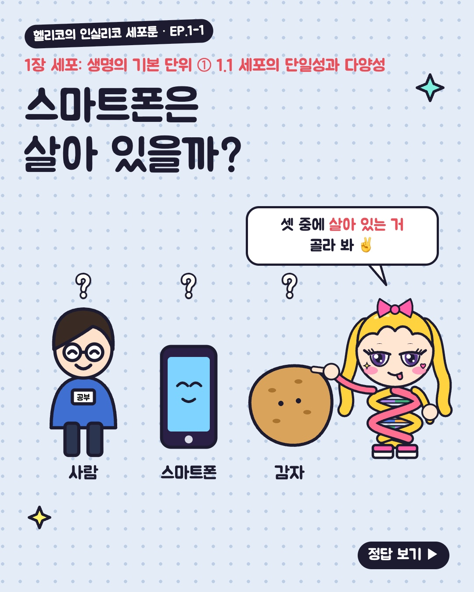
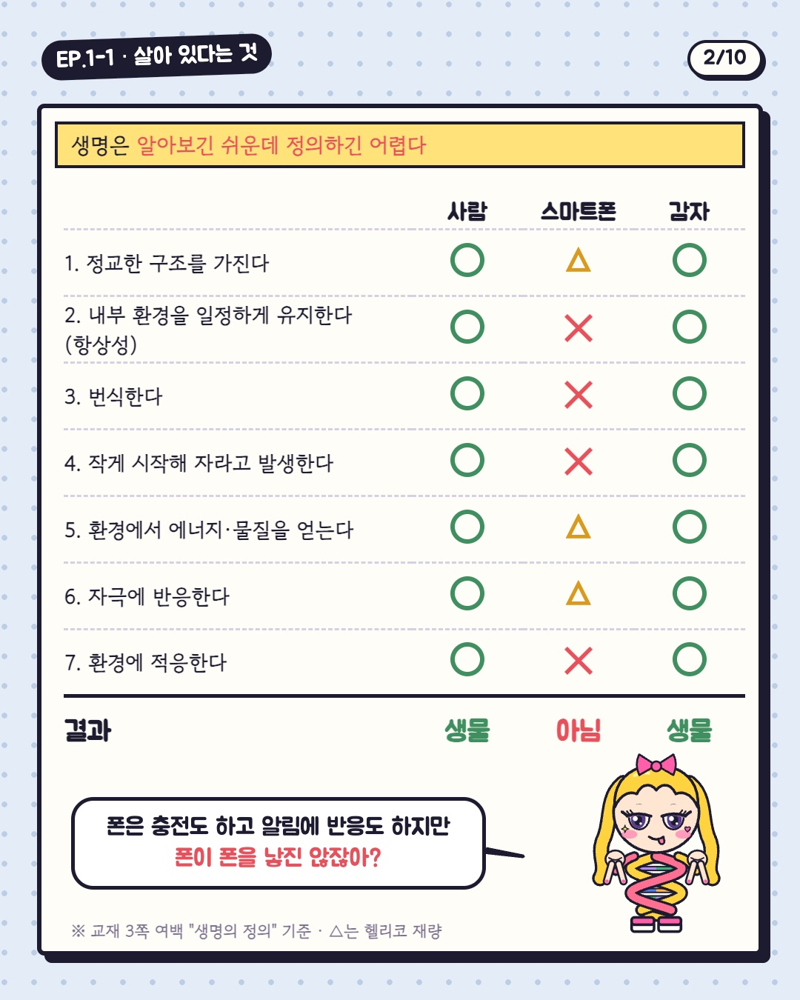
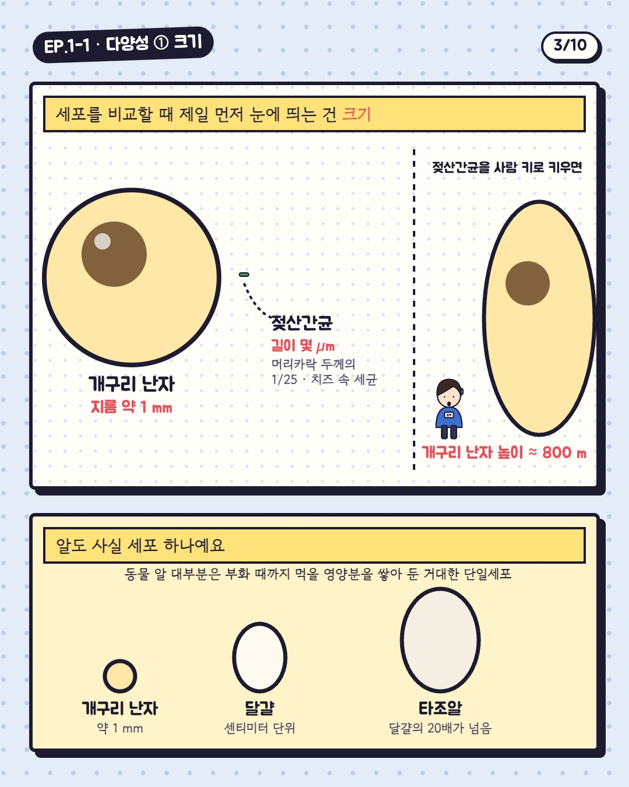
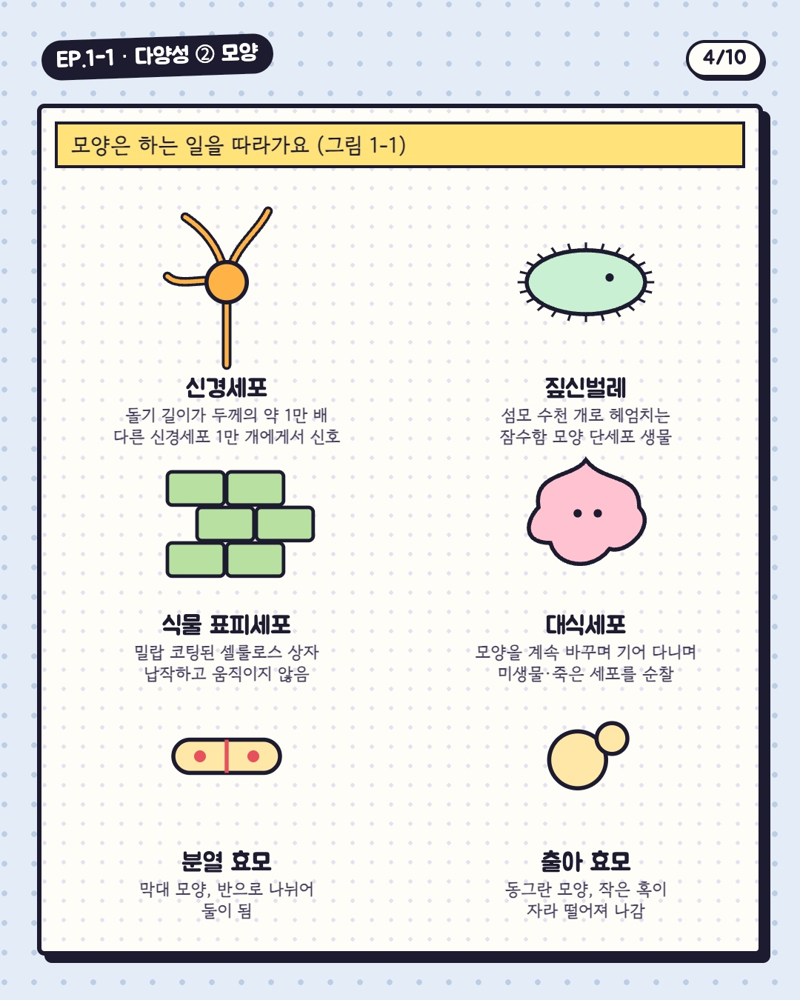
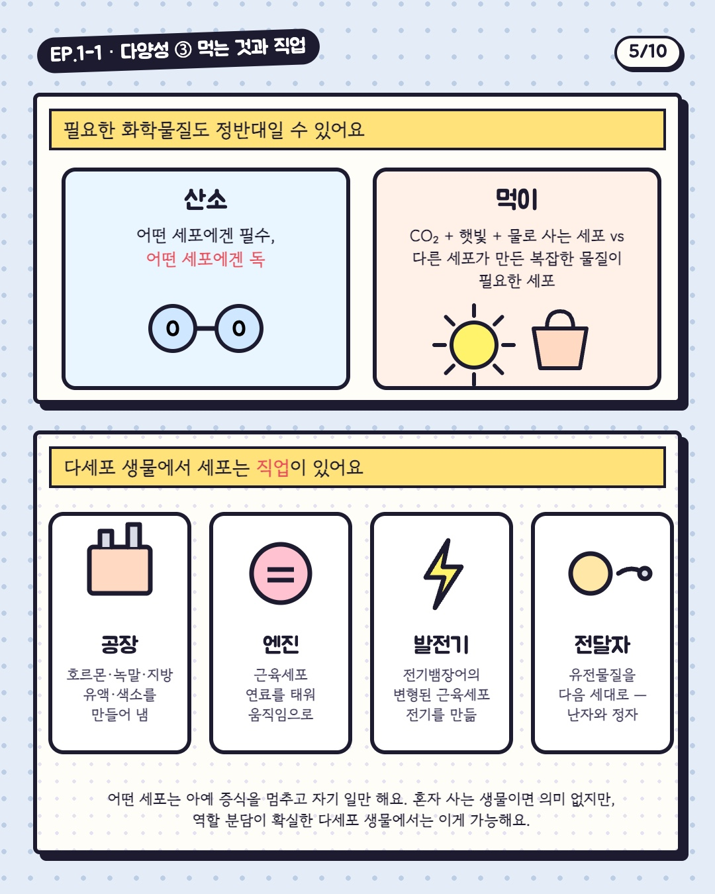
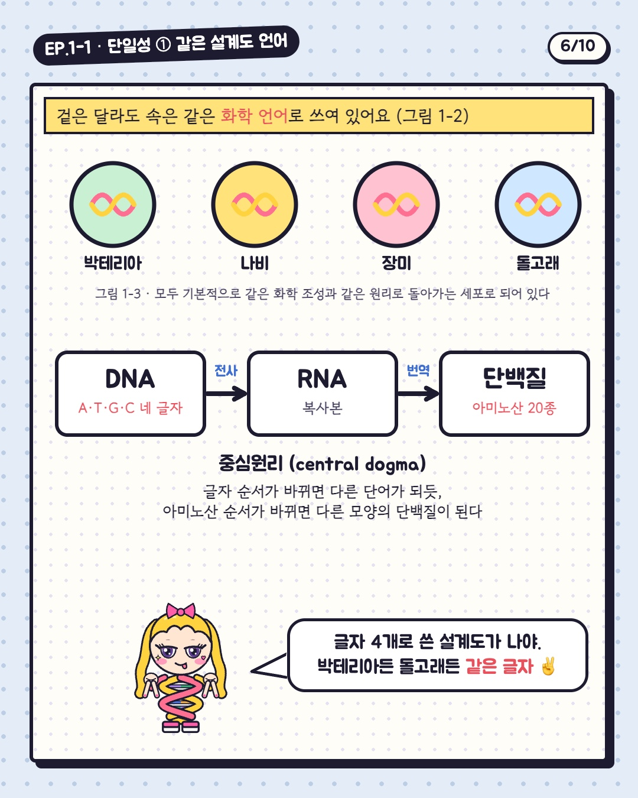
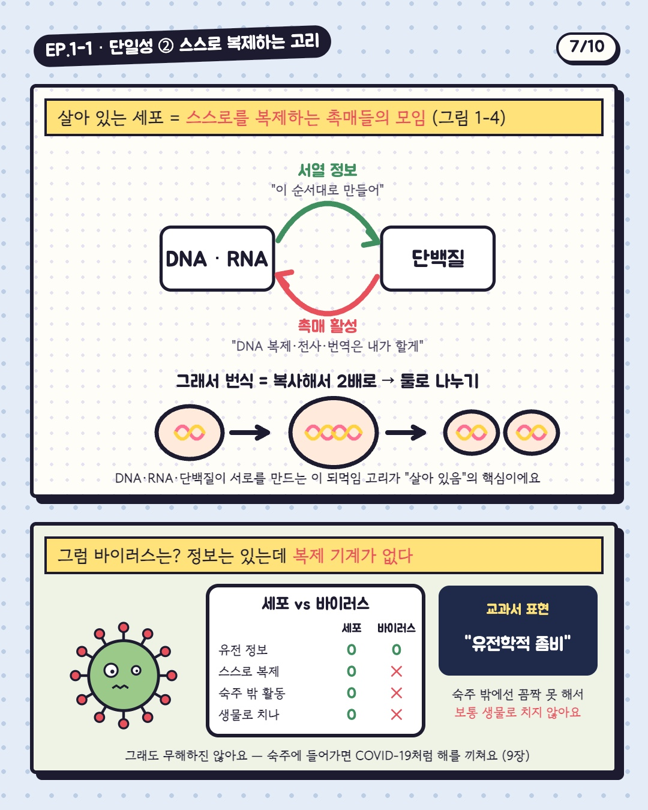
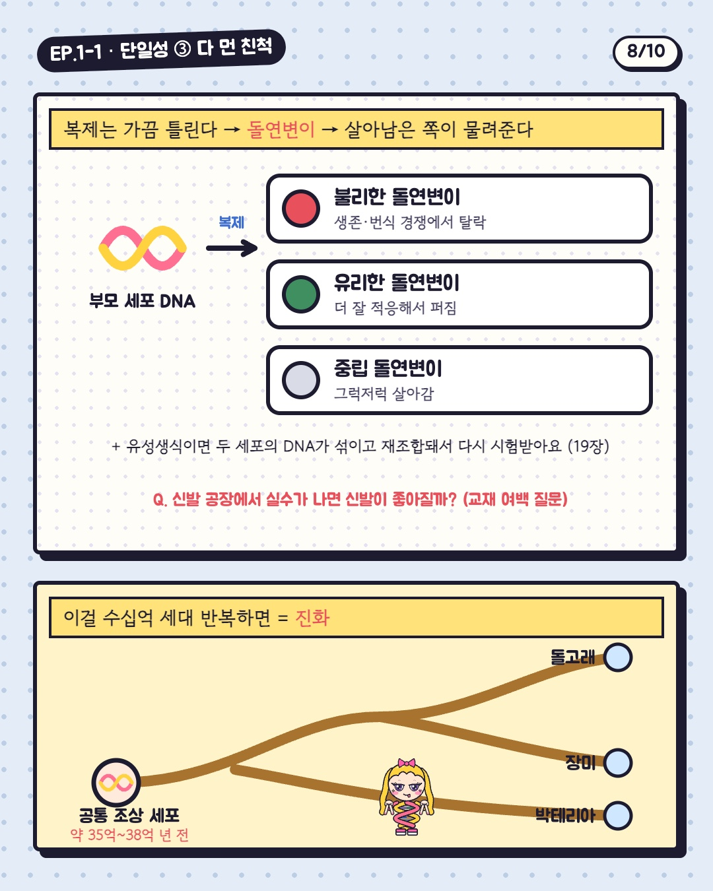
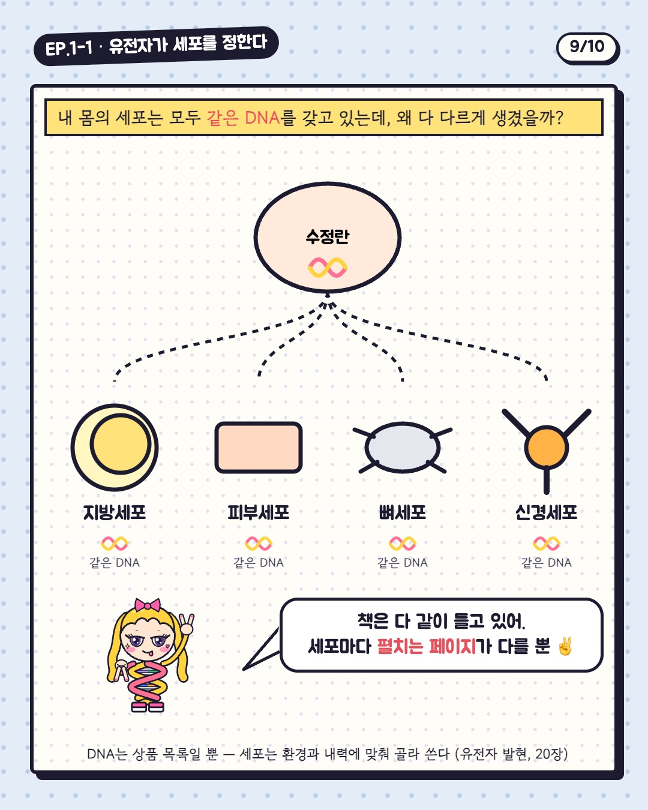
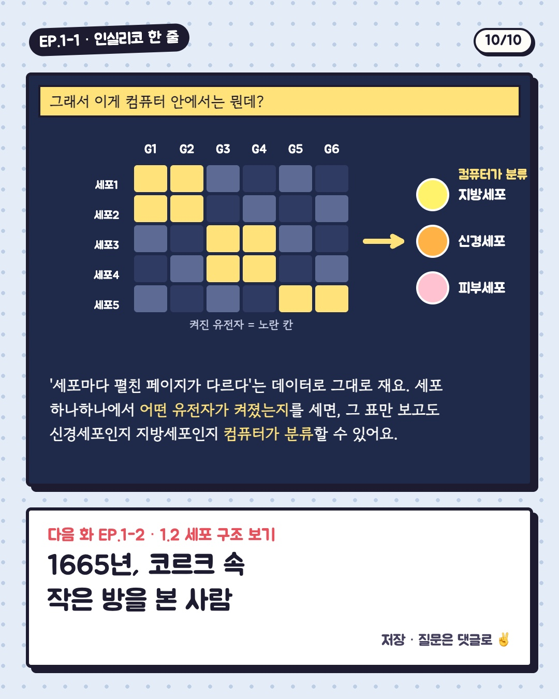

# EP.1-1 스마트폰은 살아 있을까?

- 교재: 1장 1.1 세포의 단일성과 다양성
- 게시: 2026-10-08 · [인스타그램](https://www.instagram.com/p/DeOTzc6D684/)

## 캡션

```text
EP.1-1 스마트폰은 살아 있을까? 📱🥔🧑
필수세포생물학 1장 ① · 1.1 세포의 단일성과 다양성

핵, 야호~ ✌ 1장은 내용이 많아서 소절별로 나눠 올려요. 오늘은 1.1!

🔎 생명은 알아보긴 쉬운데 정의하긴 어려워요. 교과서 여백의 7가지 기준으로 채점하면 폰은 탈락(번식 불가).
🔎 다양성 — 젖산간균은 몇 µm, 개구리 난자는 약 1 mm. 젖산간균을 사람 키로 키우면 난자는 800 m 높이.
🔎 신경세포는 돌기 길이가 두께의 약 1만 배. 짚신벌레, 대식세포, 효모까지 모양은 하는 일을 따라가요.
🔎 산소가 필수인 세포도, 독인 세포도 있어요. 다세포 생물에서 세포는 공장·엔진·발전기 같은 '직업'이 있어요.
🔎 단일성 — 모든 세포는 같은 4글자(DNA)로 정보를 쓰고, DNA→RNA→단백질(중심원리)로 읽어요.
🔎 DNA·RNA와 단백질이 서로를 만드는 고리가 '살아 있음'의 핵심. 바이러스는 복제 기계가 없어서 교과서 표현으로 "유전학적 좀비".
🔎 복제 실수(돌연변이) + 선택 = 진화. 모든 생물은 약 35억~38억 년 전 공통 조상의 후손.
🔎 내 몸 세포는 모두 같은 DNA를 가졌지만, 세포마다 '펼치는 페이지(발현하는 유전자)'가 달라요.

💻 인실리코 한 줄: 세포마다 어떤 유전자가 켜졌는지 세면, 그 표만으로 컴퓨터가 세포 종류를 분류할 수 있어요.

다음 화 EP.1-2 — 1.2 세포 구조 보기: 1665년, 코르크 속 작은 방을 본 사람

#인실리코 #insilico #세포생물학 #필수세포생물학 #생명과학 #세포 #공부스타그램 #직장인스터디 #과학만화 #컷툰 #DNA #중심원리 #생물정보학
```

## 컷











