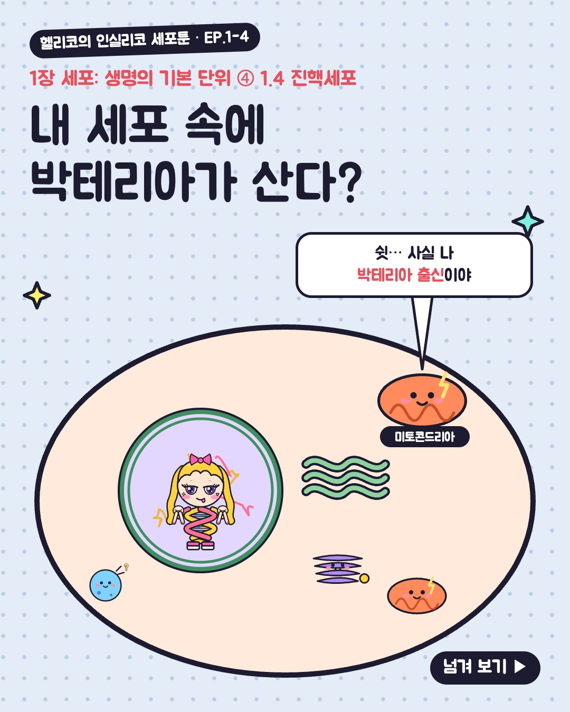
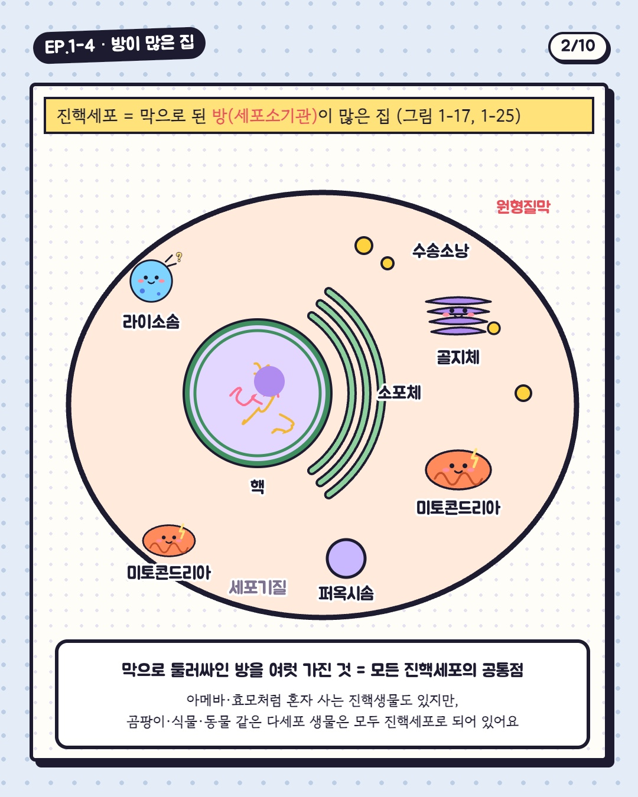
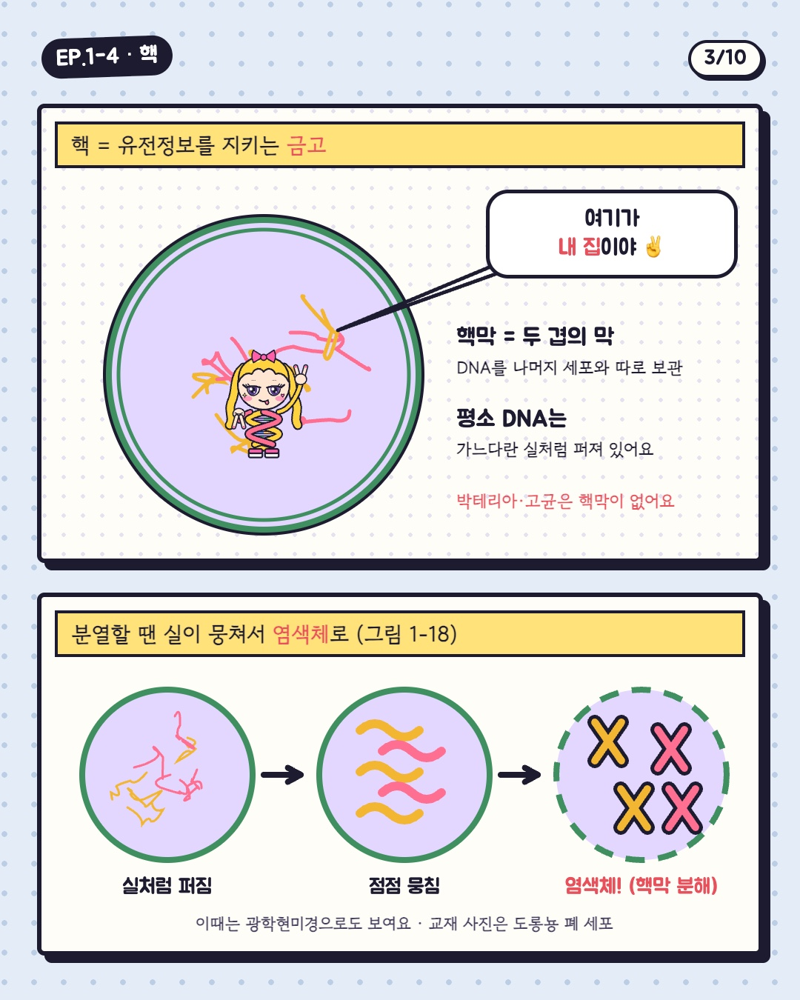
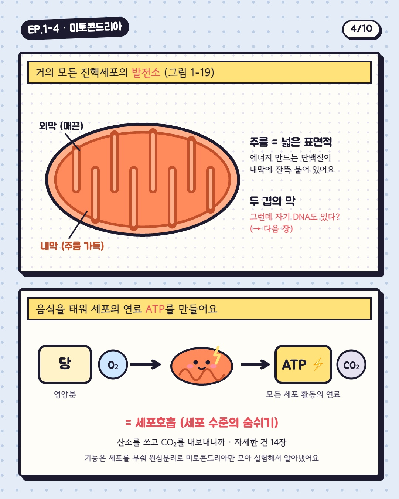
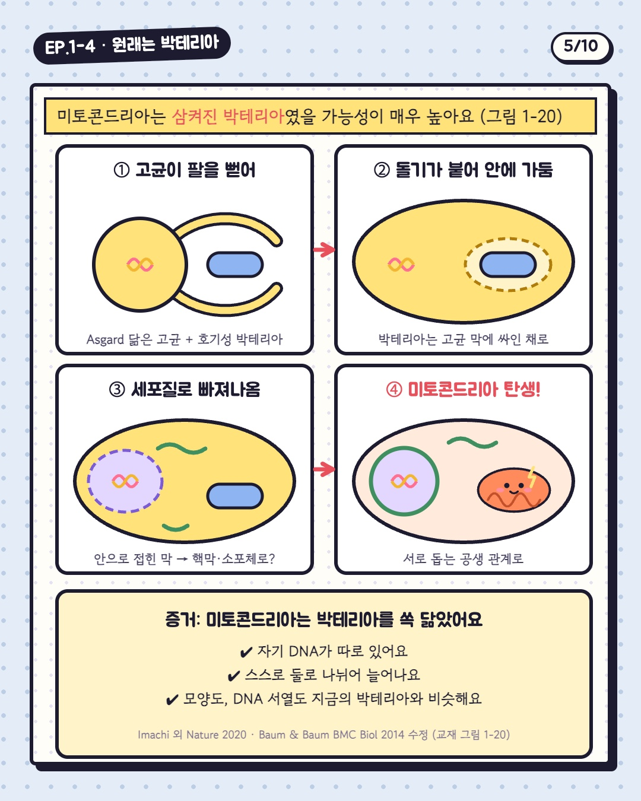
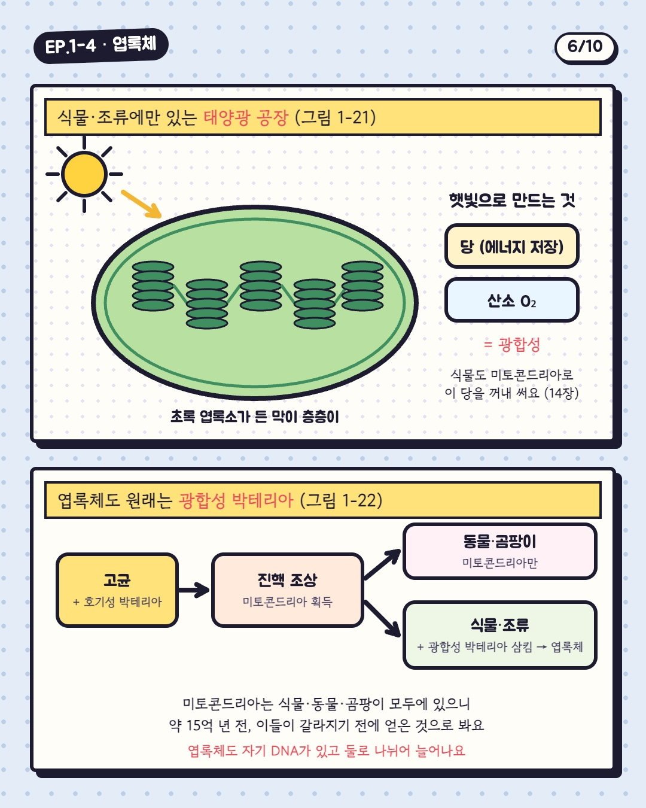
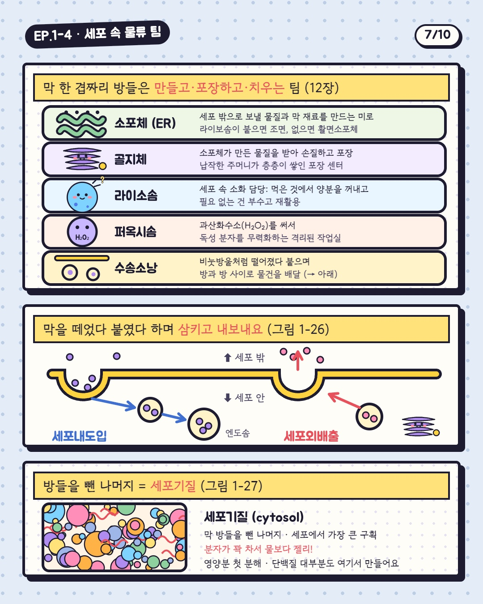
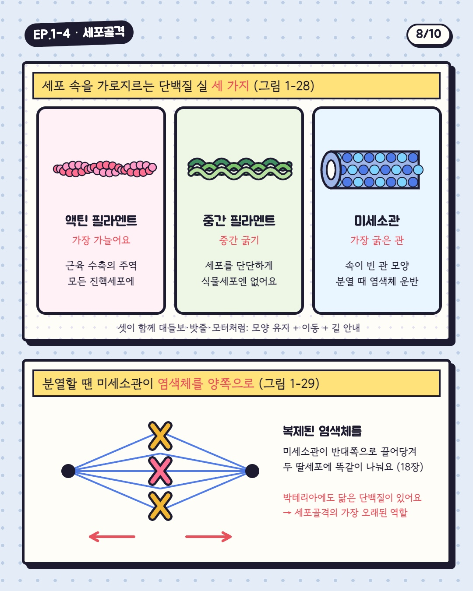
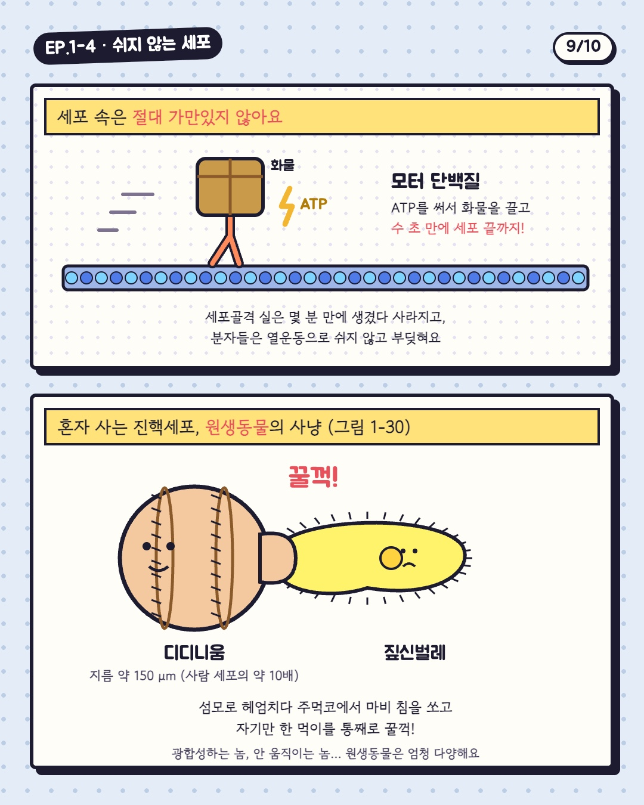
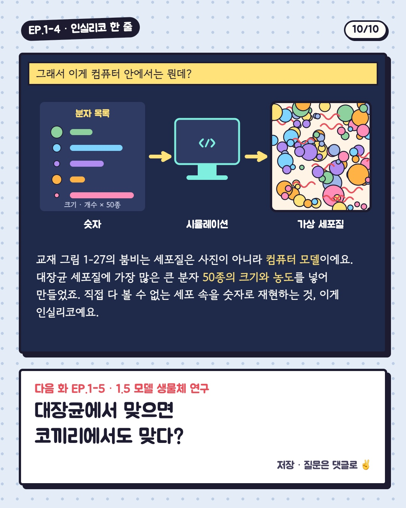

# EP.1-4 내 세포 속에 박테리아가 산다?

- 교재: 1장 1.4 진핵세포
- 게시: 2026-10-27 · [인스타그램](https://www.instagram.com/p/De_WKecD7gb/)

## 캡션

```text
EP.1-4 내 세포 속에 박테리아가 산다? 🦠
필수세포생물학 1장 ④ · 1.4 진핵세포

핵, 야호~ ✌ 오늘은 진핵세포 속 방(세포소기관) 구경! 나는 핵에 살아요.

🏠 진핵세포는 막으로 둘러싸인 방이 많은 집이에요. 아메바·효모처럼 혼자 사는 진핵생물도 있지만, 곰팡이·식물·동물은 모두 진핵세포로 되어 있어요.
🏠 핵: 두 겹 막으로 된 유전정보 금고. 평소엔 실처럼 퍼진 DNA가 분열할 땐 뭉쳐서 염색체가 돼요.
🏠 미토콘드리아: 음식을 태워 ATP를 만드는 발전소(세포호흡). 내막의 주름이 표면적을 넓혀요.
🏠 그런데 미토콘드리아는 자기 DNA가 있고, 스스로 분열하고, 박테리아를 쏙 닮았어요. 아주 먼 옛날 고균이 삼킨 호기성 박테리아였을 가능성이 매우 높아요!
🏠 엽록체: 식물·조류의 태양광 공장. 엽록체도 원래는 광합성 박테리아였던 걸로 봐요.
🏠 소포체(만들기) → 골지체(포장) → 수송소낭(배달), 라이소솜(분해·재활용), 퍼옥시솜(해독). 세포 속 물류 팀이에요.
🏠 세포골격(액틴·중간 필라멘트·미세소관)은 세포의 대들보·밧줄·모터. 모터 단백질은 ATP로 화물을 끌고 수 초 만에 세포 끝까지!
🏠 원생동물 디디니움은 자기만 한 짚신벌레를 통째로 삼켜요.

💻 인실리코 한 줄: 교재 그림 1-27의 붐비는 세포질은 사진이 아니라 컴퓨터 모델이에요. 분자 50종의 크기·농도로 세포 속을 재현했어요.

다음 화 EP.1-5 — 1.5 모델 생물체 연구: 대장균에서 맞으면 코끼리에서도 맞다?

#인실리코 #insilico #세포생물학 #필수세포생물학 #생명과학 #진핵세포 #미토콘드리아 #세포소기관 #공생설 #공부스타그램 #직장인스터디 #과학만화 #컷툰 #생물정보학
```

## 컷











