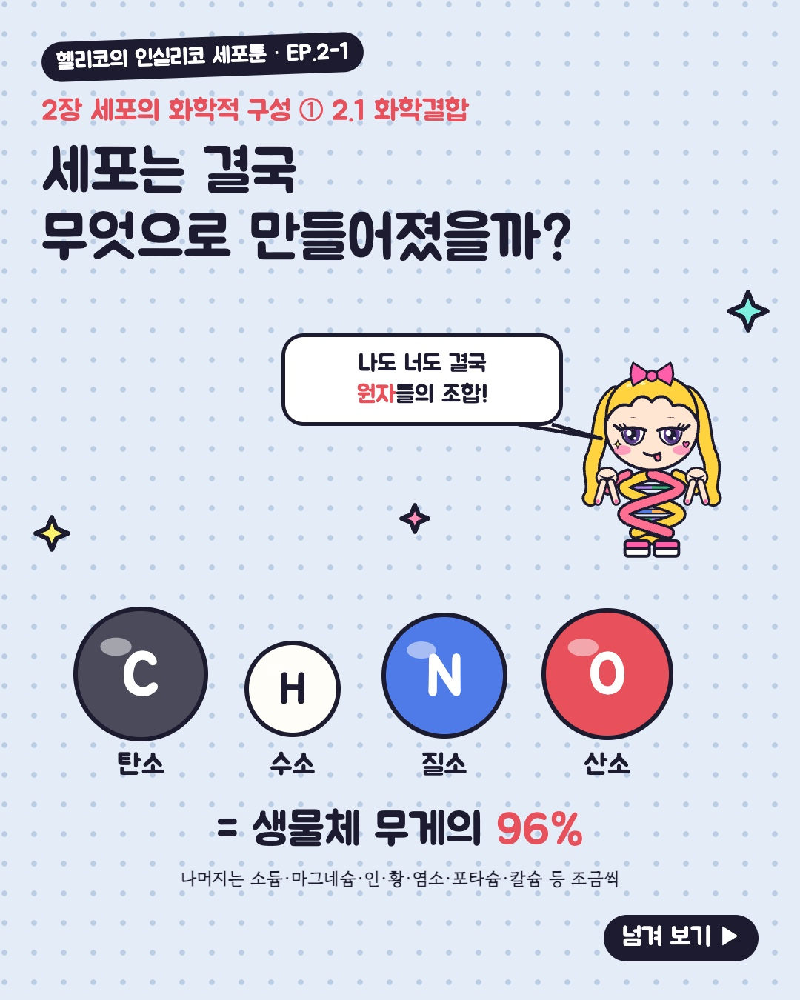
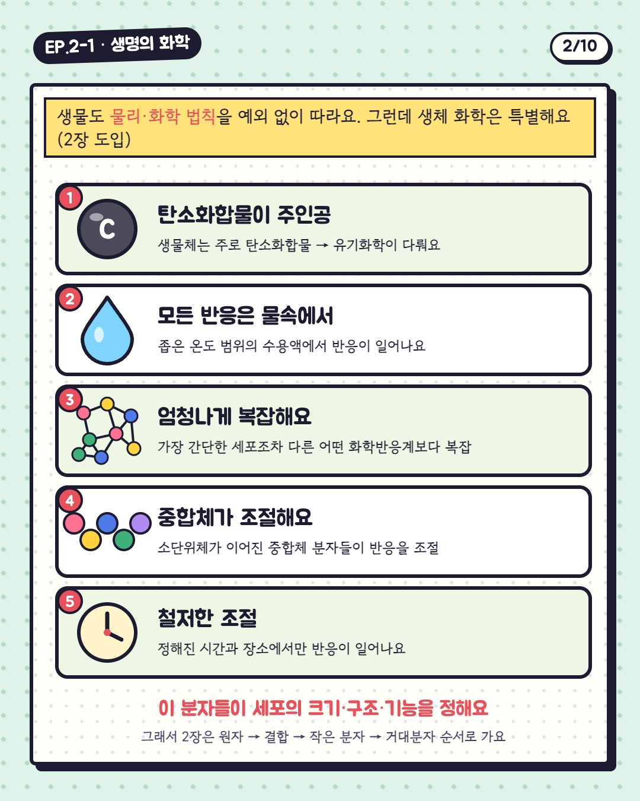
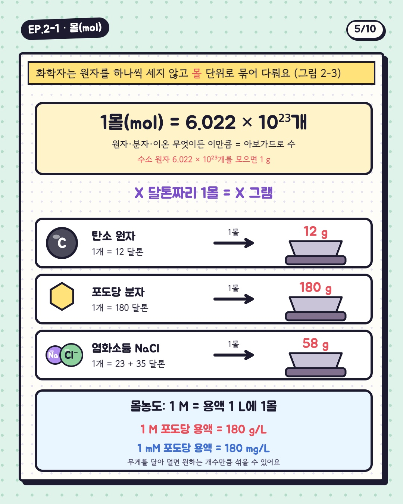
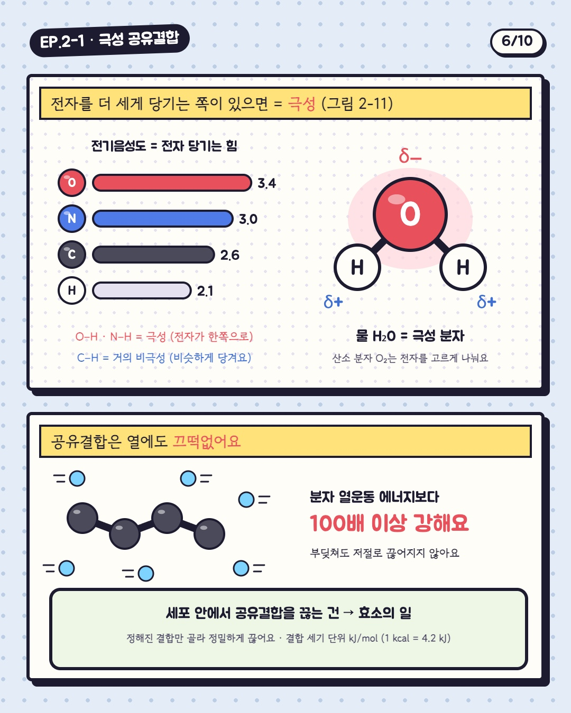
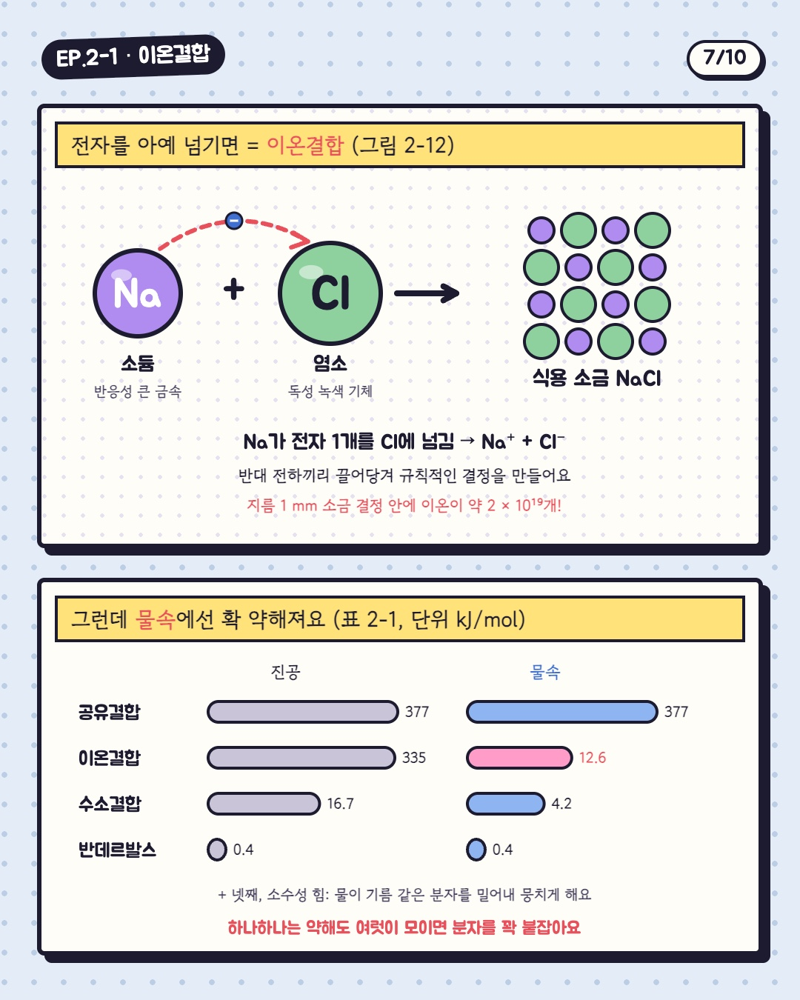
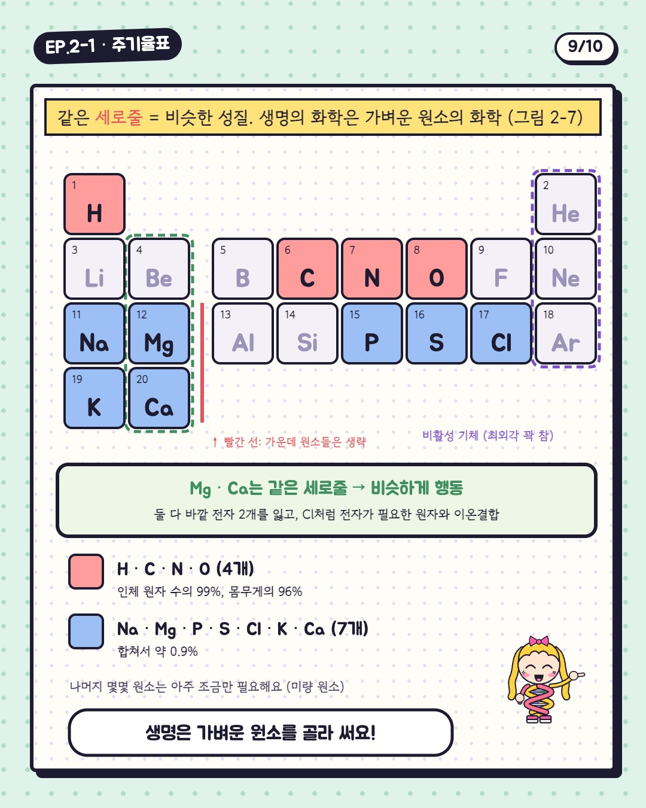
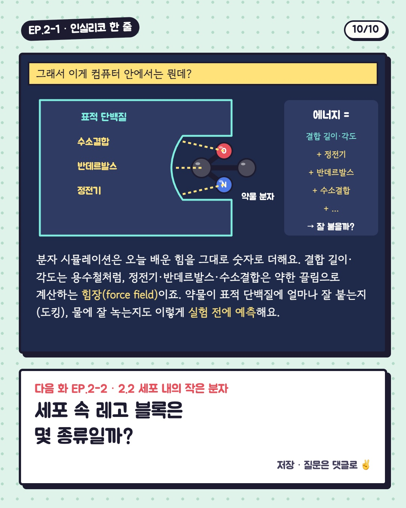

# EP.2-1 세포는 어떤 원자로 만들어졌을까?

- 교재: 2장 2.1 화학결합
- 게시: 2026-11-19 · [인스타그램](https://www.instagram.com/p/Df6ERxrD0tj/)

## 캡션

```text
EP.2-1 세포는 어떤 원자로 만들어졌을까? ⚛️
필수세포생물학 2장 ① · 2.1 화학결합 (원자와 전자각)

핵, 야호~ ✌ 오늘부터 2장 「세포의 화학적 구성」! 결합을 알려면 먼저 원자 속부터 들여다봐야 해요.

🧪 생물도 물리·화학 법칙을 따르지만 생체 화학은 특별해요: 탄소화합물 · 수용액 · 엄청난 복잡성 · 중합체 · 철저한 조절.
⚛️ 원자 = 가운데 양전하의 핵(양성자+중성자) + 둘레의 음전하 전자구름. 양성자 수가 원자번호이고, 전자 수와 같아요 (수소 1, 탄소 6).
⚖️ 동위원소는 양성자 수는 같고 중성자 수만 달라요. ¹⁴C(양성자 6, 중성자 8)는 탄소연대측정에, 수소에는 중수소·삼중수소가 있어요.
📏 탄소 원자 지름은 약 0.2 nm, 500만 개를 늘어놓아야 1 mm! 무게 단위 달톤은 ¹²C의 1/12이에요.
🥄 1몰 = 6.022 × 10²³개. X 달톤짜리 1몰은 X g이라서 1 M 포도당 용액은 180 g/L예요.
🌍 원소는 약 90종인데 C·H·N·O 넷이 생물체 무게의 96%! 생체 원자의 약 60%는 수소, 지표면 원자의 30%는 규소예요.
🧅 전자각 정원은 2 · 8 · 8 · 18 · 18개, 안쪽부터 채워요. 최외각이 꽉 찬 헬륨·네온·아르곤은 반응하지 않아요.
🤝 빈자리를 채우는 방법은 전자 주고받기(이온결합)와 나눠 쓰기(공유결합). 주기율표의 같은 세로줄은 성질이 비슷해요.

💻 인실리코 한 줄: 컴퓨터는 분자를 원소·원자번호·질량과 연결 관계가 담긴 '원자 목록'으로 기억해요. 독성 예측 모델도 어떤 원자가 몇 개 있는지부터 세요.

다음 화 EP.2-2 — 2.1 공유결합: 원자들은 전자를 어떻게 나눠 쓸까?

#인실리코 #insilico #세포생물학 #필수세포생물학 #생명과학 #화학결합 #원자 #전자각 #동위원소 #몰 #주기율표 #공부스타그램 #직장인스터디 #과학만화 #컷툰 #생물정보학
```

## 컷











