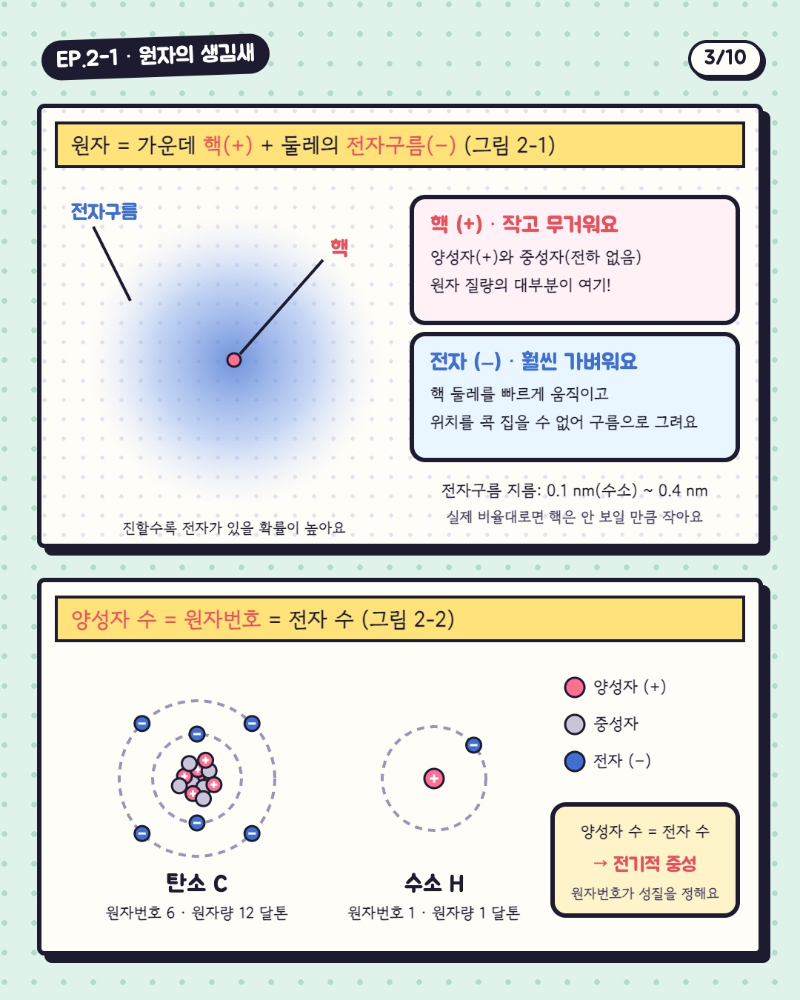
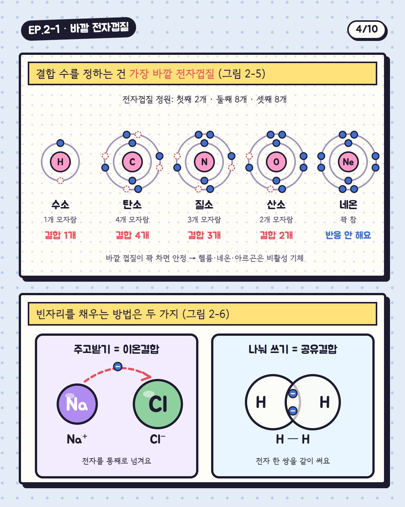
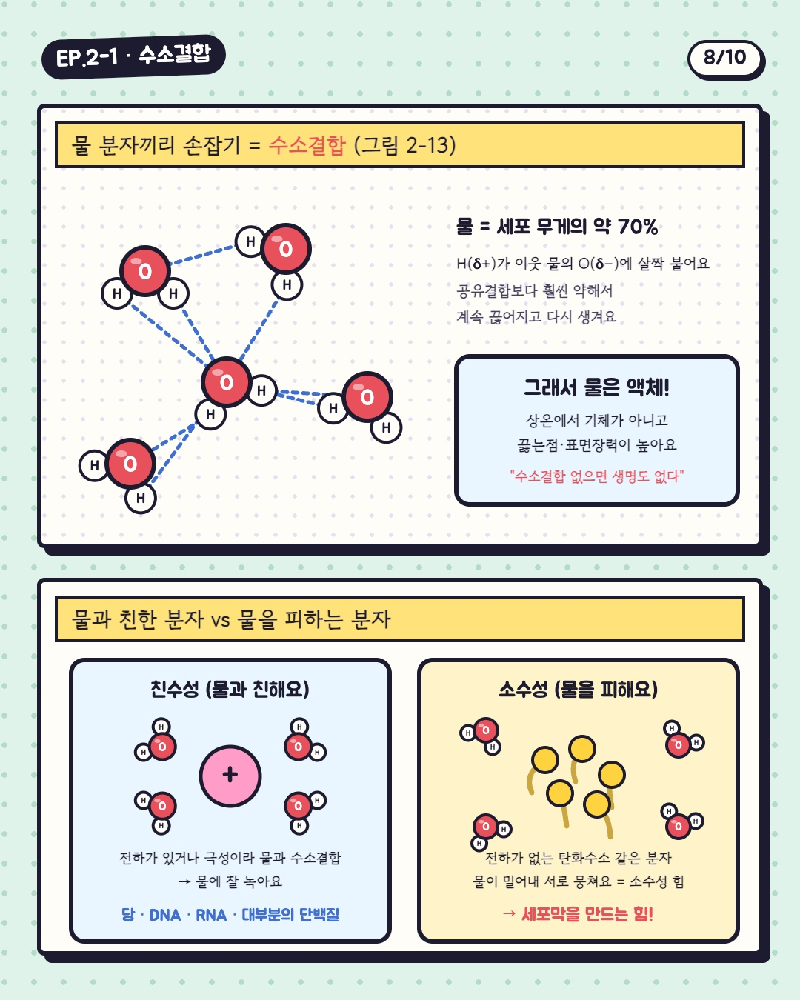

# EP.2-1 세포는 결국 무엇으로 만들어졌을까?

- 교재: 2장 2.1 화학결합
- 게시: 2026-11-07 · [인스타그램](https://www.instagram.com/p/Df1G57oj9QZ/)

## 캡션

```text
EP.2-1 세포는 결국 무엇으로 만들어졌을까? ⚛️
필수세포생물학 2장 ① · 2.1 화학결합 (2장 시작!)

핵, 야호~ ✌ 오늘부터 2장! 세포를 이루는 원자와 그 원자들을 묶는 결합을 만나 봐요.

⚛️ 원자 = 가운데 핵(양성자+중성자) + 둘레의 전자. 양성자 수가 원자번호예요. 탄소-14처럼 중성자 수만 다른 동위원소는 탄소연대측정에 쓰여요.
⚛️ 자연계 원소는 약 90개지만, 탄소·수소·질소·산소 넷이 생물체 무게의 96%를 차지해요.
⚛️ 결합 수를 정하는 건 가장 바깥 전자껍질. 빈자리 수만큼 결합해요: 수소 1 · 산소 2 · 질소 3 · 탄소 4.
⚛️ 공유결합 = 전자 한 쌍을 나눠 쓰기. 정해진 길이(수소 분자 0.074 nm)와 각도가 있고, 이중결합은 회전하지 못해요.
⚛️ 산소·질소는 전자를 세게 당겨서 O–H, N–H 결합은 극성! 그래서 물은 극성 분자예요.
⚛️ 이온결합 = 전자를 통째로 넘기기 (Na⁺ + Cl⁻ = 소금). 하지만 물속에서는 확 약해져요.
⚛️ 수소결합·반데르발스·정전기·소수성 힘: 하나하나는 약해도 여럿이 모이면 분자를 꽉 붙잡아요. 물이 액체인 것도, 세포막이 생기는 것도 이 힘 덕분!
⚛️ H⁺를 내놓으면 산, 받으면 염기. 세포 속은 완충액 덕분에 거의 중성(pH 7 근처)이에요.

💻 인실리코 한 줄: 분자 시뮬레이션은 결합 길이·각도와 정전기·반데르발스·수소결합을 숫자로 더한 '힘장(force field)'으로 약물이 표적 단백질에 얼마나 잘 붙는지 실험 전에 예측해요.

다음 화 EP.2-2 — 2.2 세포 내의 작은 분자: 세포 속 레고 블록은 몇 종류일까?

#인실리코 #insilico #세포생물학 #필수세포생물학 #생명과학 #화학결합 #공유결합 #수소결합 #이온결합 #원자 #pH #공부스타그램 #직장인스터디 #과학만화 #컷툰 #생물정보학
```

## 컷









