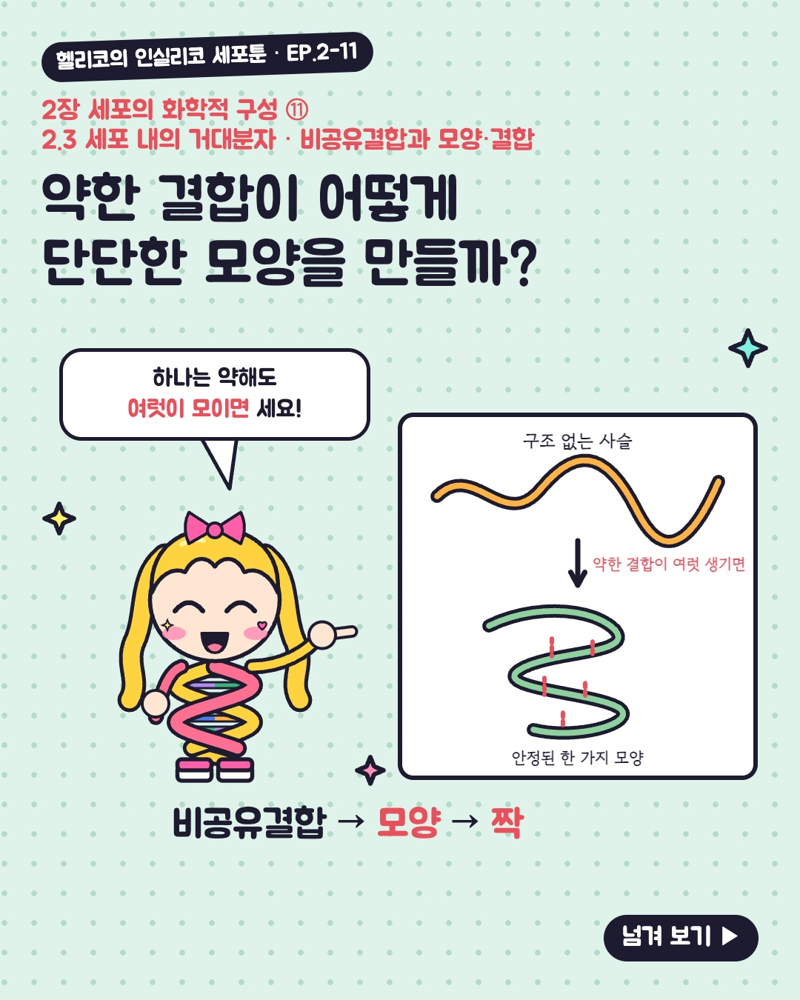
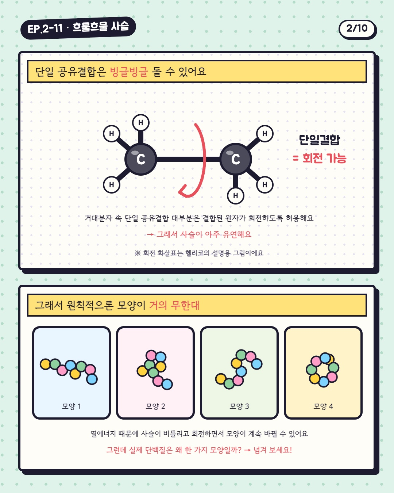
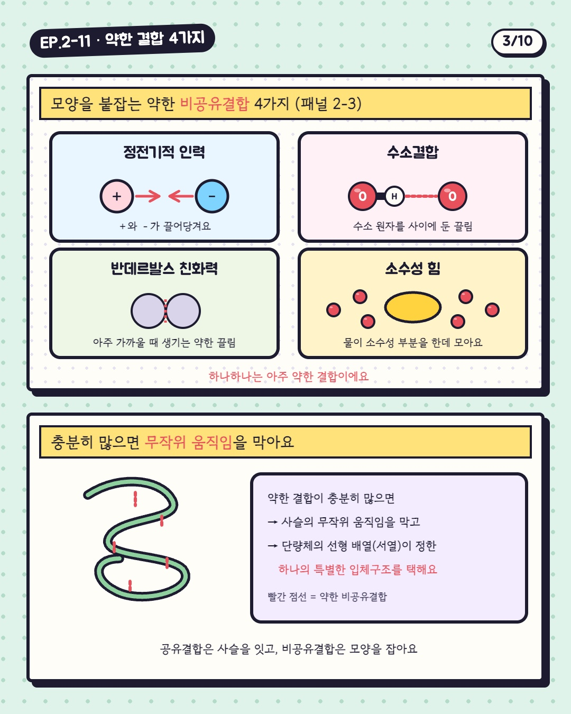
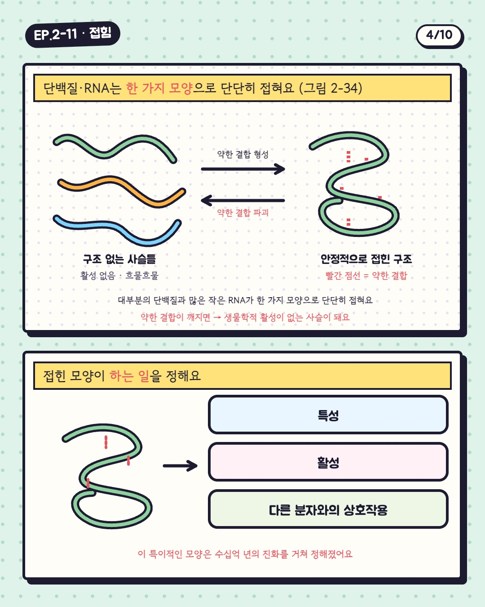
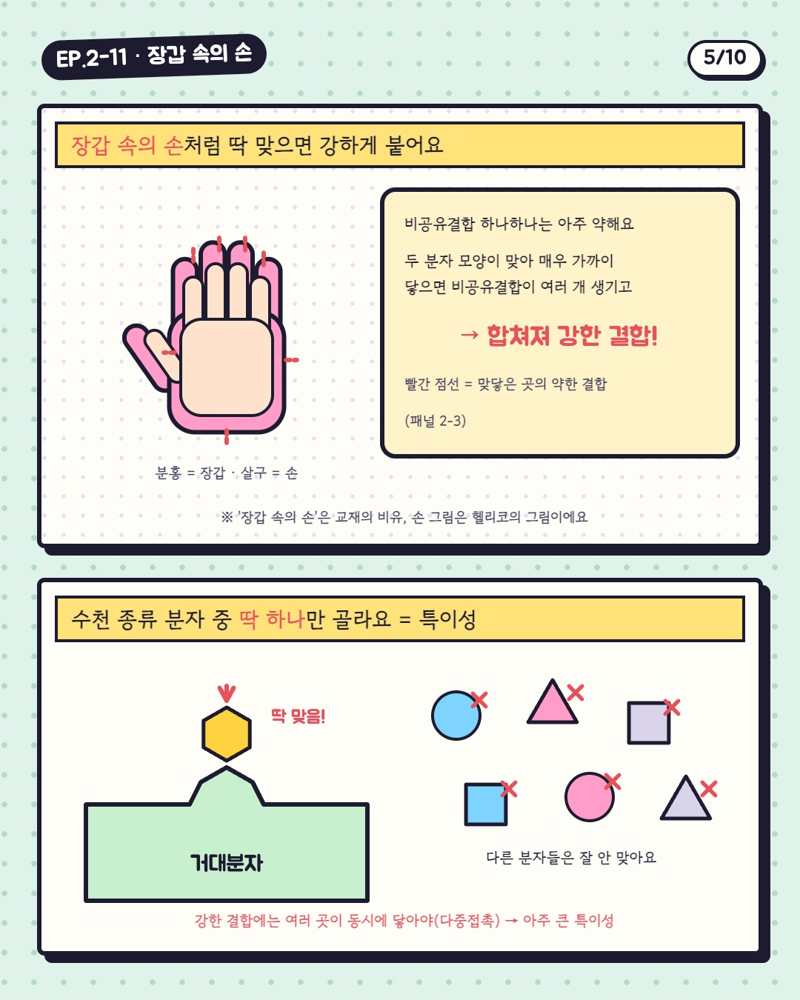
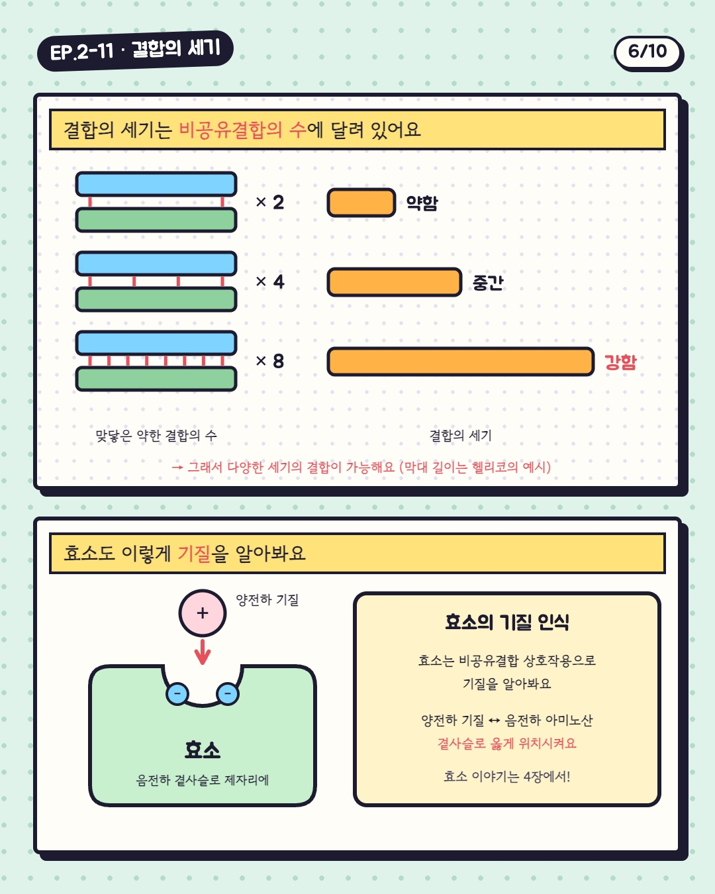
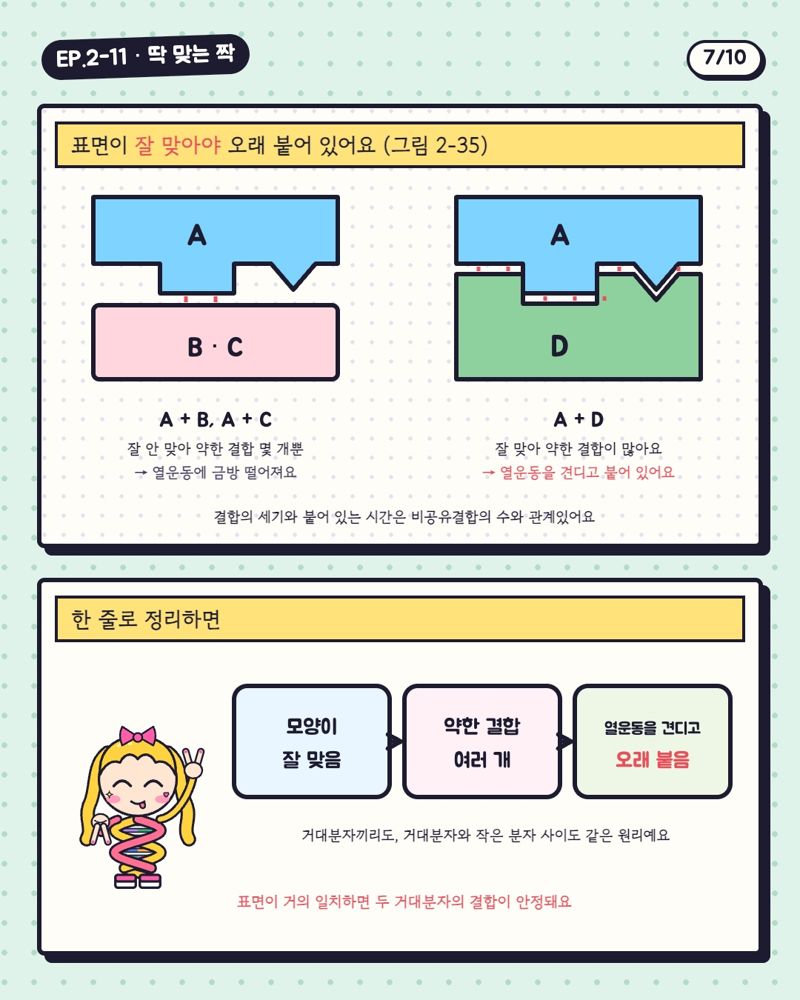
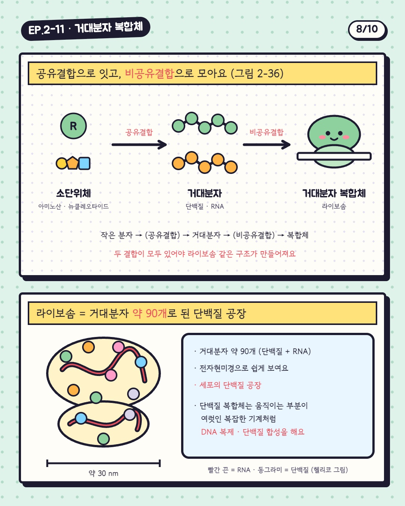
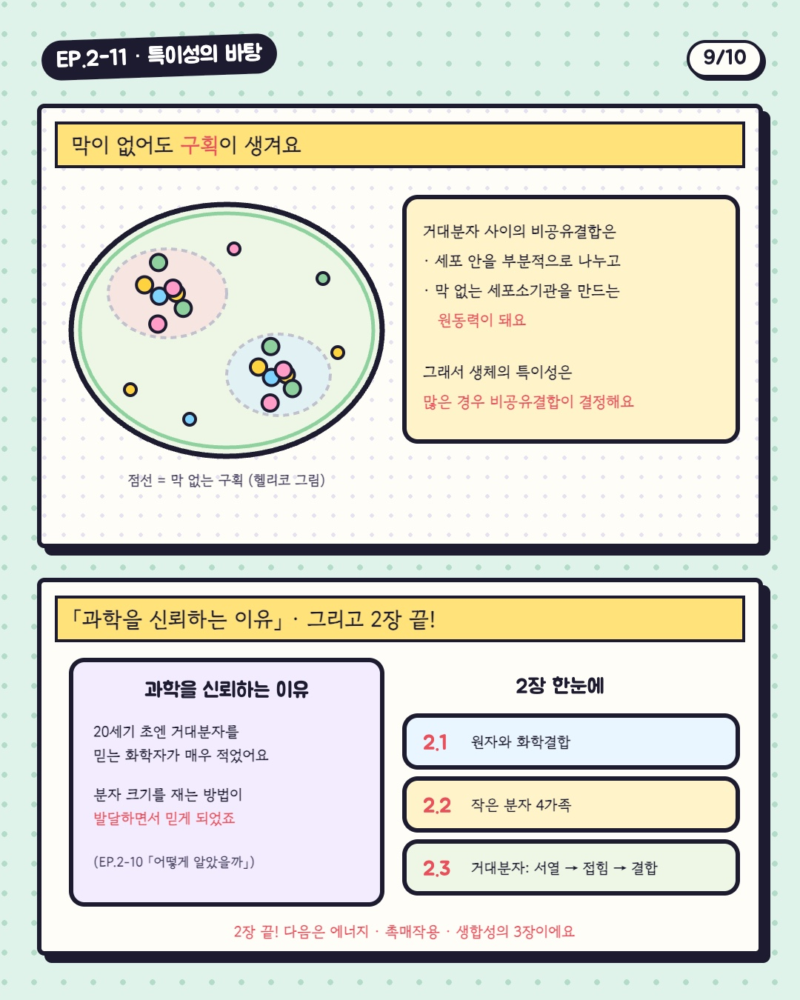
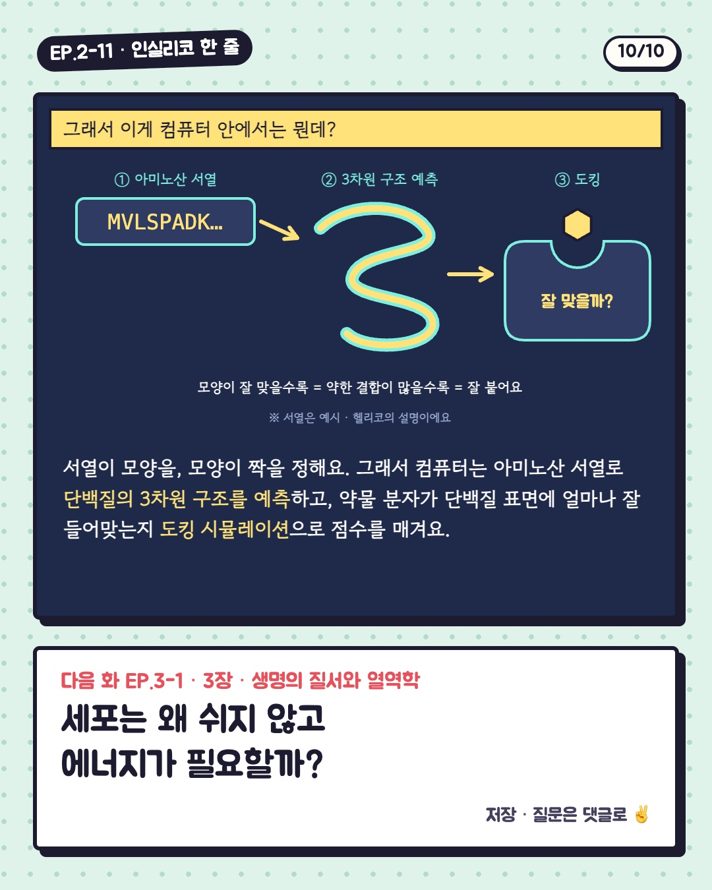

# EP.2-11 약한 결합이 어떻게 단단한 모양을 만들까?

- 교재: 2장 2.3 세포 내의 거대분자
- 게시: 2026-11-24 · [인스타그램](https://www.instagram.com/p/DgG8aZLDz6V/)

## 캡션

```text
EP.2-11 약한 결합이 어떻게 단단한 모양을 만들까? 🧩
필수세포생물학 2장 ⑪ · 2.3 세포 내의 거대분자

핵, 야호~ ✌ 지난 화에서 거대분자가 '진짜 큰 분자'라는 걸 확인했죠? 오늘은 그 긴 사슬이 어떻게 한 가지 모양으로 접히고, 어떻게 딱 맞는 짝을 찾는지 알아봐요. 오늘로 2장 끝!

🔄 거대분자 속 단일 공유결합은 대부분 회전할 수 있어서, 원칙적으로는 사슬이 거의 무한한 모양(입체구조)을 가질 수 있어요.
🧲 정전기적 인력 · 수소결합 · 반데르발스 친화력 · 소수성 힘, 이 약한 비공유결합이 충분히 많으면 무작위 움직임을 막고 하나의 입체구조를 고정해요(패널 2-3).
🧬 대부분의 단백질과 많은 작은 RNA는 특이적이고 안정된 3차원 구조로 접혀요. 이 약한 결합이 깨지면 활성 없는 사슬이 돼요(그림 2-34).
🧤 '장갑 속의 손'처럼 모양이 딱 맞아 가까이 닿으면, 약한 결합 여러 개가 모여 강하고 선택적인 결합이 돼요.
⚖️ 결합의 세기는 비공유결합의 수에 달려 있어요. 효소는 양전하 기질을 음전하 곁사슬로 제자리에 놓아 알아봐요(4장).
🔍 A–B, A–C처럼 잘 안 맞으면 열운동에 금방 떨어지고, A–D처럼 잘 맞으면 붙어 있어요(그림 2-35).
🏭 작은 분자는 공유결합으로 거대분자가 되고, 거대분자는 비공유결합으로 복합체가 돼요. 라이보솜은 거대분자 약 90개로 된 약 30 nm 크기의 단백질 공장이에요(그림 2-36).
🫧 비공유결합은 막 없는 세포 내 구획을 만드는 원동력이고, 생체 특이성의 바탕이에요. 그리고 거대분자를 믿게 된 건 크기를 재는 방법이 발달했기 때문이에요(과학을 신뢰하는 이유).

💻 인실리코 한 줄: 서열이 모양을, 모양이 짝을 정해요. 그래서 컴퓨터는 아미노산 서열로 단백질 3차원 구조를 예측하고, 약물이 단백질 표면에 얼마나 잘 들어맞는지 도킹 시뮬레이션으로 점수를 매겨요.

다음 화 EP.3-1 — 3장 에너지, 촉매작용, 생합성 · 3.1 생명의 질서와 열역학: 세포는 왜 쉬지 않고 에너지가 필요할까?

#인실리코 #insilico #세포생물학 #필수세포생물학 #생명과학 #거대분자 #단백질 #비공유결합 #단백질구조 #단백질접힘 #라이보솜 #도킹 #공부스타그램 #과학만화 #컷툰
```

## 컷











