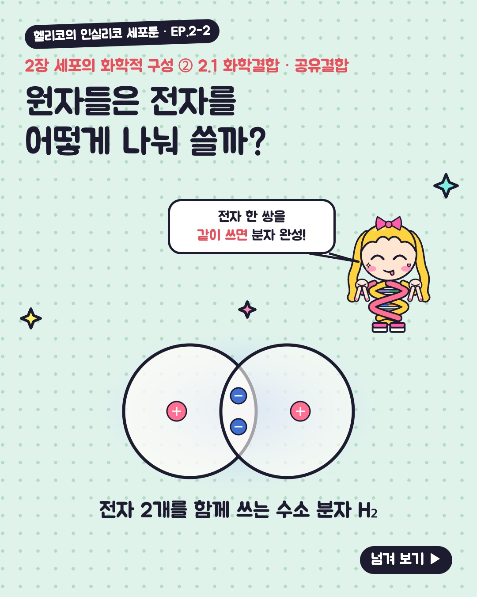
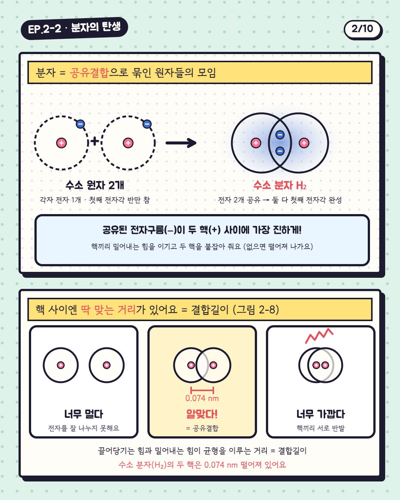
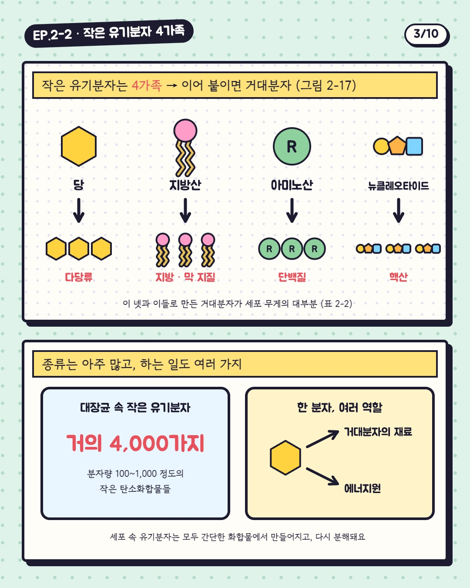
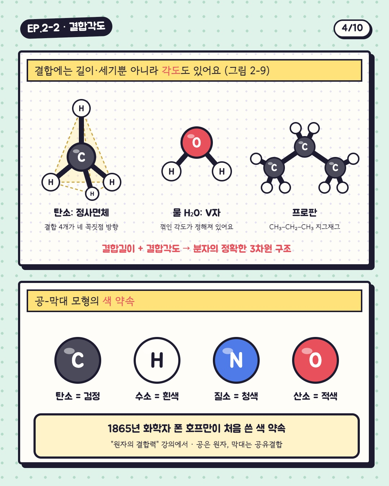
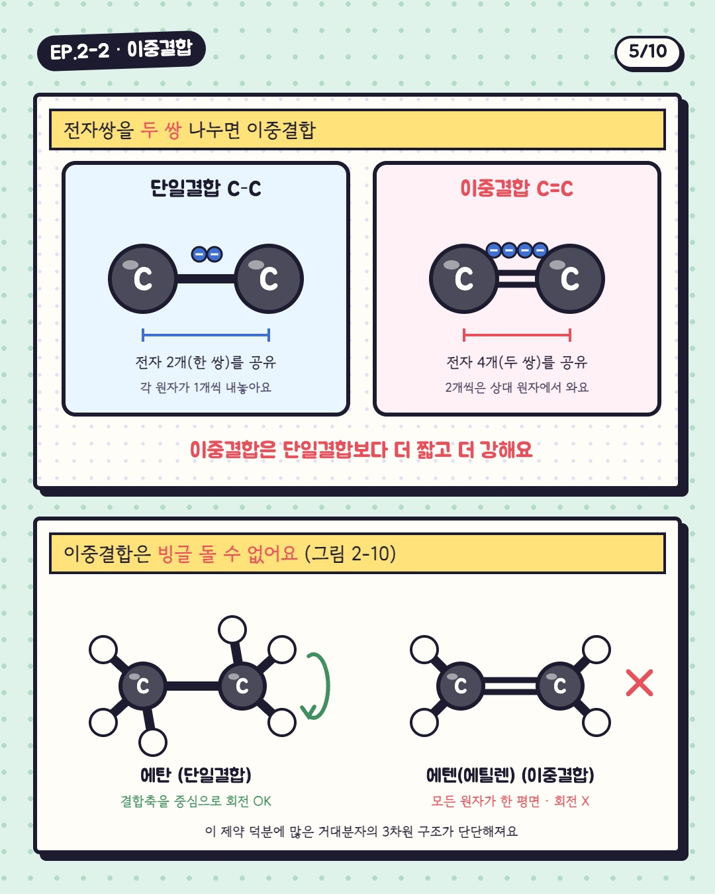
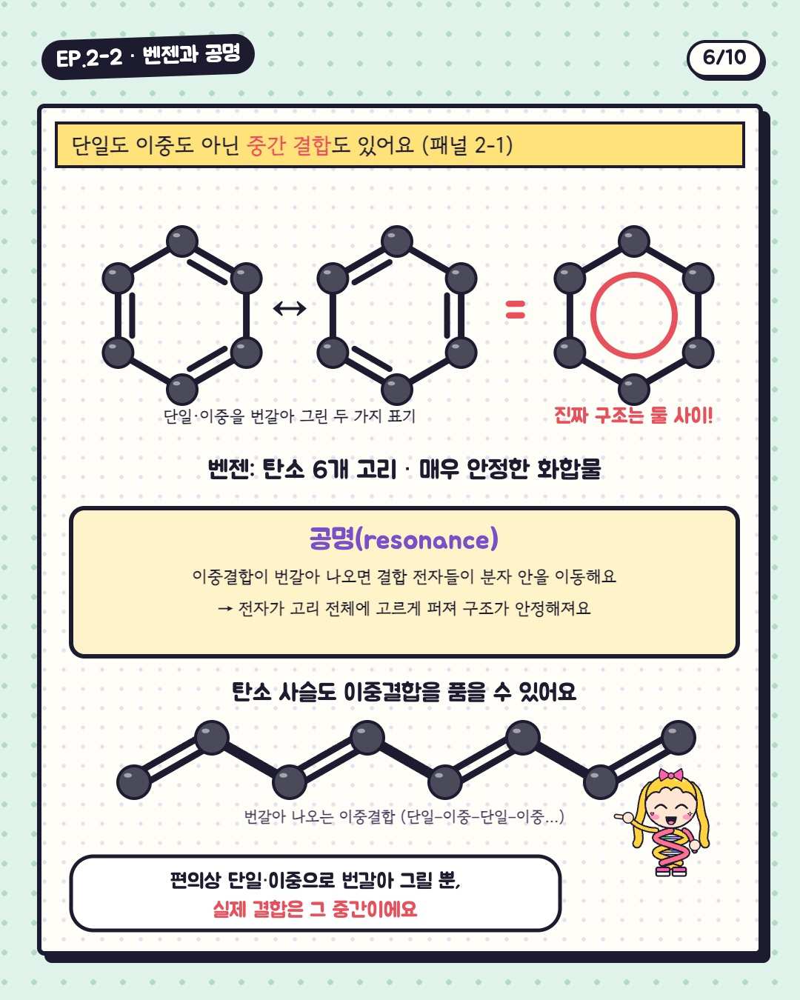
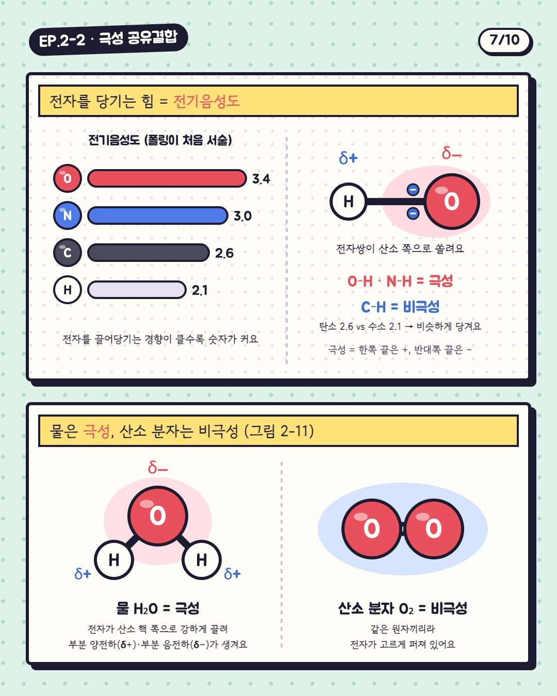
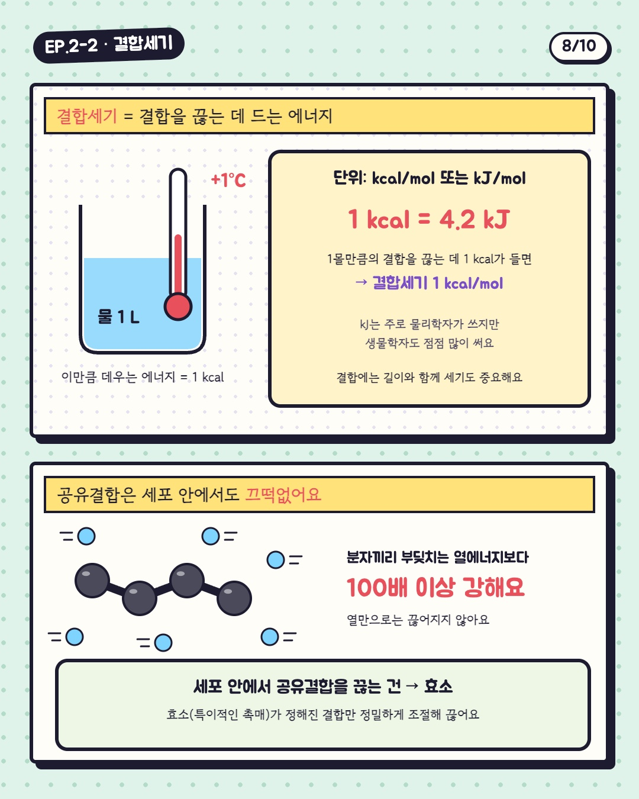
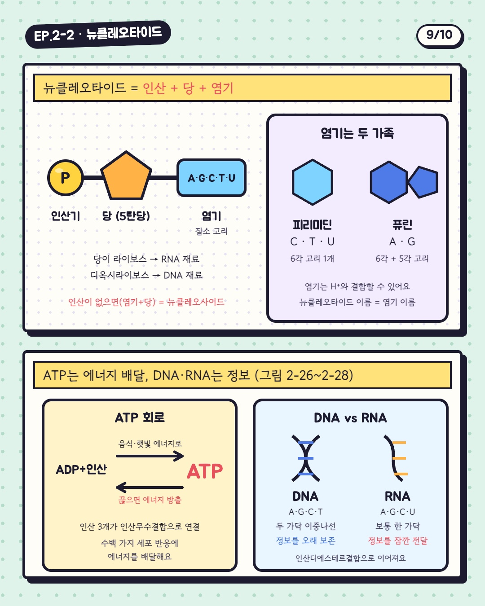
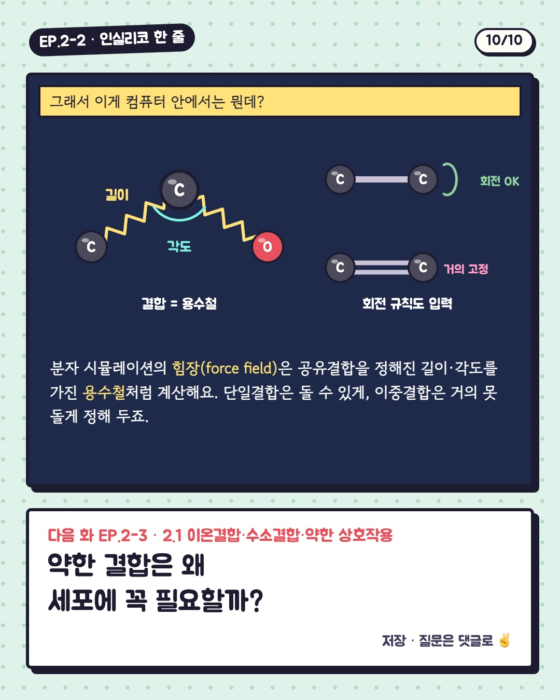

# EP.2-2 세포 속 레고 블록은 몇 종류일까?

- 교재: 2장 2.2 세포 내의 작은 분자
- 게시: 2026-11-08 · [인스타그램](https://www.instagram.com/p/Df1q5ckjwTa/)

## 캡션

```text
EP.2-2 세포 속 레고 블록은 몇 종류일까? 🧱
필수세포생물학 2장 ② · 2.2 세포 내의 작은 분자

핵, 야호~ ✌ 지난 화에서 원자와 결합을 봤다면, 오늘은 그 원자들로 만든 '작은 분자'들! 세포를 짓는 블록은 딱 4가족이에요.

🧱 물을 빼면 세포 속 물질은 거의 다 탄소화합물(유기분자). 탄소는 결합 4개로 사슬도 고리도 만들어요.
🧱 작은 유기분자는 당 · 지방산 · 아미노산 · 뉴클레오타이드 4가족. 이어 붙이면 다당류 · 단백질 · 핵산 같은 거대분자가 돼요.
🧱 당: 단당류는 (CH₂O)ₙ, 포도당은 C₆H₁₂O₆. 이어 붙이면 이당류(자당) → 올리고당 → 다당류(글리코젠·녹말·셀룰로오스).
🧱 붙일 땐 물 1개를 빼는 축합, 끊을 땐 물 1개를 넣는 가수분해. 다당류·단백질·핵산 모두 이 방식이에요.
🧱 지방산: 친수성 머리 + 소수성 꼬리 = 양친매성. 같은 무게당 포도당보다 6배 에너지를 내요.
🧱 인지질은 꼬리 2개 + 친수성 머리 → 물속에서 저절로 지질이중층(세포막)을 만들어요.
🧱 아미노산 20가지는 곁사슬 R만 달라요. 펩타이드결합으로 이어져 단백질(세포 건조 무게의 절반!)이 돼요.
🧱 뉴클레오타이드 = 인산 + 당 + 염기. ATP는 에너지 배달부, DNA·RNA는 유전정보를 담아요.

💻 인실리코 한 줄: 약물도 대부분 작은 유기분자예요. 컴퓨터는 분자를 SMILES 문자열로 적고 화학기를 세어 '분자 지문'을 만든 뒤, 물에 잘 녹는지·독성이 있는지 실험 전에 예측(QSAR)해요.

다음 화 EP.2-3 — 2.3 세포 내의 거대분자: 블록을 길게 이으면 무슨 일이 생길까?

#인실리코 #insilico #세포생물학 #필수세포생물학 #생명과학 #유기분자 #당 #지방산 #아미노산 #뉴클레오타이드 #인지질 #ATP #공부스타그램 #직장인스터디 #과학만화 #컷툰 #생물정보학
```

## 컷











