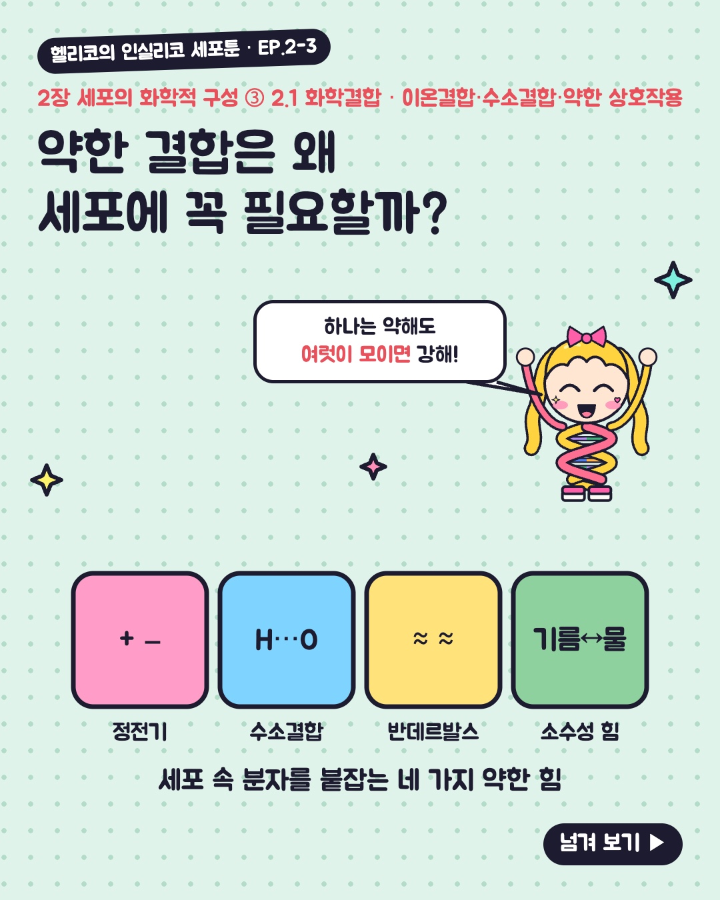
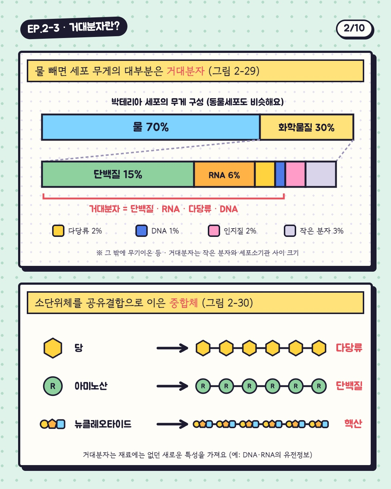
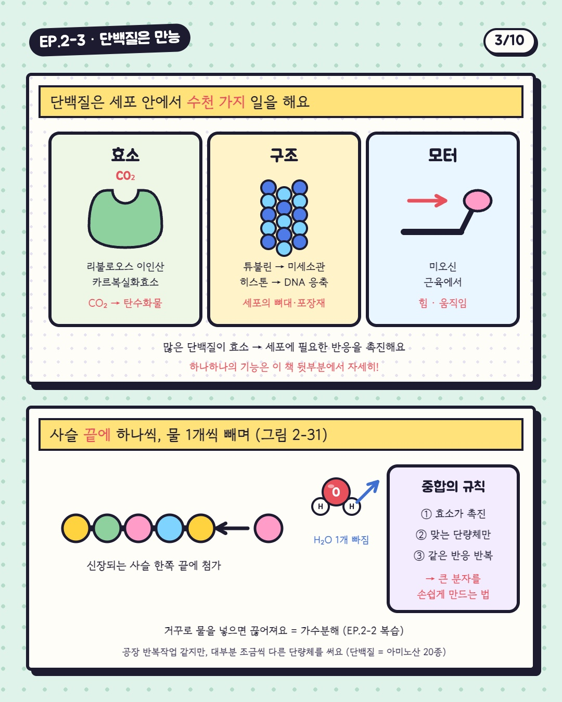
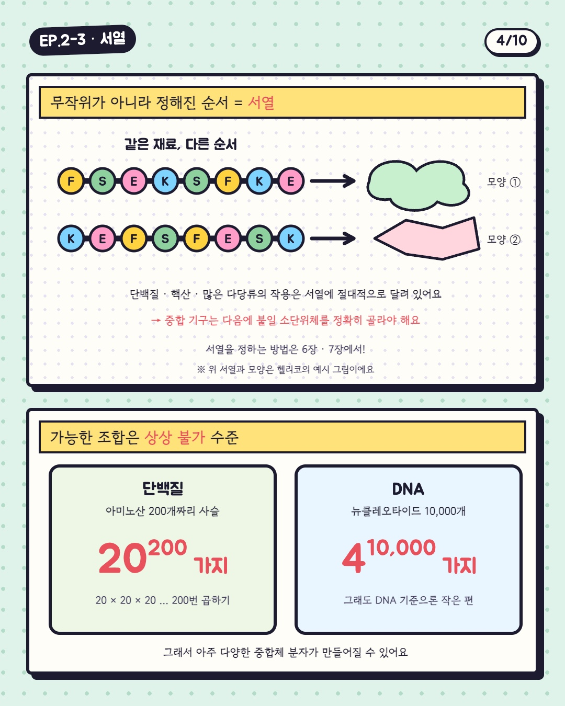
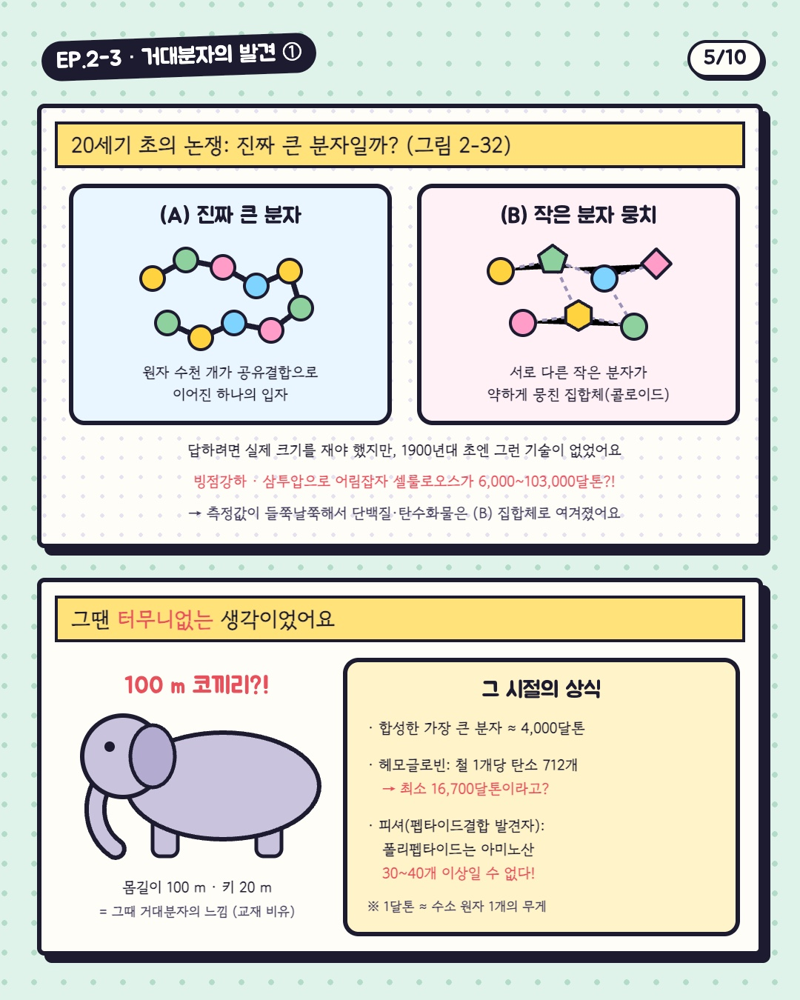
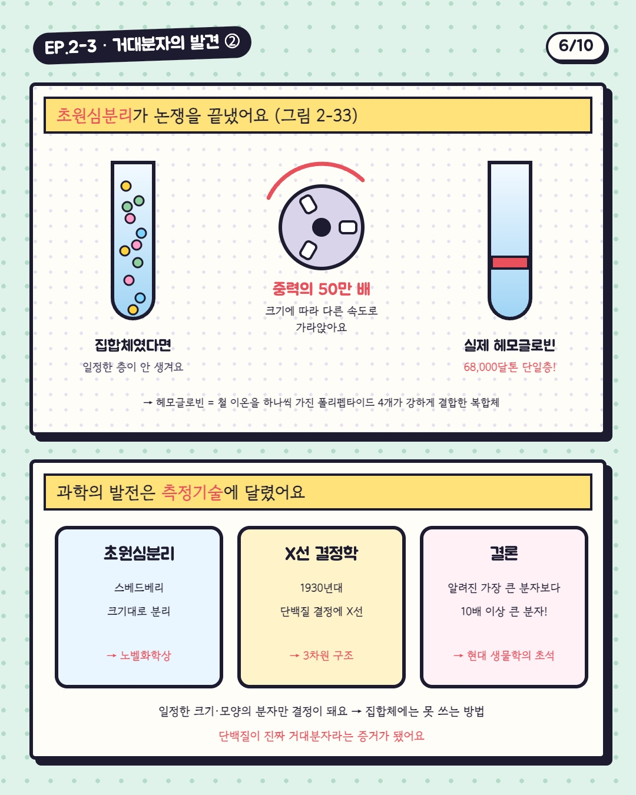
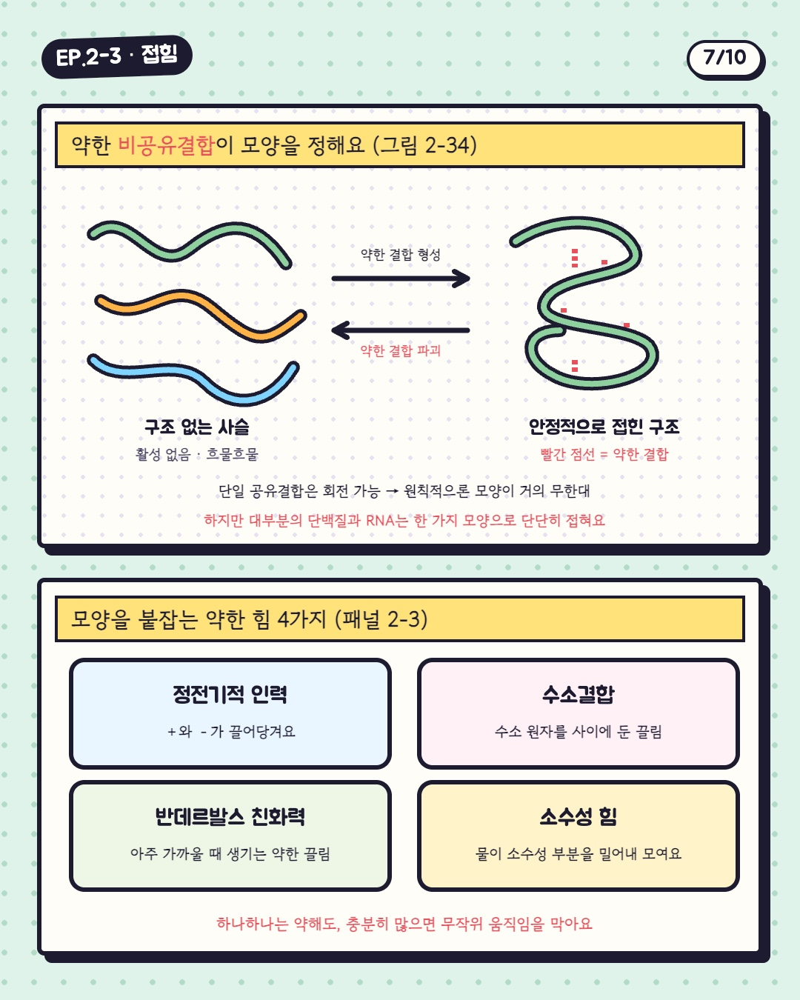
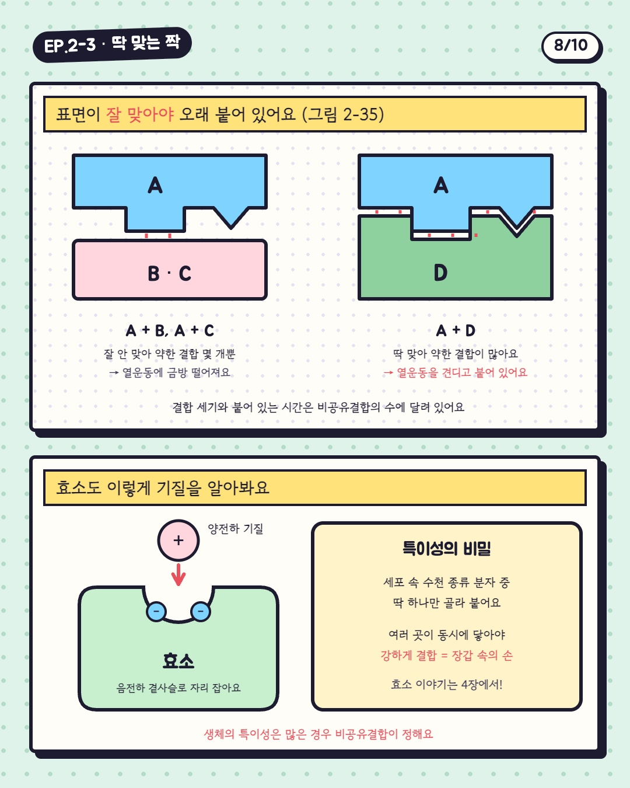
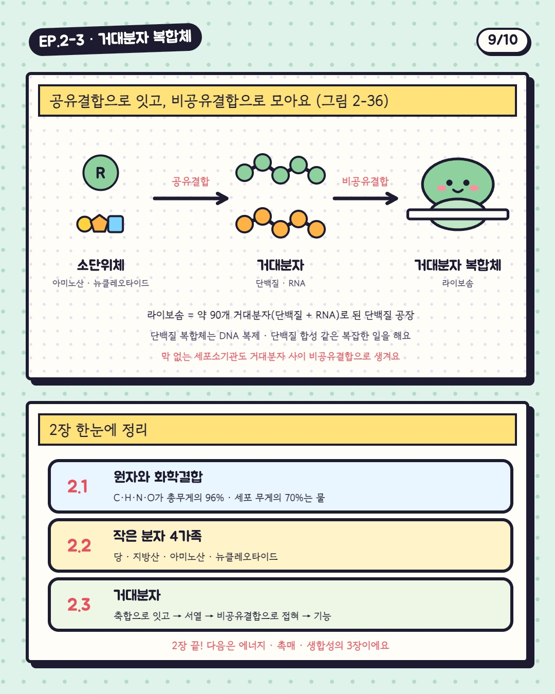
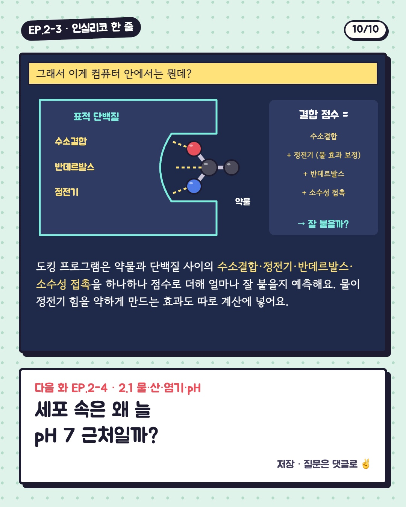

# EP.2-3 약한 결합은 왜 세포에 꼭 필요할까?

- 교재: 2장 2.1 화학결합
- 게시: 2026-11-20 · [인스타그램](https://www.instagram.com/p/Df8pLCeD94t/)

## 캡션

```text
EP.2-3 약한 결합은 왜 세포에 꼭 필요할까? 🧲
필수세포생물학 2장 ③ · 2.1 화학결합 (이온결합·수소결합·약한 상호작용)

핵, 야호~ ✌ 오늘은 전자를 넘겨주는 이온결합과, 하나하나는 약하지만 모이면 강해지는 비공유결합 이야기예요.

🧂 Na가 전자 1개를 Cl에 넘기면 Na⁺와 Cl⁻가 되어 서로 끌어당겨요 = 이온결합. 이렇게만 묶인 물질을 염이라고 불러요.
💎 소금 결정은 이온이 규칙적으로 쌓인 격자! 지름 1 mm 결정에 이온이 약 2×10¹⁹개 들어 있대요.
💧 물속에서 이온은 물분자에 둘러싸여 흩어지고, 이온결합은 공유결합보다 10~100배 약해져요. Na⁺, Cl⁻, K⁺, Ca²⁺는 신경세포에서 중요해요.
🤲 물은 세포 무게의 약 70%. 극성인 물분자끼리 수소결합을 이뤄 높은 끓는점과 큰 표면장력을 만들어요.
🌊 물과 친한 친수성(당, DNA, RNA, 대부분의 단백질) vs 물을 싫어하는 소수성(탄화수소).
➕➖ 약한 결합 ① 정전기적 인력: 큰 분자 표면의 상보적인 전하끼리 결합해요. 물속에선 약해지지만 효소가 기질을 제자리에 놓는 데 쓰여요.
〰️ ② 반데르발스 친화력: 전자의 출렁임으로 생기는 인력. 비극성 분자 사이에서도 생겨요.
📏 ③ 수소결합: 세 원자가 일직선일 때 가장 강하고, 폴리펩타이드 접힘과 DNA의 G–C 쌍에서 나타나요.
🫧 ④ 소수성 힘: 물이 비극성 분자를 밀어내 모이게 하는 힘. 세포막 형성의 핵심이에요!

💻 인실리코 한 줄: 도킹 프로그램은 약물과 단백질 사이의 수소결합·정전기·반데르발스·소수성 접촉을 점수로 더해 얼마나 잘 붙을지 예측해요.

다음 화 EP.2-4 — 2.1 물·산·염기·pH: 세포 속은 왜 늘 pH 7 근처일까?

#인실리코 #insilico #세포생물학 #필수세포생물학 #생명과학 #이온결합 #수소결합 #반데르발스 #소수성 #비공유결합 #공부스타그램 #직장인스터디 #과학만화 #컷툰 #생물정보학
```

## 컷











