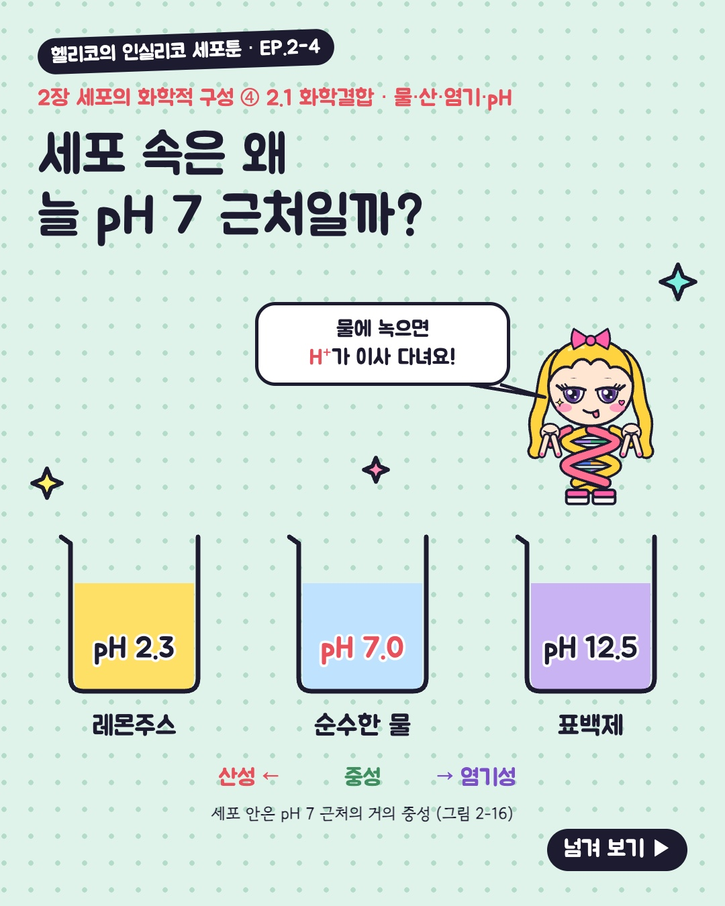
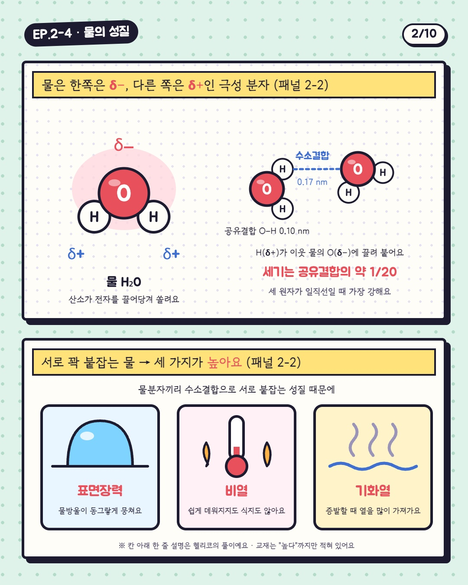
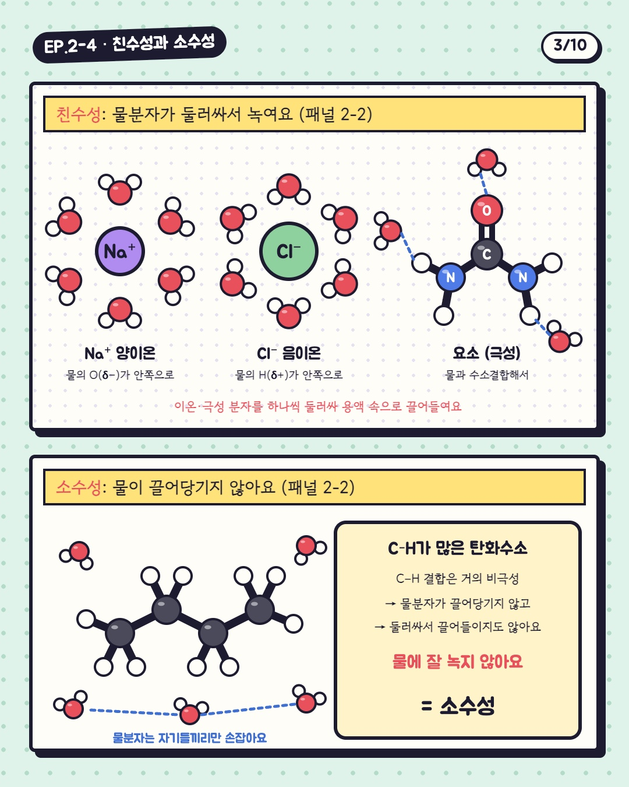
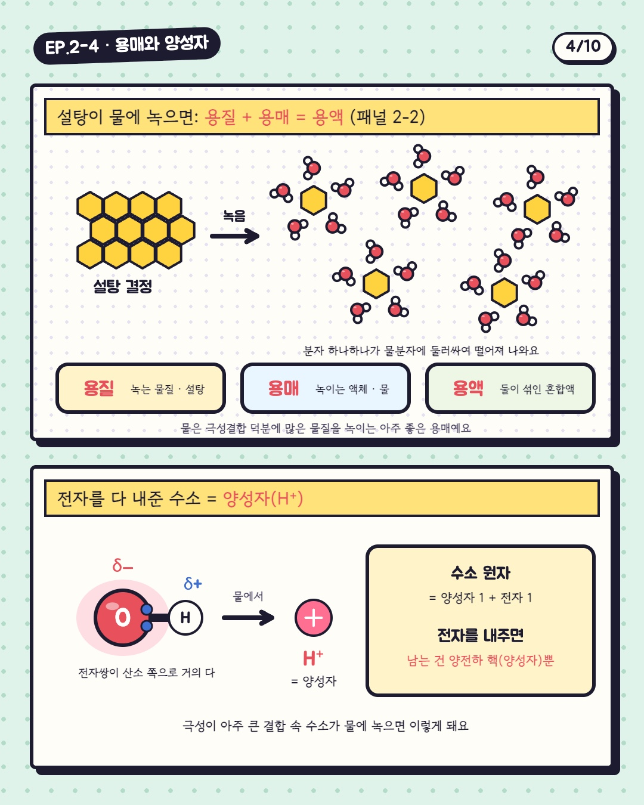
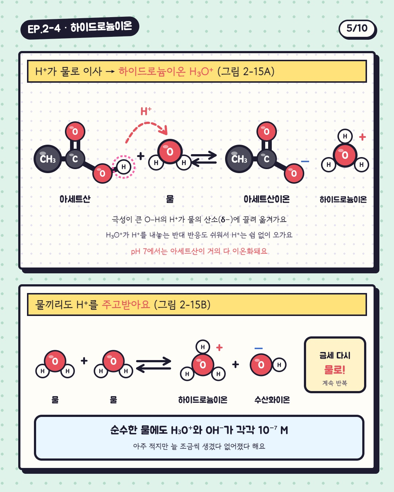
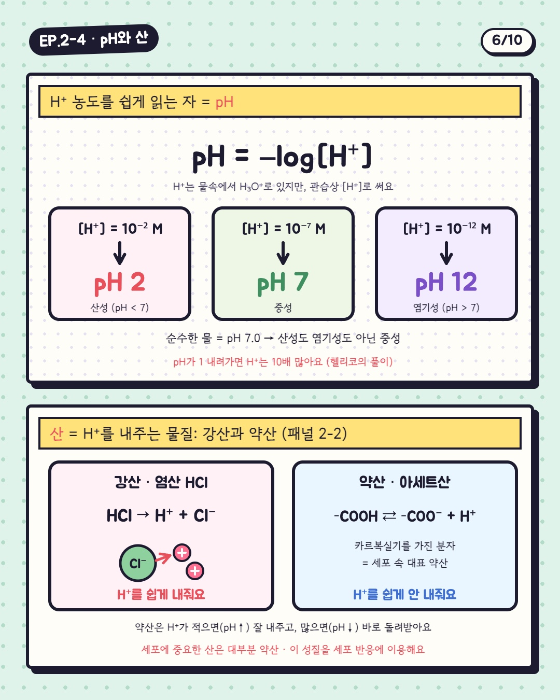
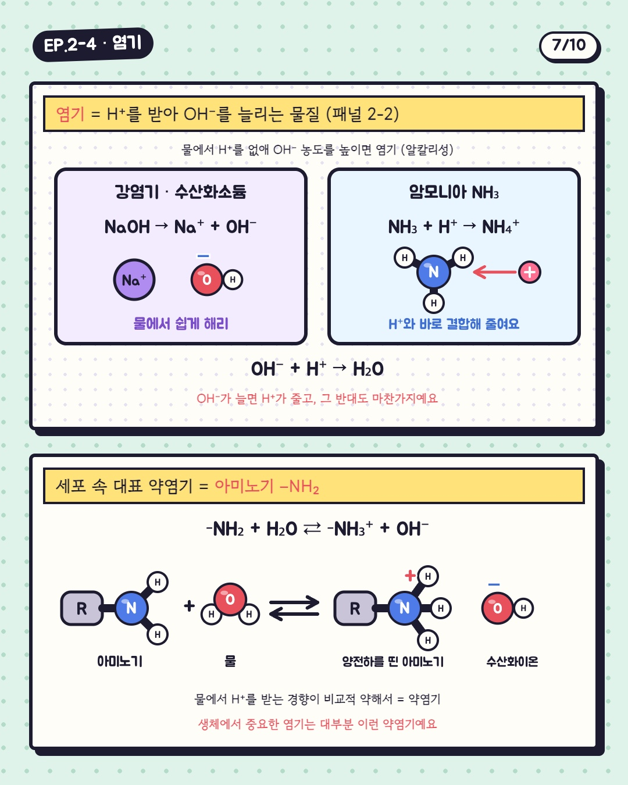
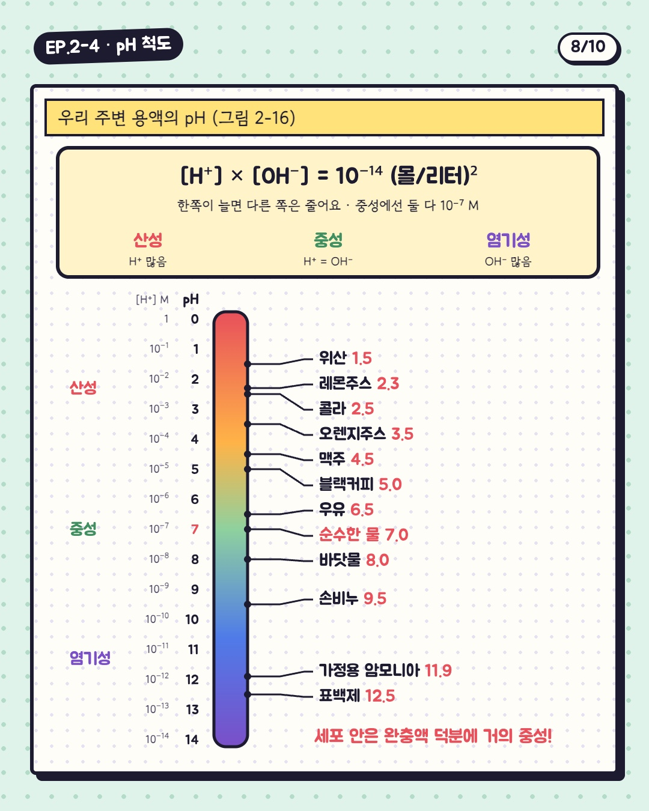
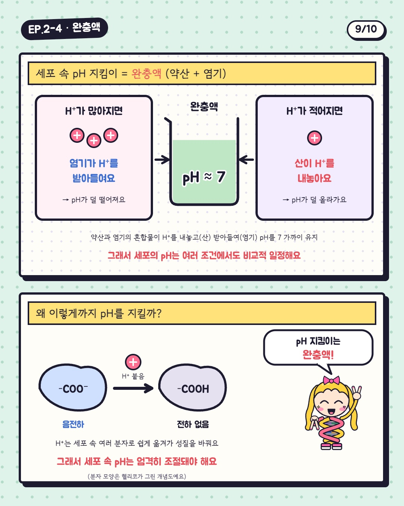
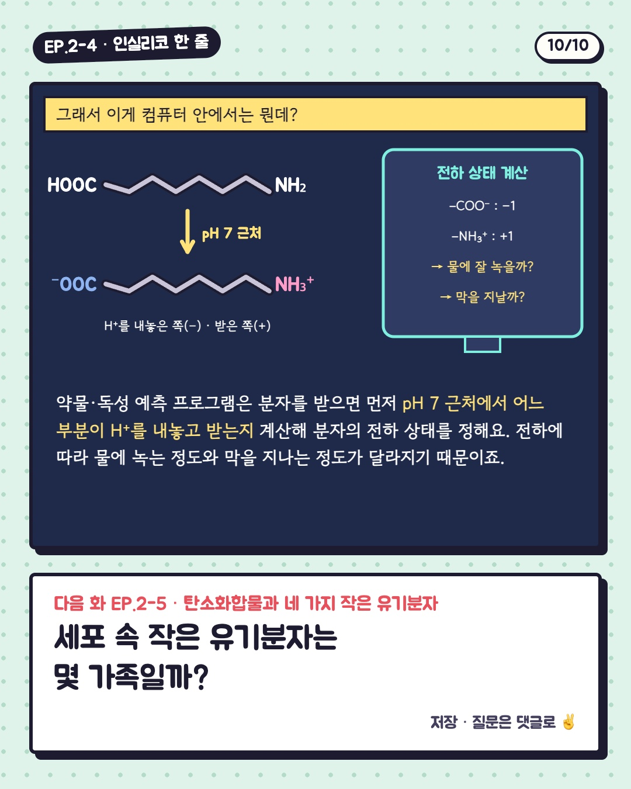

# EP.2-4 세포 속은 왜 늘 pH 7 근처일까?

- 교재: 2장 2.1 화학결합
- 게시: 2026-11-20 · [인스타그램](https://www.instagram.com/p/Df9ZRmaD30E/)

## 캡션

```text
EP.2-4 세포 속은 왜 늘 pH 7 근처일까? 🍋
필수세포생물학 2장 ④ · 2.1 화학결합

핵, 야호~ ✌ 오늘은 세포의 바다, 물! 물에 녹은 분자에서 H⁺가 이사 다니는 이야기, 산·염기·pH를 만나 봐요.

💧 물은 극성 분자예요. 산소 쪽은 δ−, 수소 쪽은 δ+. 이웃 물분자와 수소결합(공유결합의 약 1/20 세기)으로 서로 붙잡아서 표면장력·비열·기화열이 높아요.
💧 이온(Na⁺, Cl⁻)과 극성 분자(요소)는 물분자에 둘러싸여 녹아요 = 친수성. C–H가 많은 탄화수소는 물이 끌어당기지 않아 안 녹아요 = 소수성.
💧 설탕(용질)이 물(용매)에 녹으면 용액! 물은 많은 물질을 녹이는 아주 좋은 용매예요.
🍋 극성이 큰 결합 속 수소가 전자를 내주면 양성자(H⁺). H⁺는 물분자로 옮겨가 하이드로늄이온(H₃O⁺)이 돼요. 순수한 물에도 H₃O⁺가 10⁻⁷ M 있어요.
🍋 pH = −log[H⁺]. 순수한 물은 pH 7.0, 중성이에요.
🍋 산은 H⁺를 내주고(강산 염산, 약산 아세트산·–COOH), 염기는 H⁺를 받아 OH⁻를 늘려요(강염기 NaOH, 약염기 –NH₂). 세포 속 산·염기는 대부분 약산·약염기!
🧪 [H⁺] × [OH⁻] = 10⁻¹⁴. 위산 1.5 · 레몬주스 2.3 · 블랙커피 5.0 · 우유 6.5 · 바닷물 8.0 · 표백제 12.5 (그림 2-16)
🧪 세포 안은 약산+염기 혼합물인 완충액이 H⁺를 주고받아 pH를 7 가까이로 지켜요.

💻 인실리코 한 줄: 약물·독성 예측 프로그램은 분자가 pH 7 근처에서 어느 부분이 H⁺를 내놓고 받는지 먼저 계산해 전하 상태를 정해요. 전하에 따라 물에 녹는 정도와 막을 지나는 정도가 달라지거든요.

다음 화 EP.2-5 — 2.2 탄소화합물과 네 가지 작은 유기분자: 세포 속 작은 유기분자는 몇 가족일까?

#인실리코 #insilico #세포생물학 #필수세포생물학 #생명과학 #pH #산과염기 #완충액 #수소결합 #친수성 #소수성 #공부스타그램 #직장인스터디 #과학만화 #컷툰 #생물정보학
```

## 컷











