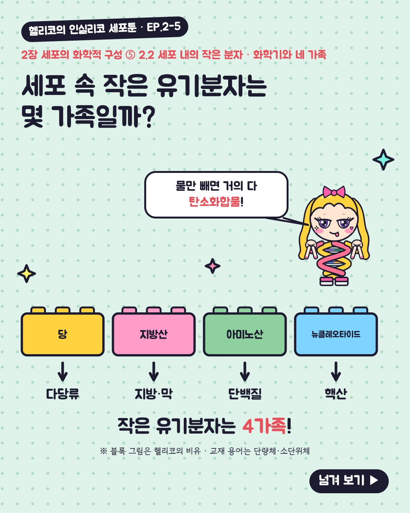
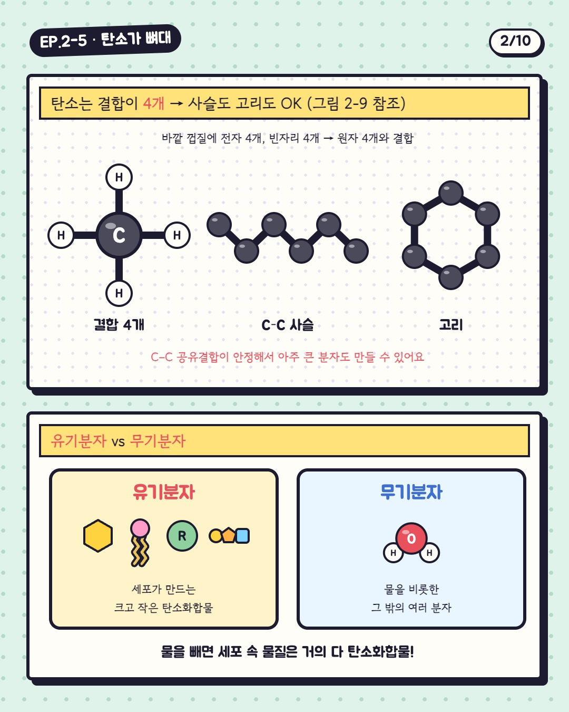
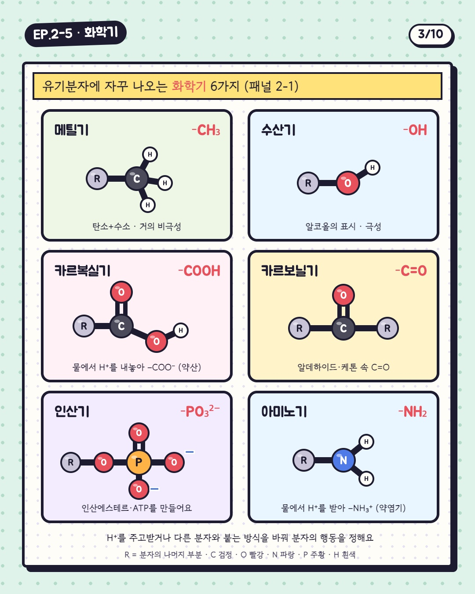
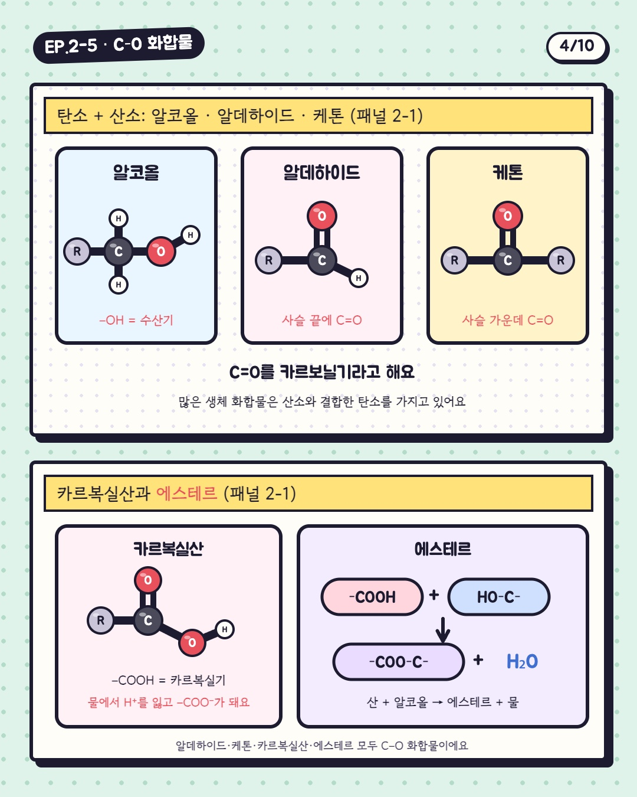
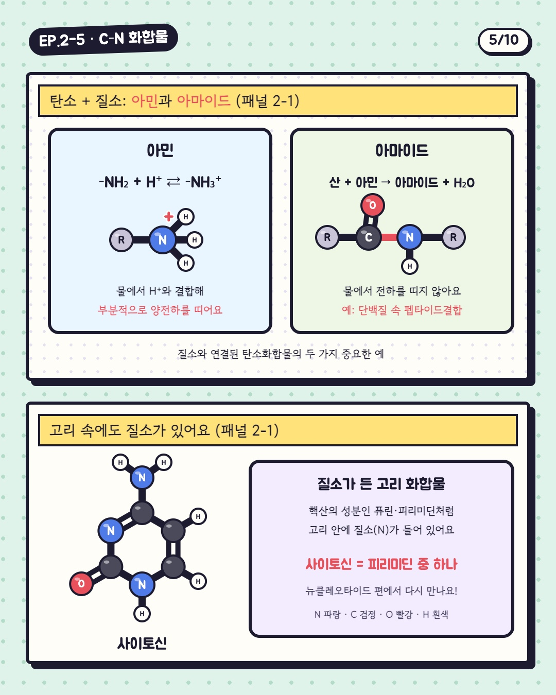
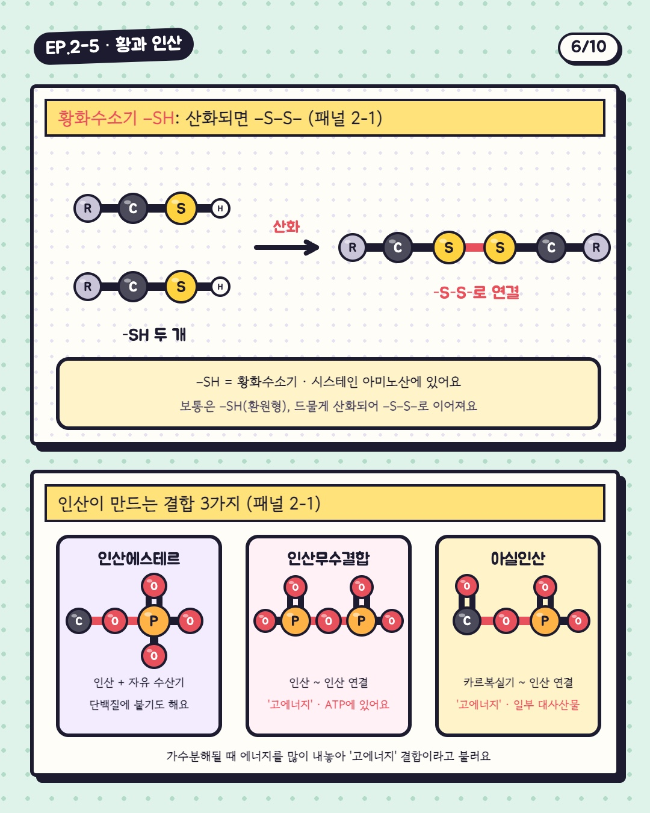
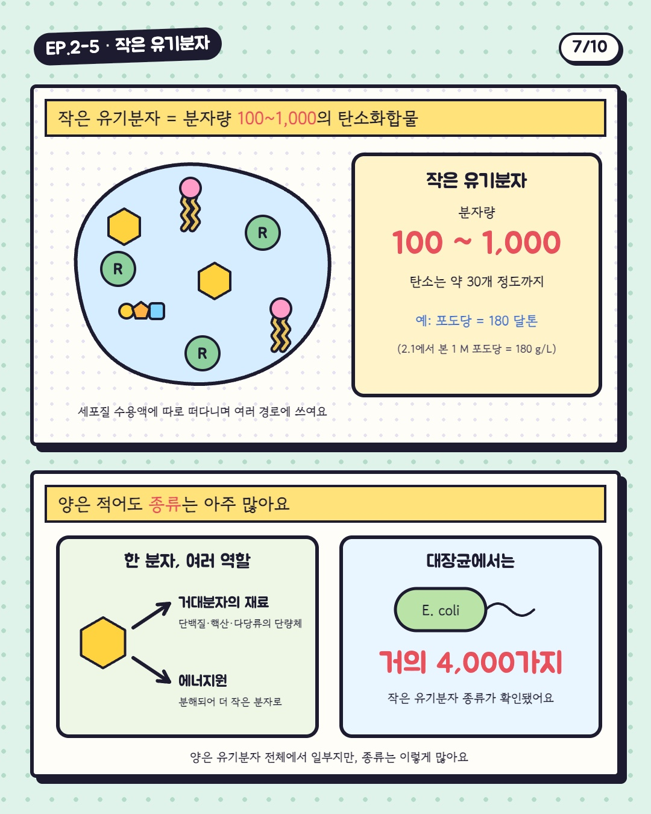
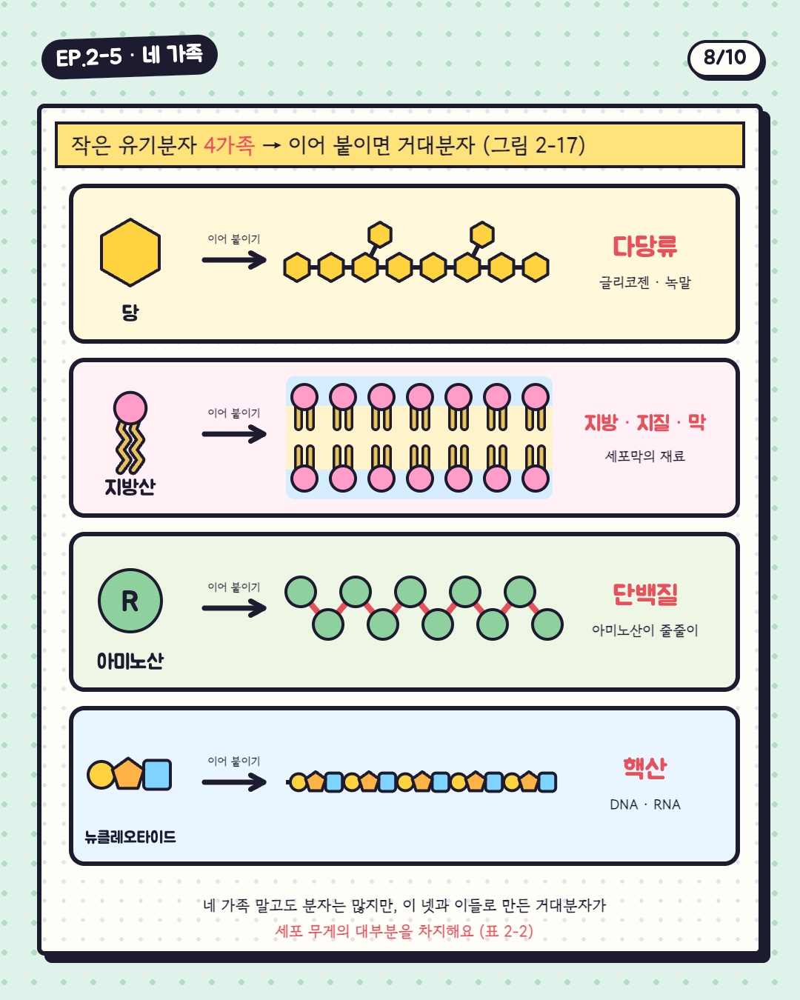
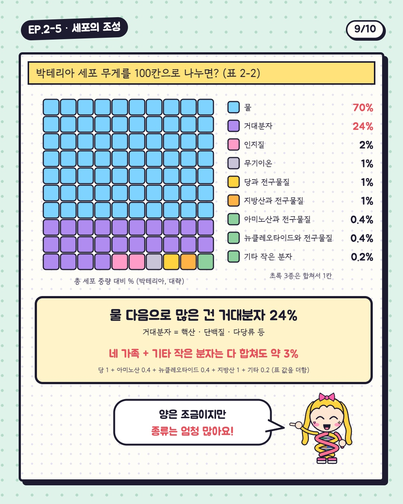
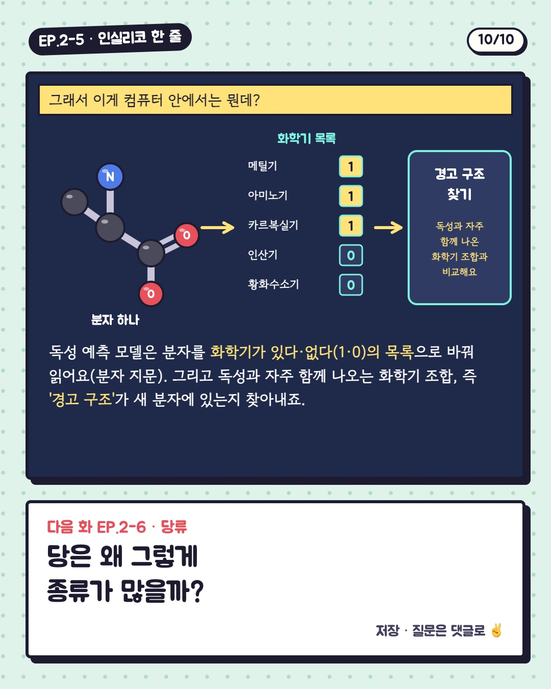

# EP.2-5 세포 속 작은 유기분자는 몇 가족일까?

- 교재: 2장 2.2 세포 내의 작은 분자
- 게시: 2026-11-21 · [인스타그램](https://www.instagram.com/p/Df_N92uD2iv/)

## 캡션

```text
EP.2-5 세포 속 작은 유기분자는 몇 가족일까? 🧱
필수세포생물학 2장 ⑤ · 2.2 세포 내의 작은 분자

핵, 야호~ ✌ 오늘부터 2.2! 세포를 이루는 작은 유기분자와, 그 분자들에 자꾸 나오는 화학기를 만나 봐요.

🧱 물을 빼면 세포 속 물질은 거의 다 탄소화합물! 탄소는 결합 4개를 만들고, 안정한 C–C 결합으로 사슬과 고리를 이뤄요.
🧱 세포가 만드는 탄소화합물은 유기분자, 물 같은 나머지는 무기분자예요.
🧪 자꾸 나오는 화학기 6가지: 메틸기(–CH₃) · 수산기(–OH) · 카르복실기(–COOH) · 카르보닐기(C=O) · 인산기(–PO₃²⁻) · 아미노기(–NH₂)
🧪 C–O 화합물: 알코올 · 알데하이드 · 케톤 · 카르복실산 · 에스테르(산 + 알코올). C–N 화합물: 아민(물에서 H⁺와 결합) · 아마이드(전하 없음, 펩타이드결합). 사이토신처럼 고리 속에도 질소가 있어요.
🧪 황화수소기(–SH, 시스테인)는 산화되면 –S–S–로 이어져요. 인산은 인산에스테르, '고에너지' 인산무수결합(ATP), 아실인산을 만들어요.
🔬 작은 유기분자 = 분자량 100~1,000의 탄소화합물. 거대분자의 재료도 되고 에너지원도 돼요. 대장균에서만 거의 4,000가지!
🔬 네 가족: 당 → 다당류, 지방산 → 지방·막, 아미노산 → 단백질, 뉴클레오타이드 → 핵산 (그림 2-17)
🔬 박테리아 세포 무게: 물 70%, 거대분자 24%, 인지질 2%, 나머지 작은 분자들은 다 합쳐도 몇 % (표 2-2)

💻 인실리코 한 줄: 독성 예측 모델은 분자를 '화학기가 있다·없다' 목록(분자 지문)으로 바꿔 읽고, 독성과 자주 함께 나오는 화학기 조합(경고 구조)이 새 분자에 있는지 찾아내요.

다음 화 EP.2-6 — 당류: 당은 왜 그렇게 종류가 많을까?

#인실리코 #insilico #세포생물학 #필수세포생물학 #생명과학 #유기분자 #화학기 #탄소화합물 #작용기 #단량체 #공부스타그램 #직장인스터디 #과학만화 #컷툰 #생물정보학
```

## 컷











