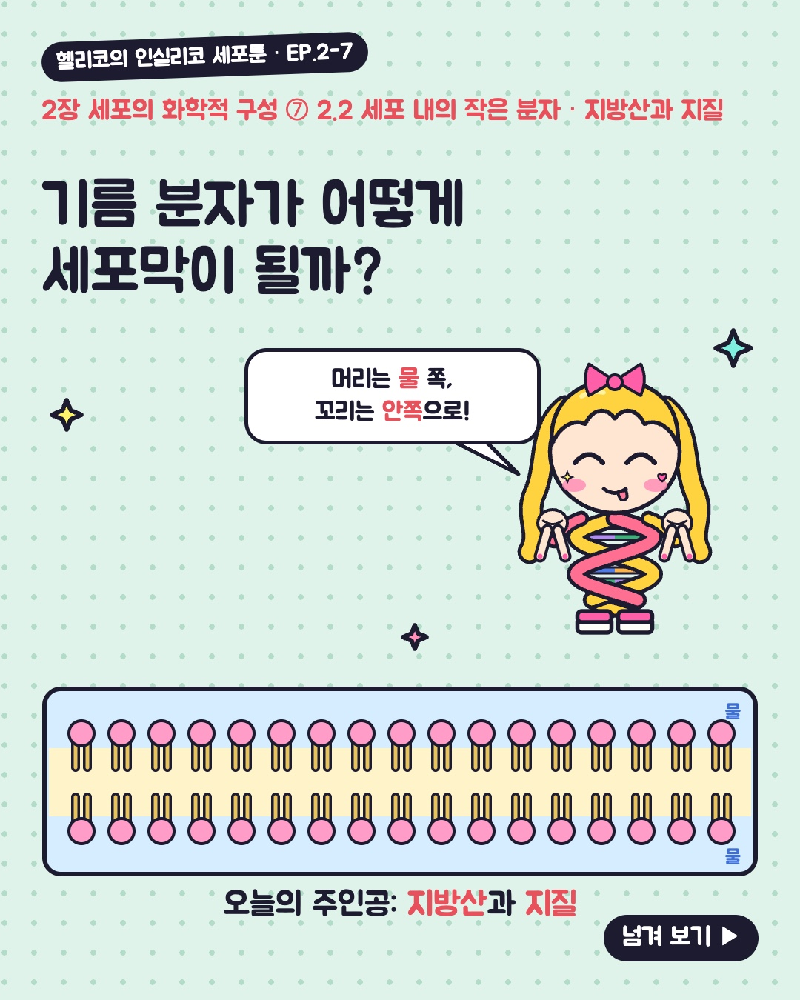
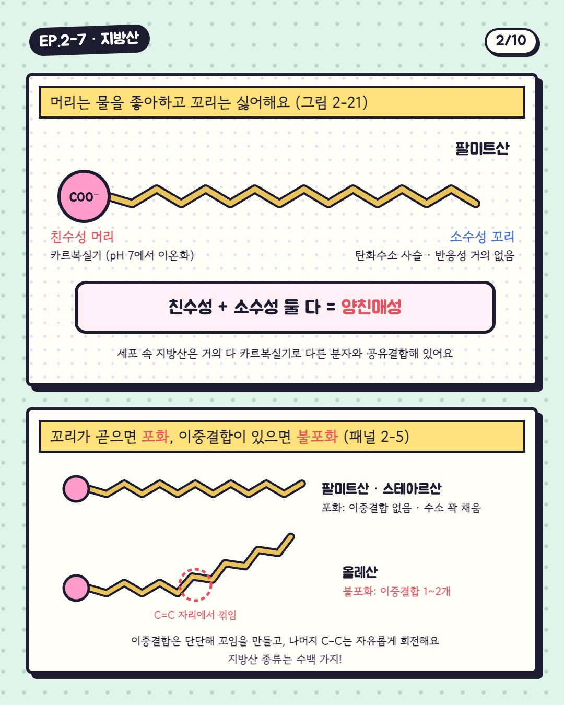
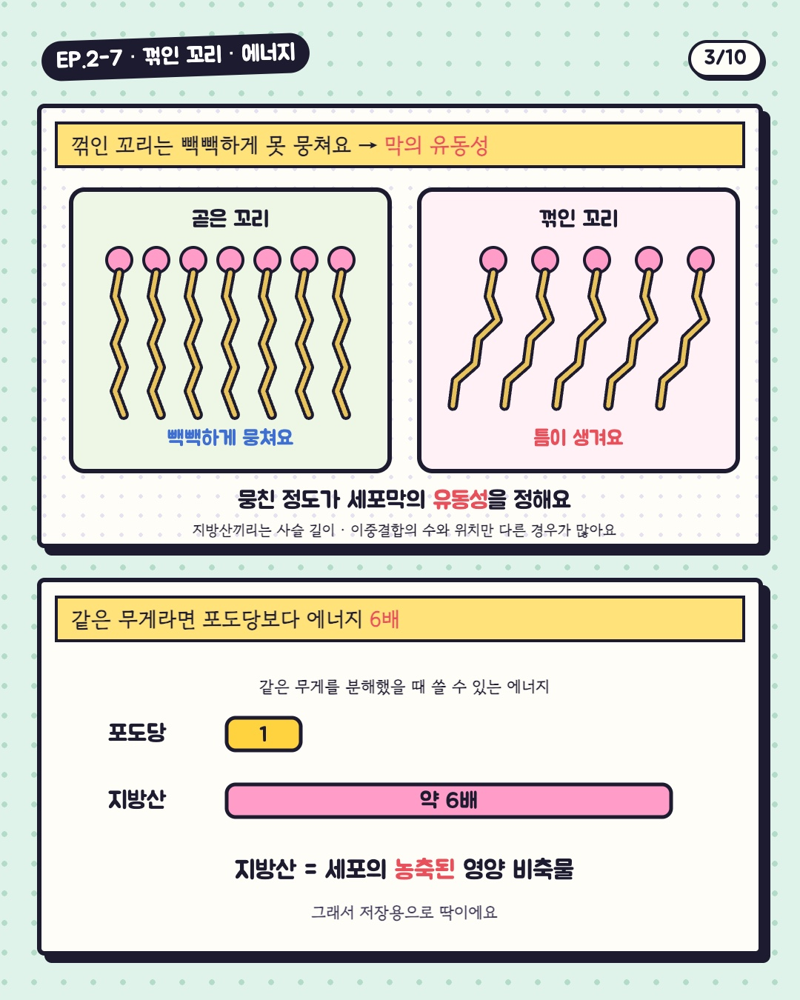
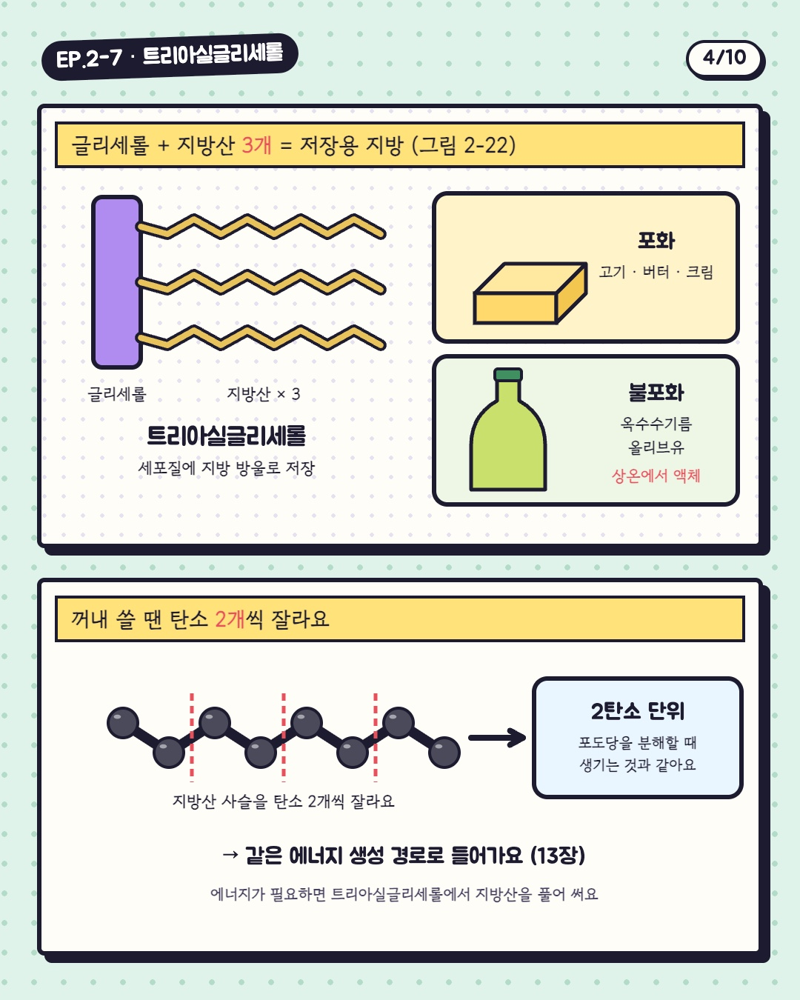
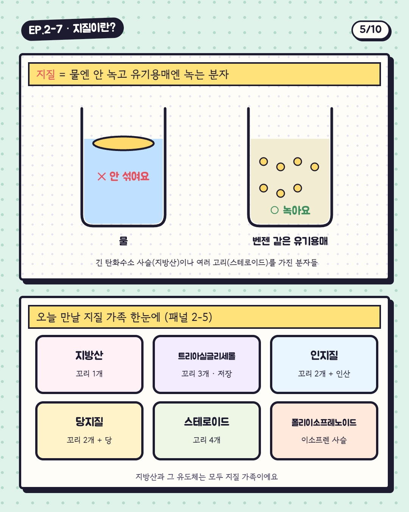
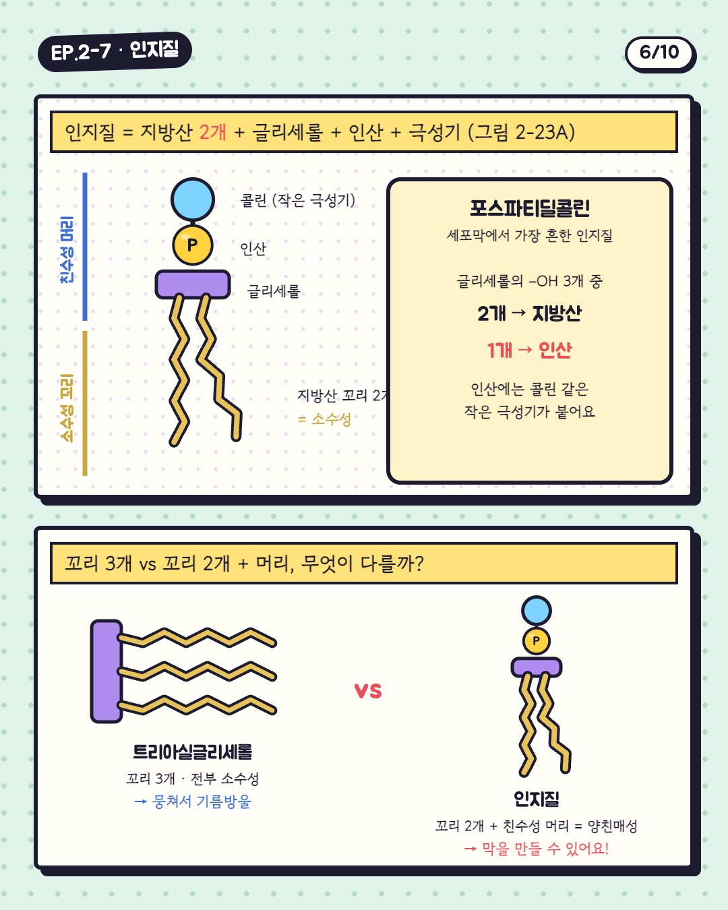
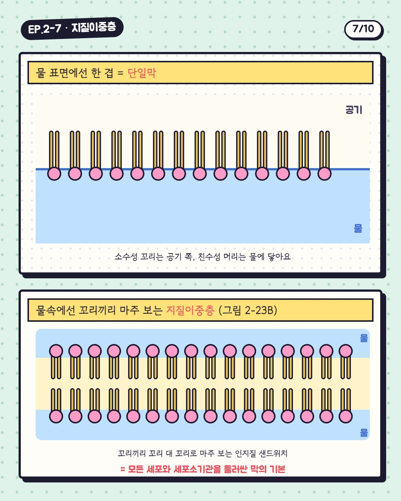
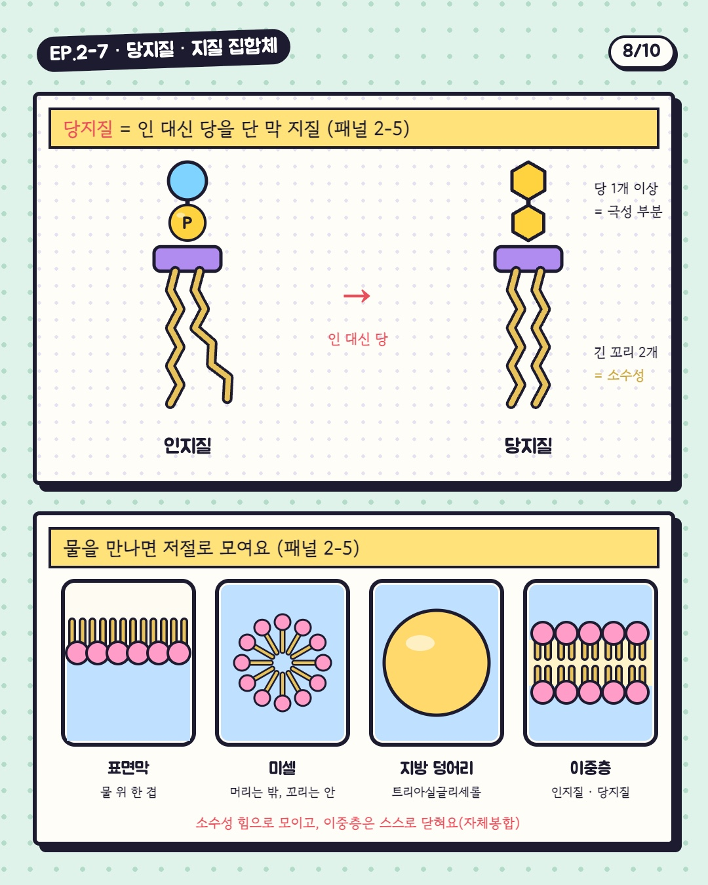
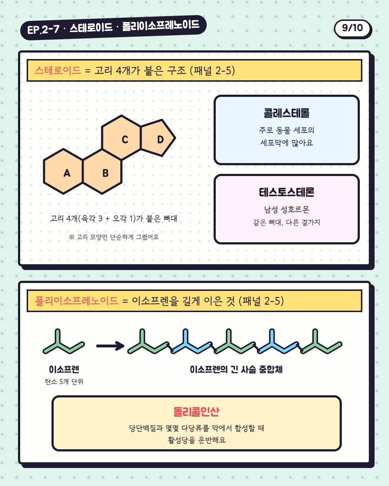
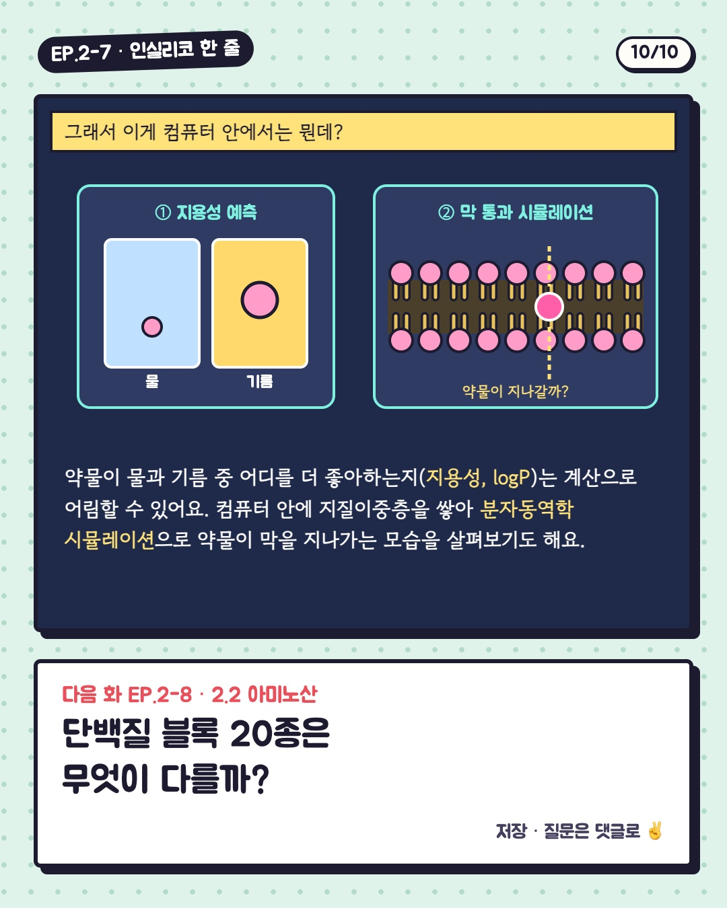

# EP.2-7 기름 분자가 어떻게 세포막이 될까?

- 교재: 2장 2.2 세포 내의 작은 분자
- 게시: 2026-11-22 · [인스타그램](https://www.instagram.com/p/DgByugIDzyF/)

## 캡션

```text
EP.2-7 기름 분자가 어떻게 세포막이 될까? 🫧
필수세포생물학 2장 ⑦ · 2.2 세포 내의 작은 분자 (지방산과 지질)

핵, 야호~ ✌ 지난 화의 당에 이어 오늘은 기름 가족! 물을 싫어하는 분자가 어떻게 세포를 감싸는 막이 되는지 따라가 봐요.

🫧 지방산(예: 팔미트산) = 물을 좋아하는 카르복실기 머리 + 물을 싫어하는 탄화수소 꼬리. 둘 다 가진 분자를 '양친매성'이라고 해요.
🫧 이중결합이 없으면 포화(팔미트산·스테아르산), 1~2개 있으면 불포화(올레산). 이중결합이 꼬리를 꺾어서 덜 뭉치고, 이 뭉친 정도가 막의 유동성을 정해요.
🫧 지방산은 같은 무게에서 포도당보다 에너지를 6배 내는 농축 비축물이에요.
🫧 트리아실글리세롤 = 글리세롤 + 지방산 3개. 버터·크림은 포화, 올리브유·옥수수기름은 불포화(상온에서 액체). 꺼내 쓸 땐 탄소 2개 단위로 잘라 포도당과 같은 에너지 경로로!
🫧 지질 = 물엔 안 녹고 벤젠 같은 유기용매엔 녹는 분자.
🫧 인지질 = 지방산 2개 + 글리세롤 + 인산 + 콜린 같은 작은 극성기. 세포막에서 가장 흔한 건 포스파티딜콜린.
🫧 물 표면에선 한 겹(단일막), 물속에선 꼬리끼리 마주 보는 지질이중층 → 모든 세포막의 기본이에요. 인 대신 당을 단 당지질도 있어요.
🫧 지질은 물속에서 표면막·미셀·지방 덩어리를 만들고, 스테로이드(고리 4개: 콜레스테롤·테스토스테론)와 폴리이소프레노이드(이소프렌 사슬, 돌리콜인산은 활성당 운반)도 지질 가족이에요.

💻 인실리코 한 줄: 약물이 물과 기름 중 어디를 더 좋아하는지(logP)는 계산으로 어림하고, 컴퓨터 속 지질이중층에서 분자동역학 시뮬레이션으로 약물이 막을 지나가는 모습을 살펴보기도 해요.

다음 화 EP.2-8 — 2.2 아미노산: 단백질 블록 20종은 무엇이 다를까?

#인실리코 #insilico #세포생물학 #필수세포생물학 #생명과학 #지방산 #지질 #인지질 #지질이중층 #세포막 #콜레스테롤 #양친매성 #공부스타그램 #직장인스터디 #과학만화 #컷툰
```

## 컷











