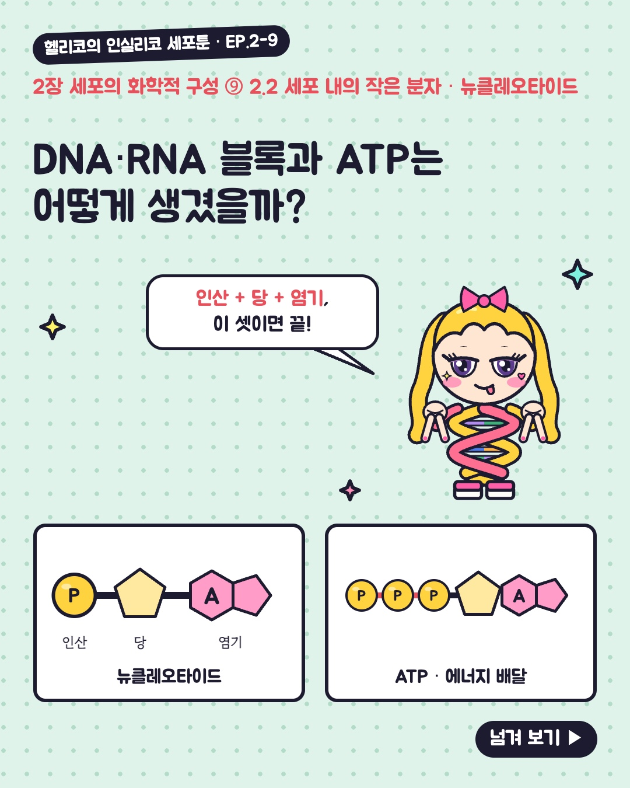
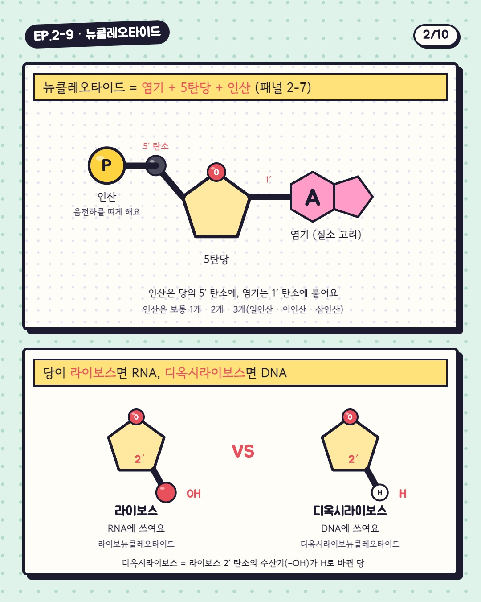
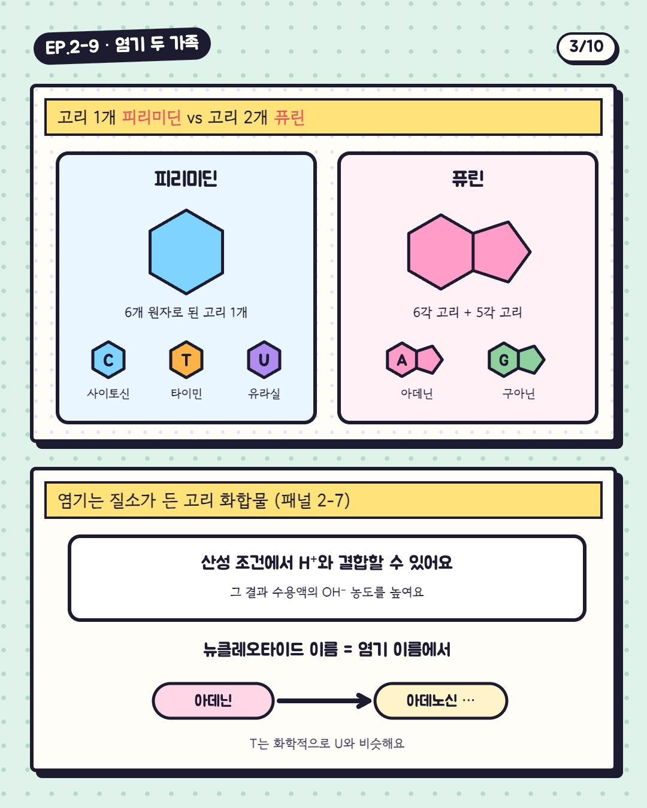
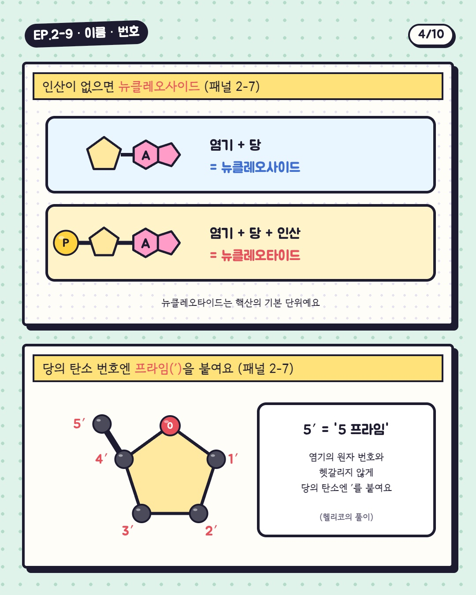
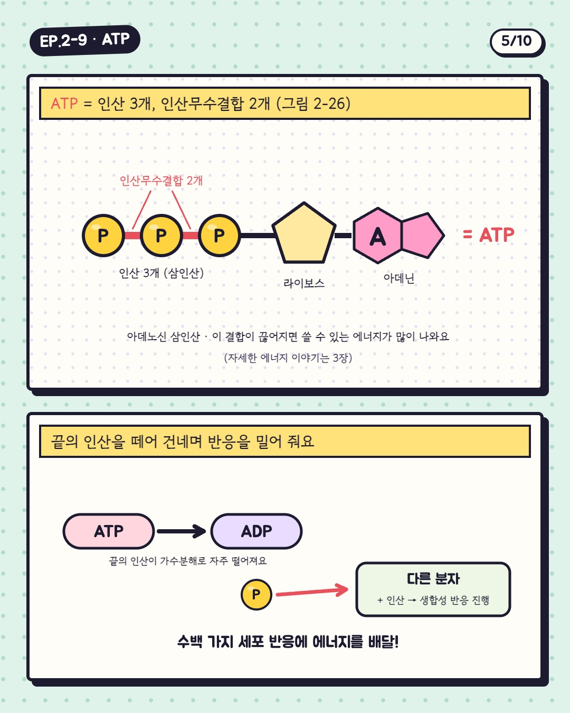
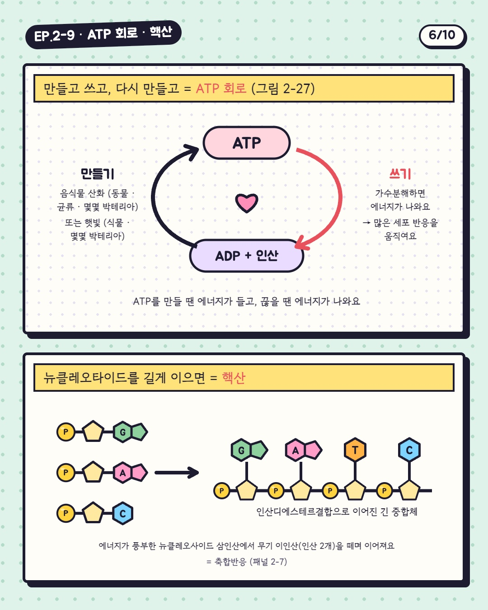
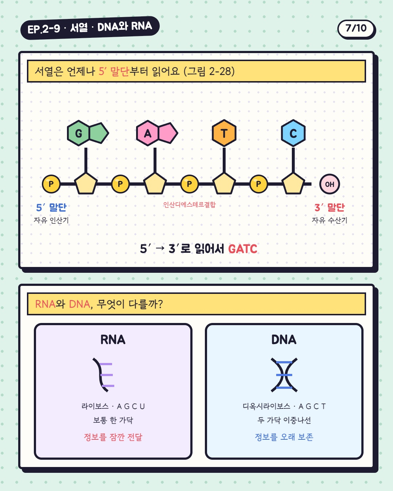
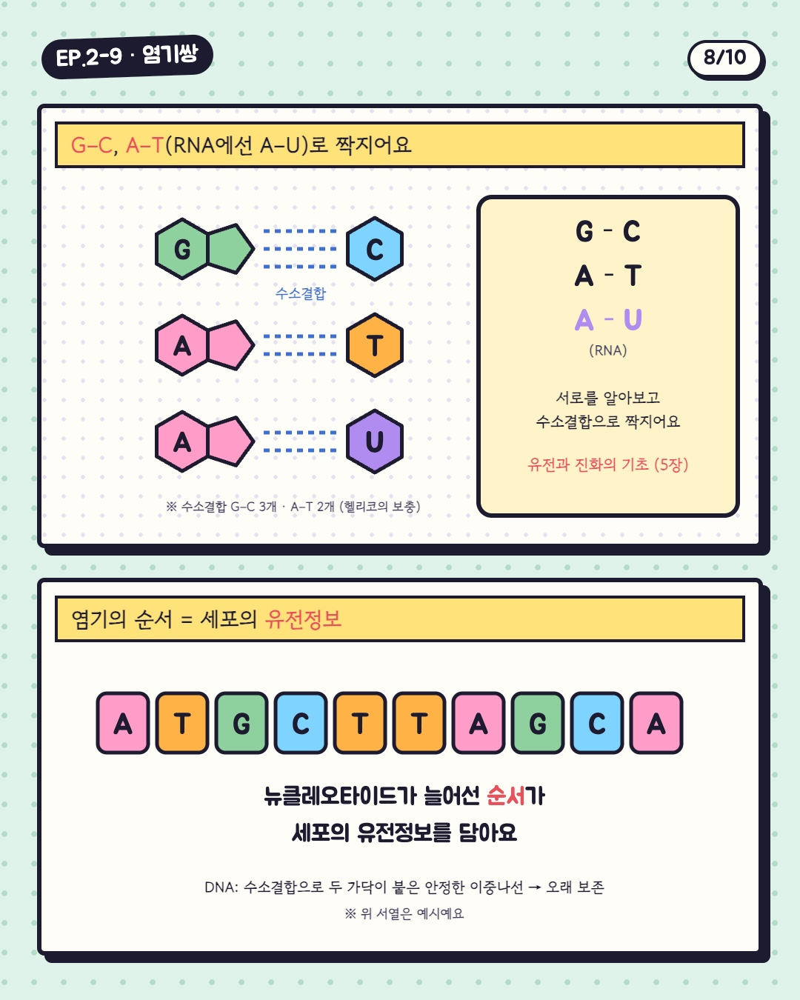
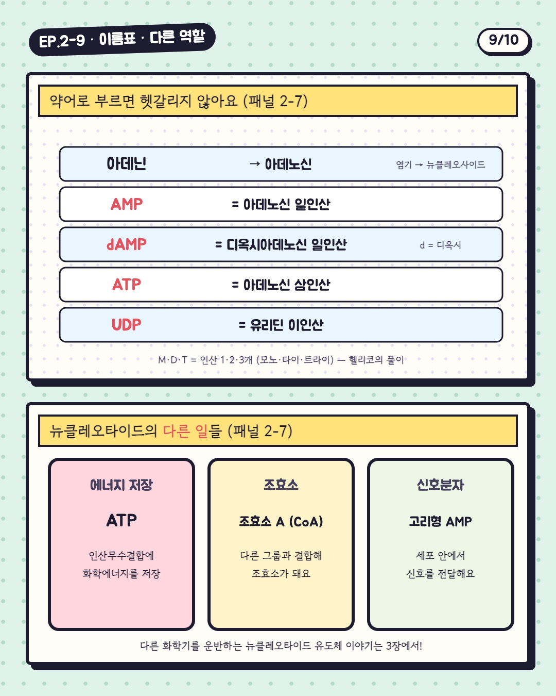
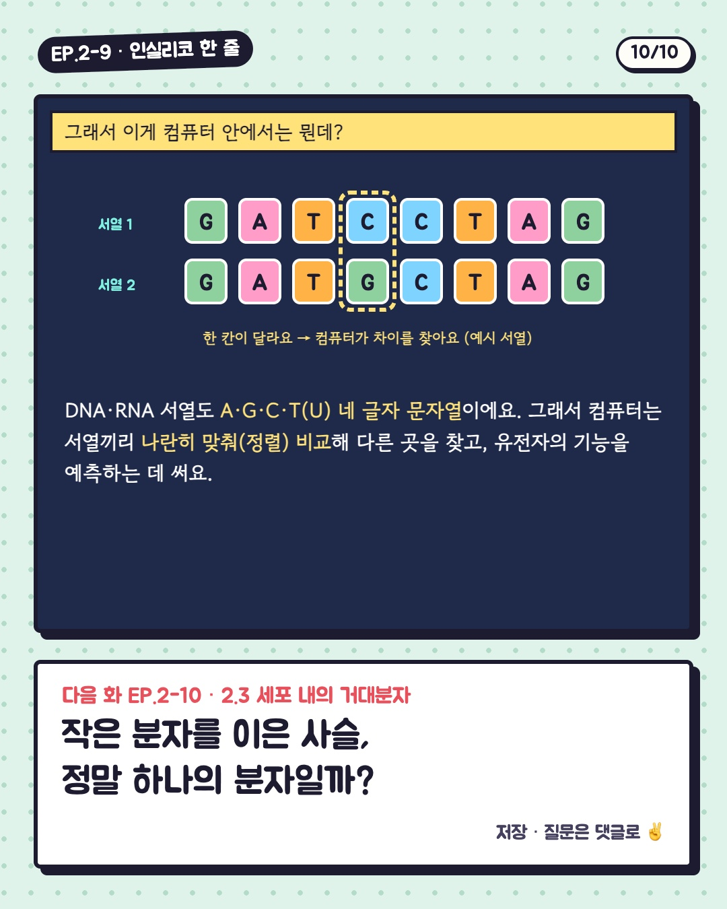

# EP.2-9 DNA·RNA 블록과 ATP는 어떻게 생겼을까?

- 교재: 2장 2.2 세포 내의 작은 분자
- 게시: 2026-11-23 · [인스타그램](https://www.instagram.com/p/DgEXhUZj2f_/)

## 캡션

```text
EP.2-9 DNA·RNA 블록과 ATP는 어떻게 생겼을까? 🧬
필수세포생물학 2장 ⑨ · 2.2 세포 내의 작은 분자 (뉴클레오타이드)

핵, 야호~ ✌ 작은 분자 4가족의 마지막, 뉴클레오타이드! 유전정보의 글자이자 에너지 배달부인 이 블록을 뜯어 봐요.

🧬 뉴클레오타이드 = 질소 염기 + 5탄당 + 인산. 당이 라이보스면 RNA, 디옥시라이보스(2′ 탄소의 –OH가 H)면 DNA에 쓰여요.
🧬 염기는 두 가족: 고리 1개 피리미딘(C·T·U), 6각+5각 고리 퓨린(A·G).
🧬 인산이 없으면(염기+당) 뉴클레오사이드. 당의 탄소 번호엔 1′, 5′처럼 프라임을 붙여요.
🧬 ATP = 아데노신 삼인산. 인산 3개가 인산무수결합 2개로 이어져 있고, 끝의 인산을 떼어 건네며 수백 가지 반응에 에너지를 배달해요.
🧬 ATP 회로: 음식물 산화나 햇빛으로 ADP+인산 → ATP, 가수분해하면 다시 ADP+인산이 되며 에너지가 나와요.
🧬 핵산 = 뉴클레오타이드가 인산디에스테르결합으로 이어진 긴 사슬. 서열은 5′ 말단부터 읽어요(예: GATC).
🧬 RNA(A·G·C·U)는 보통 한 가닥, 정보를 잠깐 전달. DNA(A·G·C·T)는 이중나선, 정보를 오래 보존. G–C, A–T(A–U) 염기쌍이 유전과 진화의 기초!
🧬 AMP·dAMP·ATP·UDP 같은 약어 이름표, 그리고 조효소 A(CoA)·고리형 AMP(신호분자)처럼 다른 일도 해요.

💻 인실리코 한 줄: DNA·RNA 서열도 A·G·C·T(U) 네 글자 문자열이라, 컴퓨터는 서열끼리 나란히 맞춰(정렬) 비교해 다른 곳을 찾고 유전자의 기능을 예측하는 데 써요.

다음 화 EP.2-10 — 2.3 세포 내의 거대분자: 작은 분자를 이은 사슬, 정말 하나의 분자일까?

#인실리코 #insilico #세포생물학 #필수세포생물학 #생명과학 #뉴클레오타이드 #DNA #RNA #ATP #염기쌍 #핵산 #유전정보 #공부스타그램 #직장인스터디 #과학만화 #컷툰
```

## 컷











