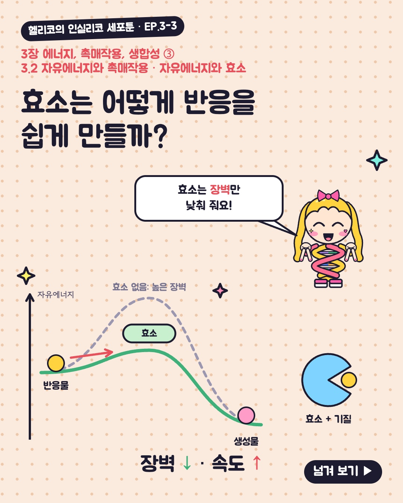
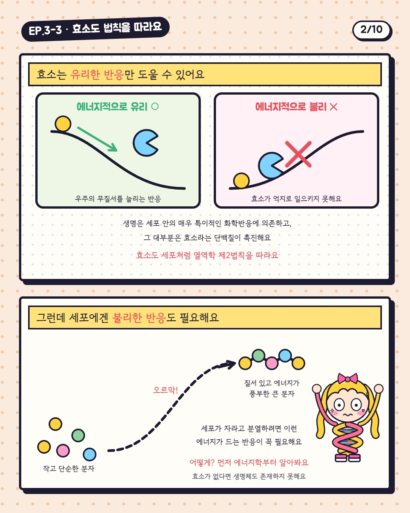
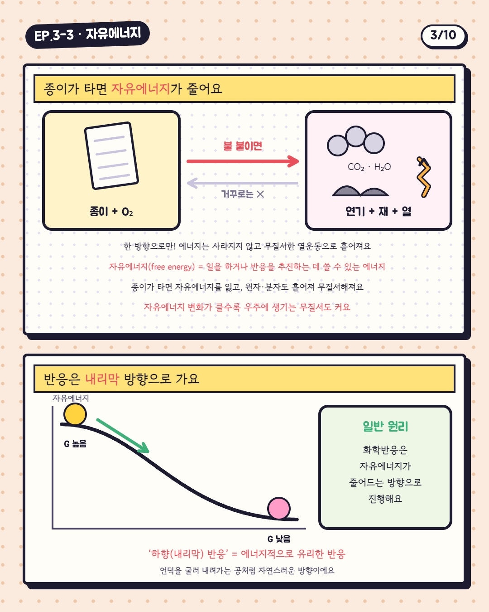
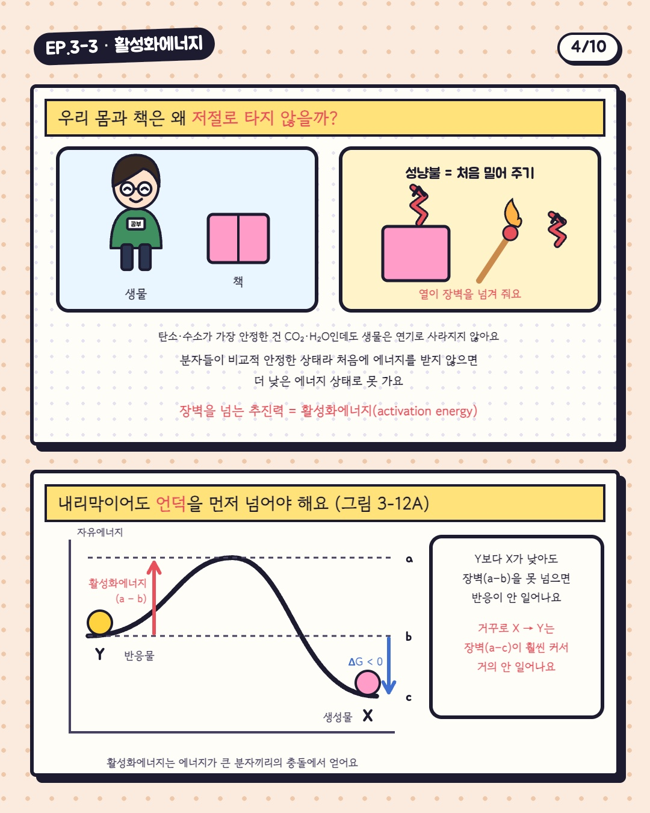
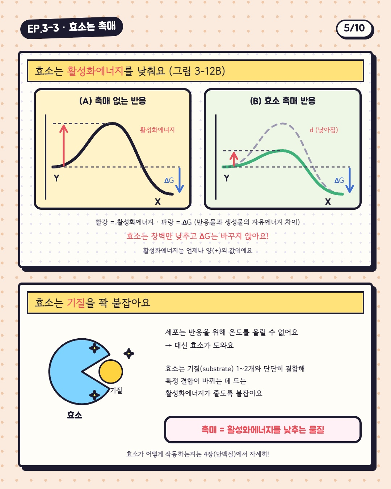
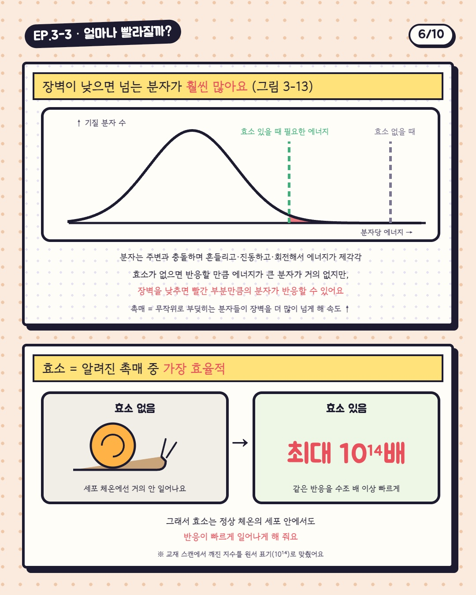
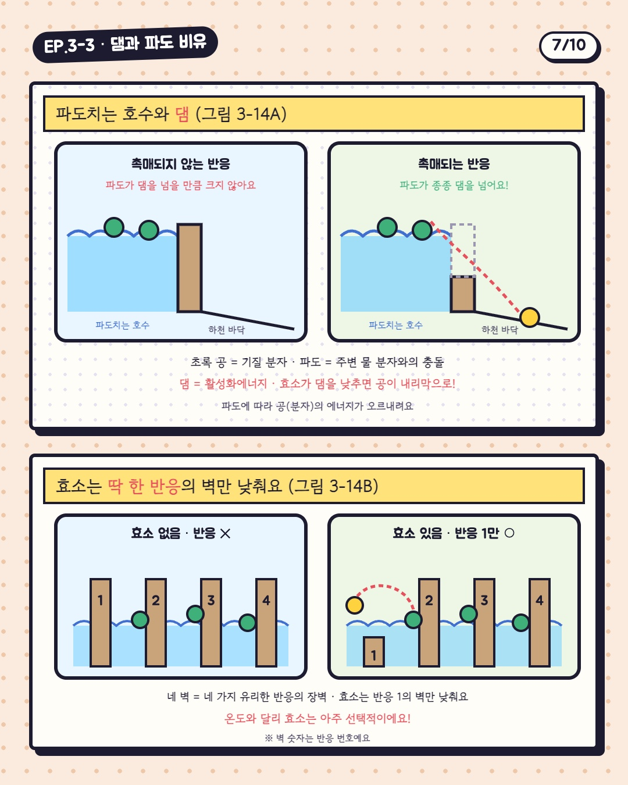
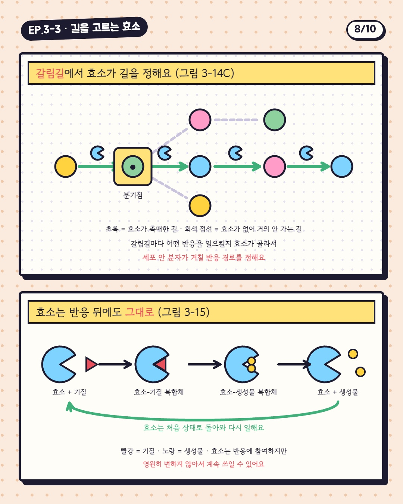
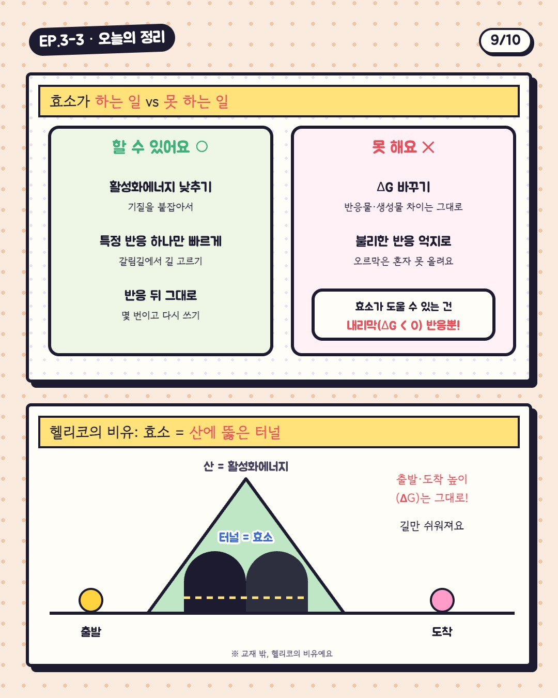
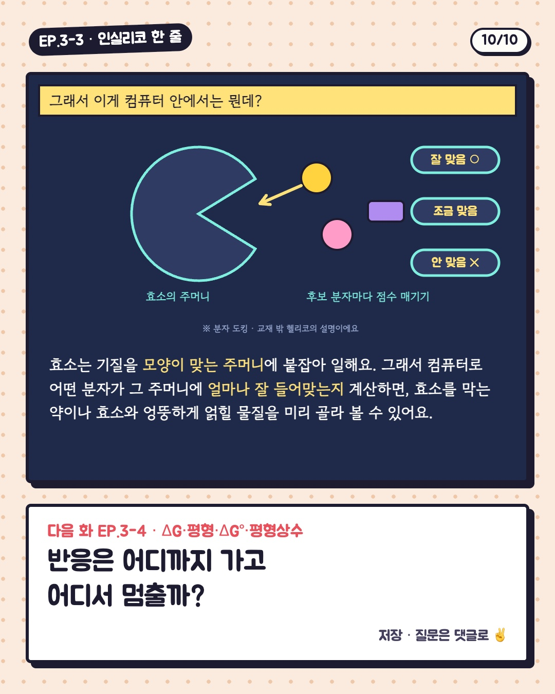

# EP.3-3 효소는 어떻게 반응을 쉽게 만들까?

- 교재: 3장 3.2 자유에너지와 촉매작용
- 게시: 2026-11-25 · [인스타그램](https://www.instagram.com/p/DgMF74Qj0El/)

## 캡션

```text
EP.3-3 효소는 어떻게 반응을 쉽게 만들까? ⛰️
필수세포생물학 3장 ③ · 3.2 자유에너지와 촉매작용

핵, 야호~ ✌ 오늘은 3.2절 첫 이야기! 세포 안 반응을 척척 해내는 효소의 비밀, 자유에너지와 활성화에너지를 알아봐요.

⚖️ 효소도 열역학 제2법칙을 따라요. 에너지적으로 유리한 반응만 도울 수 있고, 불리한 반응을 억지로 일으키지는 못해요. 그런데 세포는 자라려면 불리한 반응도 해야 하죠!
🔥 종이는 타서 연기·재·열이 되지만 거꾸로는 안 돼요. 이때 잃는 게 자유에너지 = 일을 하거나 반응을 추진할 수 있는 에너지.
⬇️ 화학반응은 자유에너지가 줄어드는 '내리막' 방향으로 진행해요.
⛰️ 그런데 우리 몸과 책은 왜 저절로 타지 않을까? 넘어야 할 언덕, 활성화에너지가 있기 때문이에요 (그림 3-12A). 책은 성냥불이 밀어 주죠.
🧩 효소는 기질을 꽉 붙잡아 활성화에너지를 낮추는 촉매예요 (그림 3-12B). 장벽이 낮아지면 넘는 분자가 확 늘어나요 (그림 3-13). 반응 속도는 최대 10¹⁴배!
🌊 댐과 파도 비유: 효소는 딱 한 반응의 벽만 낮춰서, 갈림길마다 분자가 갈 길을 정해요 (그림 3-14).
🔁 효소는 반응 뒤에도 변하지 않아 계속 다시 쓰여요 (그림 3-15). 그리고 효소는 ΔG를 바꾸지 않아요!

💻 인실리코 한 줄: 효소는 기질을 모양이 맞는 주머니에 붙잡아 일해요. 그래서 컴퓨터로 어떤 분자가 그 주머니에 얼마나 잘 들어맞는지 계산하면, 효소를 막는 약이나 효소와 엉뚱하게 얽힐 물질을 미리 골라 볼 수 있어요.

다음 화 EP.3-4 — ΔG·평형·ΔG°·평형상수: 반응은 어디까지 가고 어디서 멈출까?

#인실리코 #insilico #세포생물학 #필수세포생물학 #생명과학 #효소 #촉매 #자유에너지 #활성화에너지 #열역학 #생화학 #공부스타그램 #직장인스터디 #과학만화 #컷툰
```

## 컷











