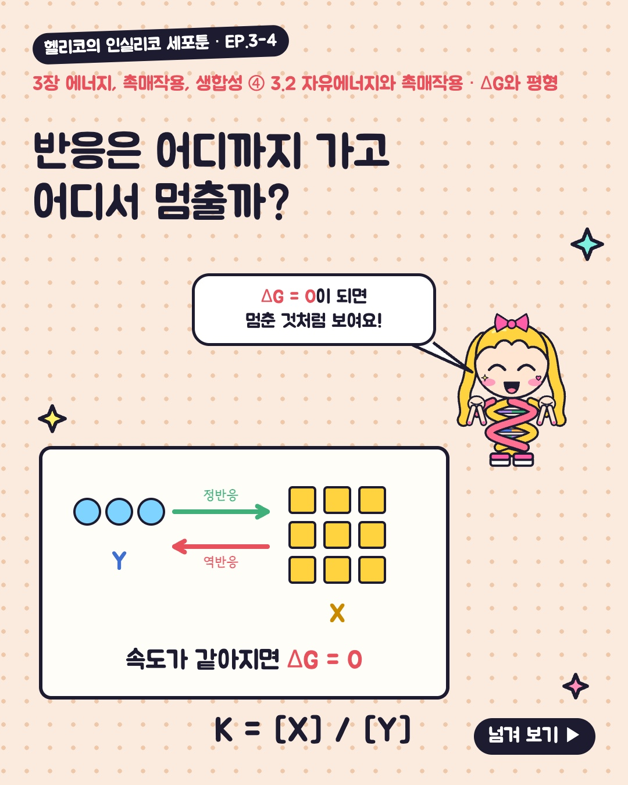
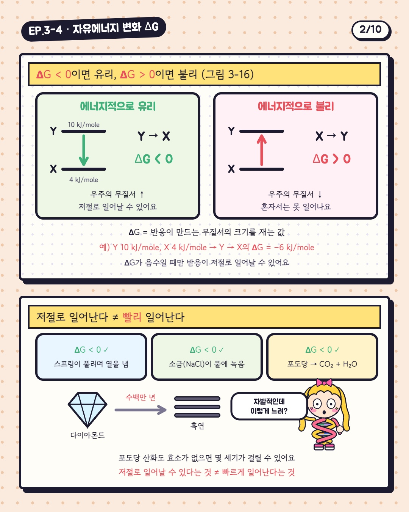
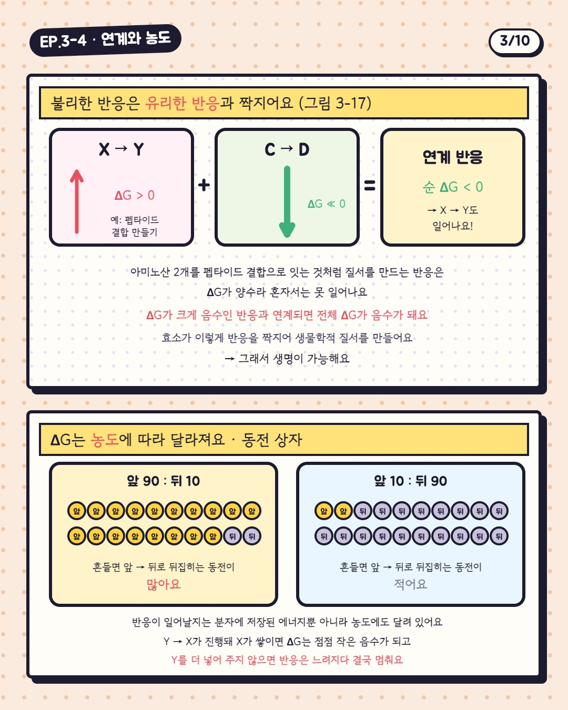
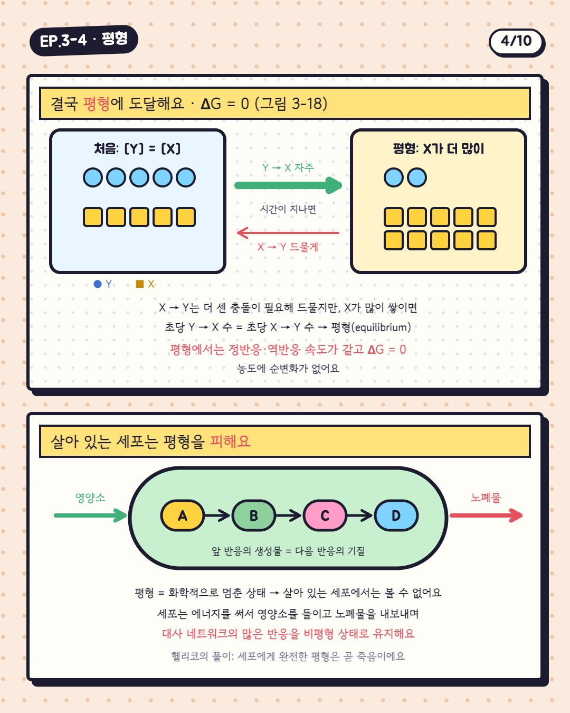
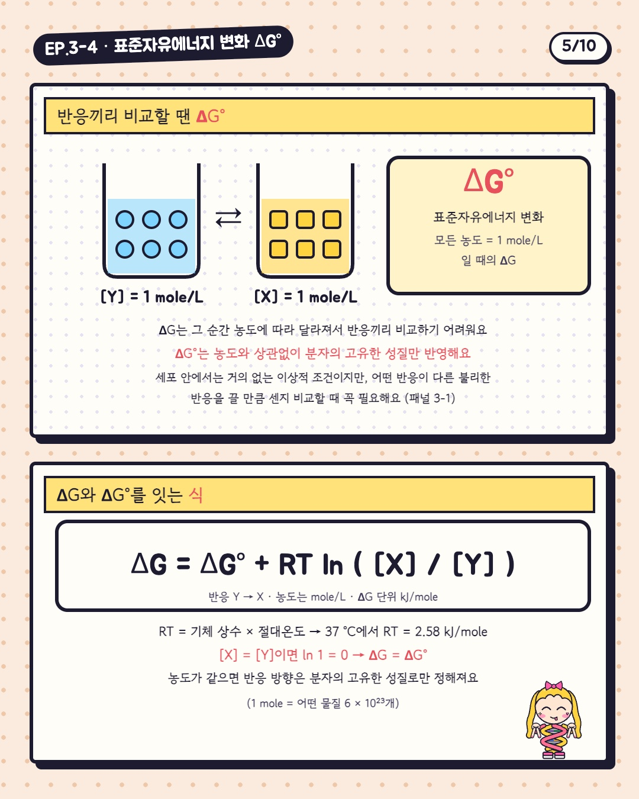
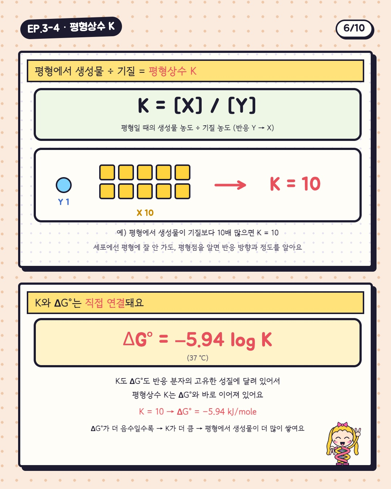
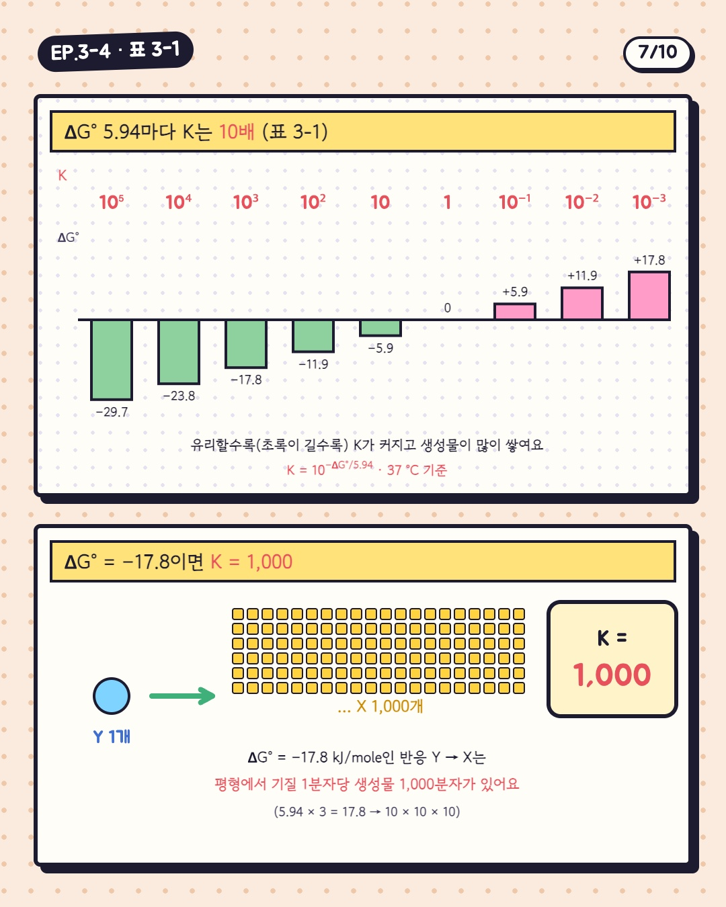
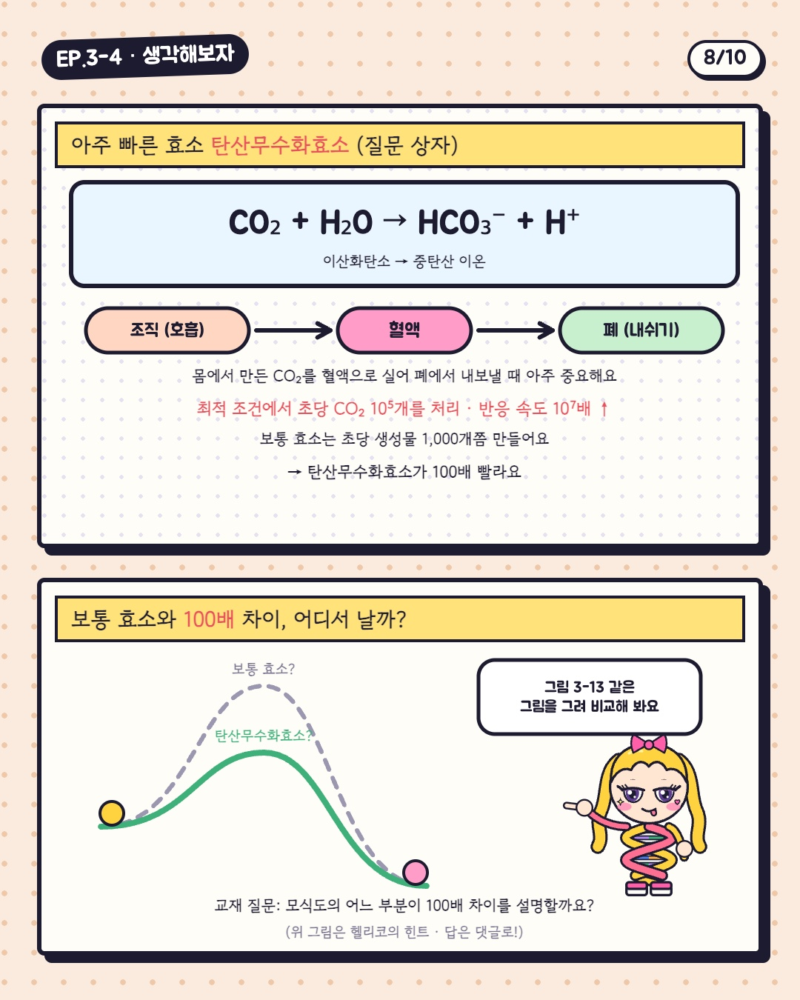
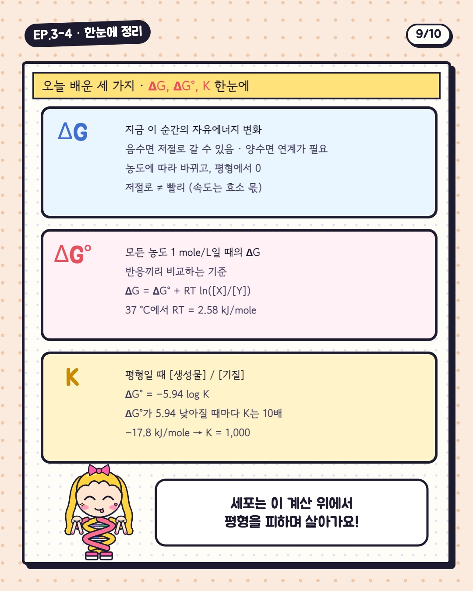
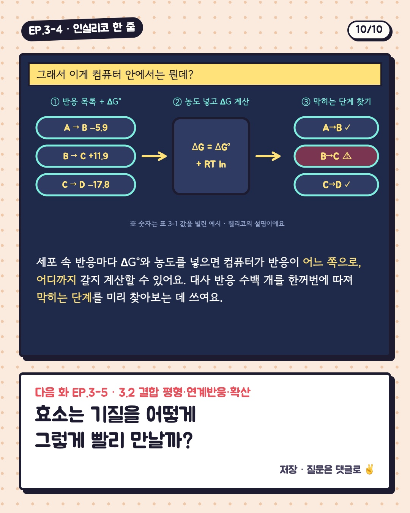

# EP.3-4 반응은 어디까지 가고 어디서 멈출까?

- 교재: 3장 3.2 자유에너지와 촉매작용
- 게시: 2026-11-26 · [인스타그램](https://www.instagram.com/p/DgM2B_6j7CD/)

## 캡션

```text
EP.3-4 반응은 어디까지 가고 어디서 멈출까? ⚖️
필수세포생물학 3장 ④ · 3.2 자유에너지와 촉매작용

핵, 야호~ ✌ 오늘은 반응의 방향을 정하는 ΔG, 반응끼리 비교하는 ΔG°, 그리고 평형상수 K 이야기예요.

⚖️ ΔG는 반응이 만드는 무질서의 크기예요. ΔG < 0이면 유리해서 저절로 일어날 수 있고, ΔG > 0이면 불리해요. (Y 10 kJ/mole → X 4 kJ/mole이면 ΔG = −6)
⚖️ 저절로 일어난다 ≠ 빨리 일어난다! 다이아몬드가 흑연으로 바뀌는 건 자발적이지만 수백만 년이 걸려요.
⚖️ 펩타이드 결합처럼 불리한 반응은 ΔG가 크게 음수인 반응과 연계될 때만 일어나요.
⚖️ ΔG는 농도에 따라 달라져요. 앞 90 : 뒤 10인 동전 상자를 흔들면 앞 → 뒤로 뒤집히는 동전이 많은 것처럼요.
⚖️ 정반응과 역반응 속도가 같아지면 평형, ΔG = 0. 살아 있는 세포는 에너지를 써서 평형을 피해요.
⚖️ 반응끼리 비교할 땐 모든 농도가 1 mole/L일 때의 ΔG°를 써요. ΔG = ΔG° + RT ln([X]/[Y]), 37 °C에서 RT = 2.58 kJ/mole.
⚖️ 평형상수 K = [X]/[Y]. ΔG° = −5.94 log K라서 ΔG°가 5.94 kJ/mole 낮아질 때마다 K는 10배! −17.8 kJ/mole이면 K = 1,000이에요 (표 3-1).
⚖️ 생각해보자: 탄산무수화효소는 초당 CO₂ 10⁵개를 처리해요. 보통 효소(초당 1,000개)와의 100배 차이는 어디서 올까요?

💻 인실리코 한 줄: 반응마다 ΔG°와 농도를 넣으면 컴퓨터가 반응이 어느 쪽으로, 어디까지 갈지 계산할 수 있어요. 대사 반응 수백 개를 한꺼번에 따져 막히는 단계를 미리 찾아보는 데 쓰여요.

다음 화 EP.3-5 — 3.2 결합 평형·연계반응·확산: 효소는 기질을 어떻게 그렇게 빨리 만날까?

#인실리코 #insilico #세포생물학 #필수세포생물학 #생명과학 #자유에너지 #평형 #평형상수 #표준자유에너지 #열역학 #생화학 #효소 #공부스타그램 #직장인스터디 #과학만화 #컷툰
```

## 컷











