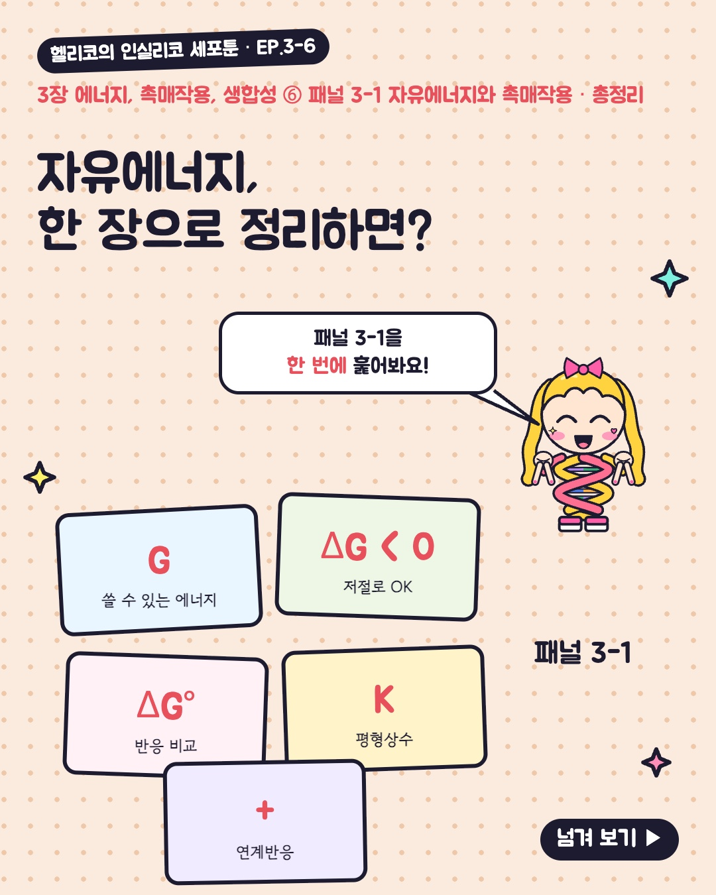
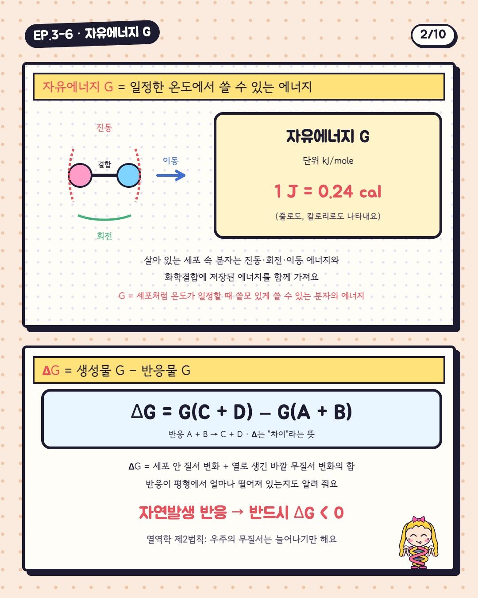
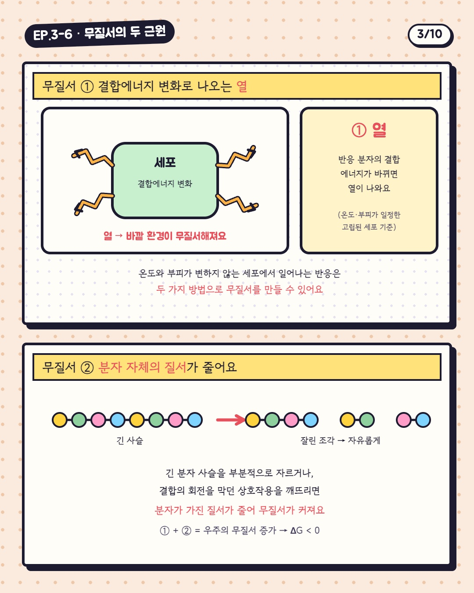
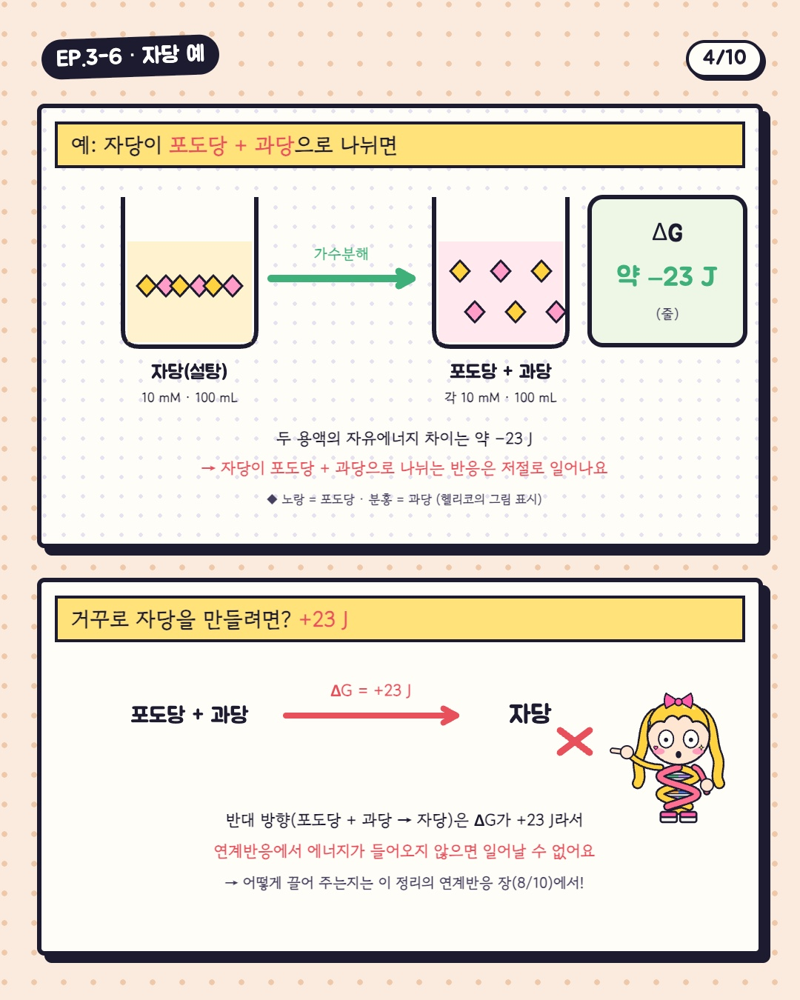
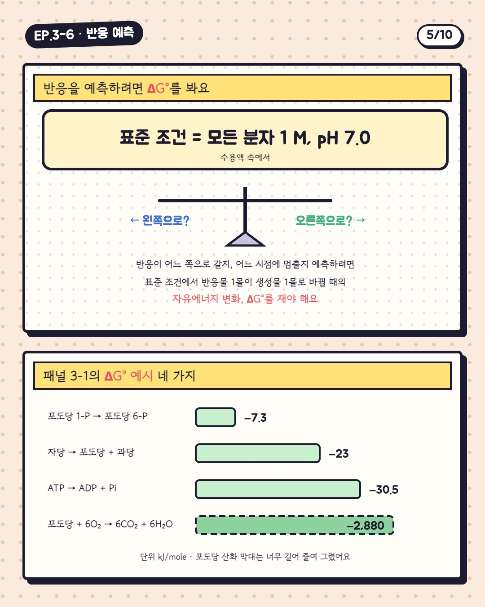
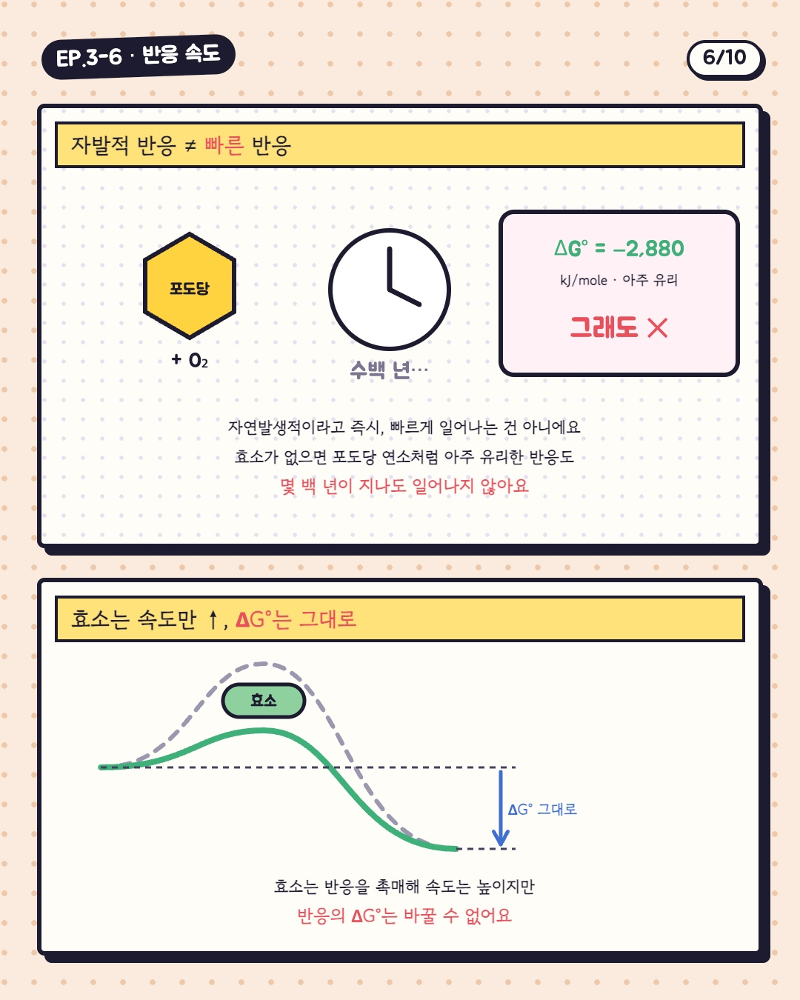
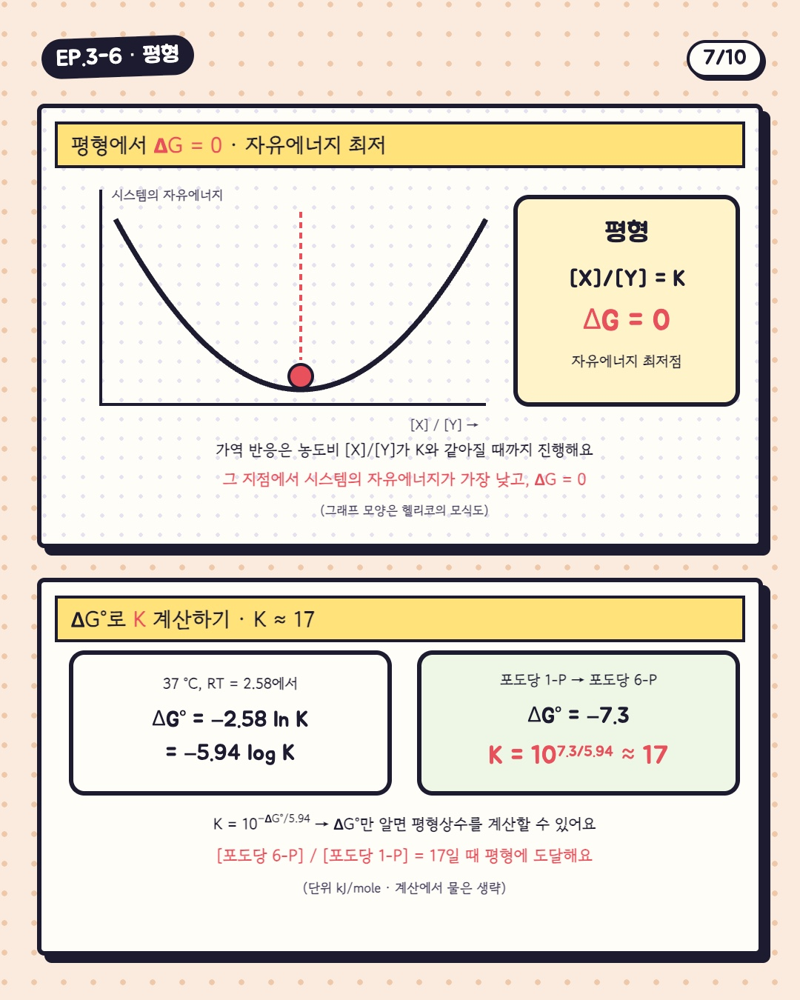
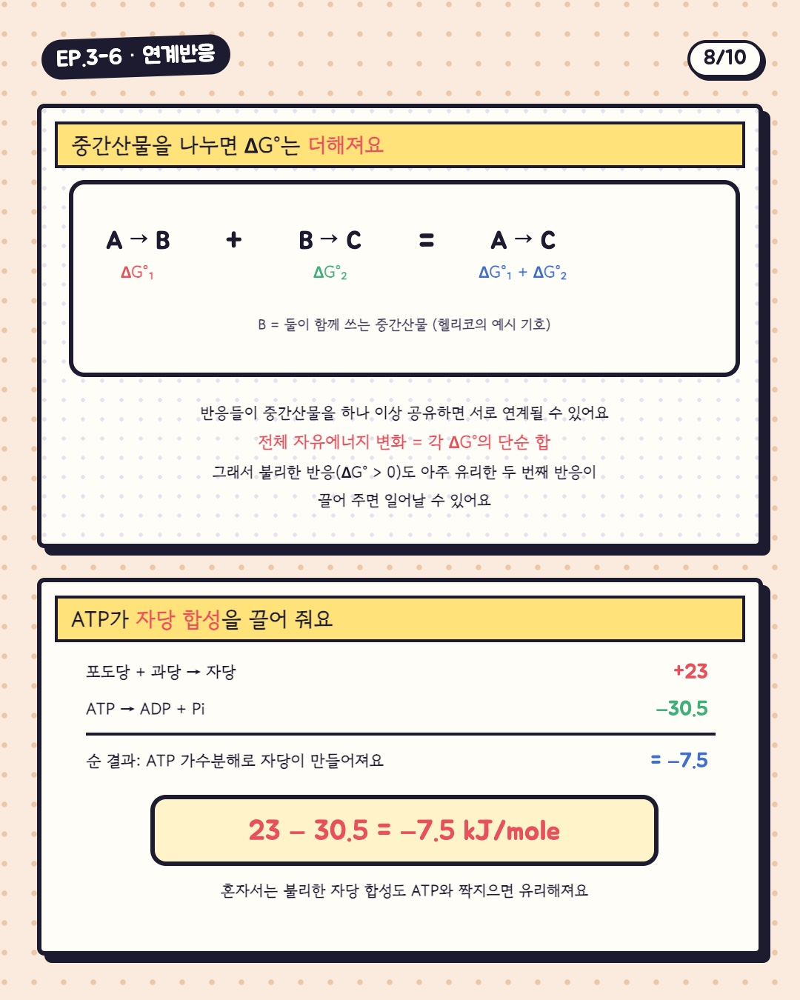
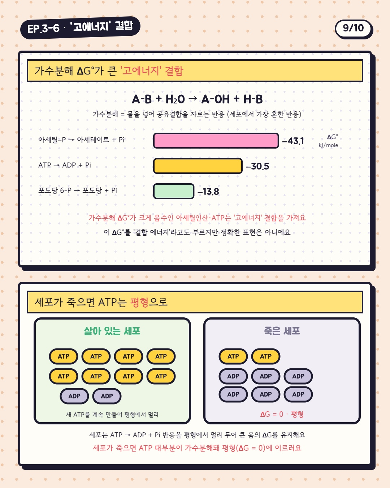
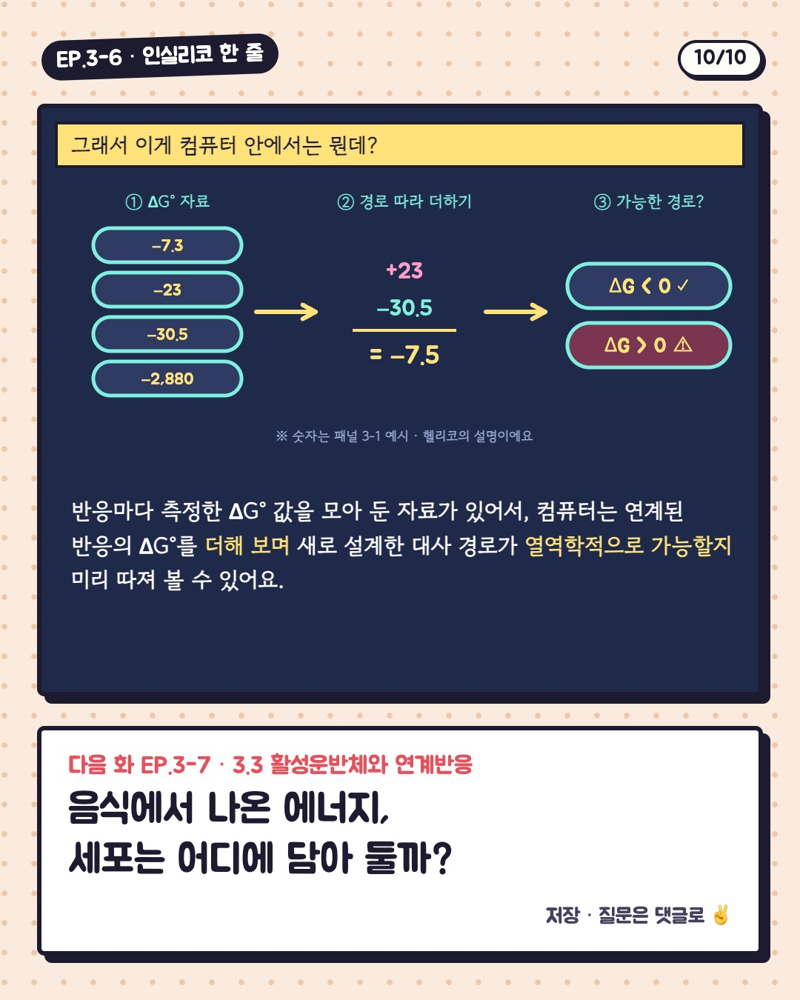

# EP.3-6 자유에너지, 한 장으로 정리하면?

- 교재: 3장 패널 3-1 자유에너지와 촉매작용
- 게시: 2026-11-27 · [인스타그램](https://www.instagram.com/p/DgPaw0rD4kW/)

## 캡션

```text
EP.3-6 자유에너지, 한 장으로 정리하면? 📋
필수세포생물학 3장 ⑥ · 패널 3-1 자유에너지와 촉매작용

핵, 야호~ ✌ 오늘은 3장 패널 3-1을 한 번에 훑어보는 자유에너지 총정리예요. 저장해 두고 복습할 때 꺼내 보세요!

📋 자유에너지 G = 세포처럼 온도가 일정할 때 쓸 수 있는 분자의 에너지 (1 J = 0.24 cal). ΔG = 생성물 G − 반응물 G.
📋 자연발생 반응은 반드시 ΔG < 0. 무질서는 ① 결합에너지 변화로 나오는 열, ② 분자 자체 질서의 감소(긴 사슬 자르기 등)로 생겨요.
📋 예: 10 mM 자당 100 mL와 10 mM 포도당 + 과당 100 mL의 자유에너지 차이는 약 −23 J. 그래서 자당 가수분해는 저절로, 거꾸로(+23 J)는 연계 없이는 안 돼요.
📋 반응을 예측하려면 ΔG°(모든 분자 1 M, pH 7.0)를 봐요. 포도당 1-P → 포도당 6-P −7.3, 자당 가수분해 −23, ATP → ADP + Pi −30.5, 포도당 산화 −2,880 kJ/mole.
📋 자발적 ≠ 빠름! 효소가 없으면 포도당 연소도 몇 백 년이 지나도 일어나지 않아요. 효소는 속도만 높이고 ΔG°는 못 바꿔요.
📋 평형에서 ΔG = 0, 자유에너지 최저. ΔG° = −2.58 ln K = −5.94 log K → 포도당 1-P → 포도당 6-P의 K ≈ 17.
📋 중간산물을 공유하는 연계반응은 ΔG°가 더해져요. 자당 합성 +23 + ATP 가수분해 −30.5 = −7.5 kJ/mole!
📋 아세틸인산(−43.1)·ATP(−30.5)는 '고에너지' 결합. 세포가 죽으면 ATP 대부분이 가수분해돼 평형(ΔG = 0)에 이르러요.

💻 인실리코 한 줄: 반응마다 측정한 ΔG° 값을 모아 둔 자료가 있어서, 컴퓨터는 연계된 반응의 ΔG°를 더해 보며 새로 설계한 대사 경로가 열역학적으로 가능할지 미리 따져 볼 수 있어요.

다음 화 EP.3-7 — 3.3 활성운반체와 연계반응: 음식에서 나온 에너지, 세포는 어디에 담아 둘까?

#인실리코 #insilico #세포생물학 #필수세포생물학 #생명과학 #자유에너지 #평형상수 #연계반응 #ATP #고에너지결합 #열역학 #생화학 #공부스타그램 #직장인스터디 #과학만화 #컷툰
```

## 컷











