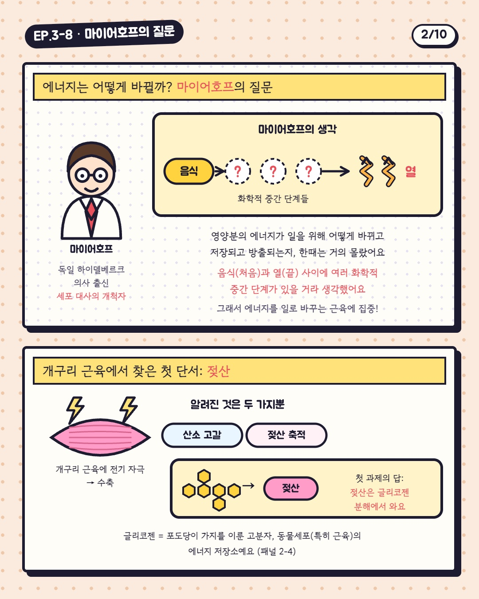
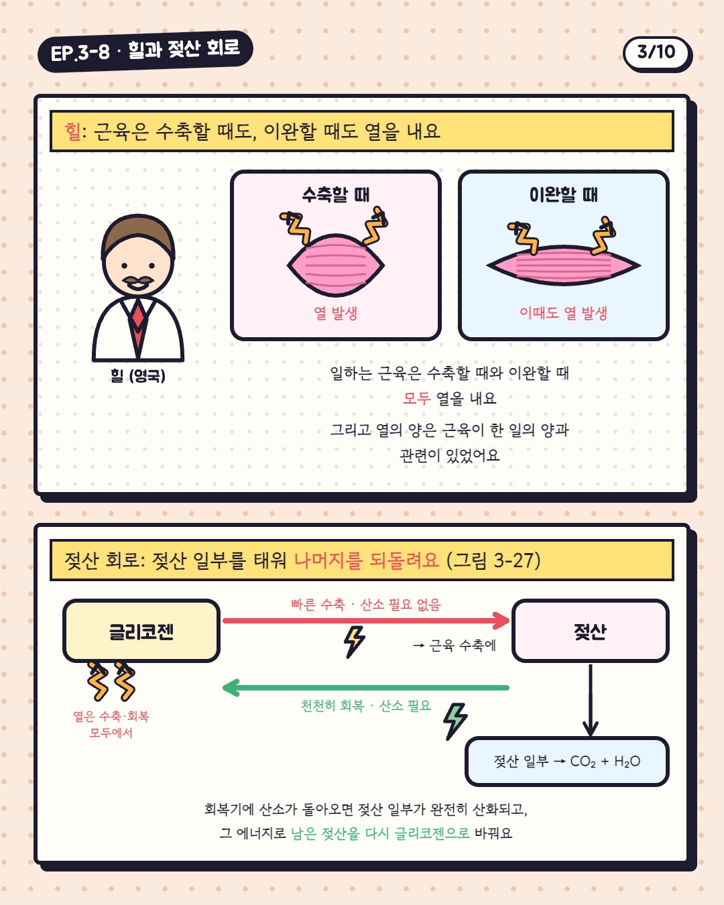
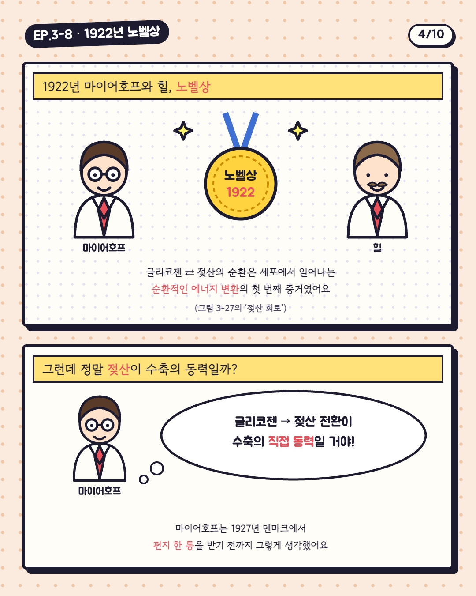
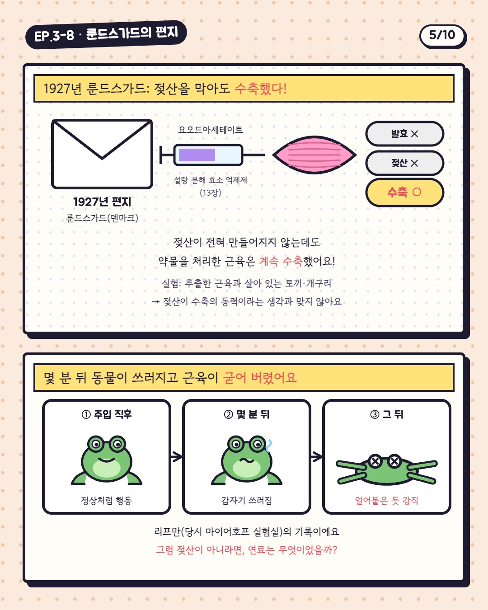
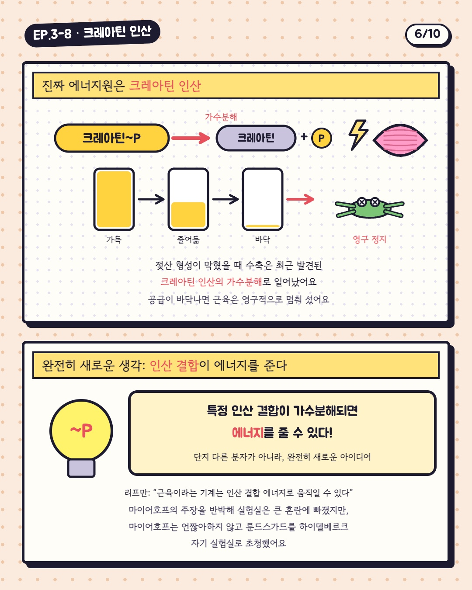
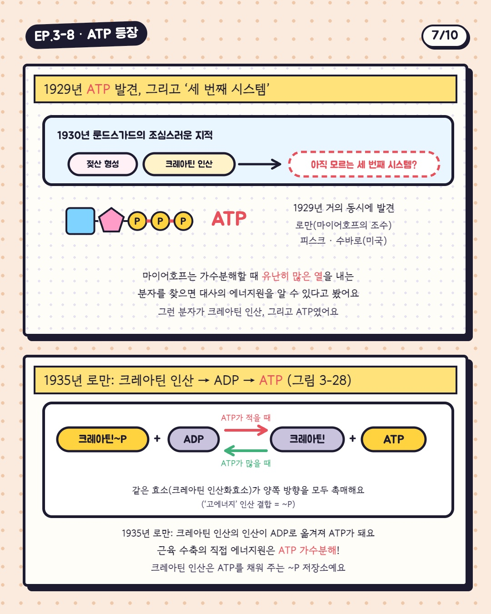
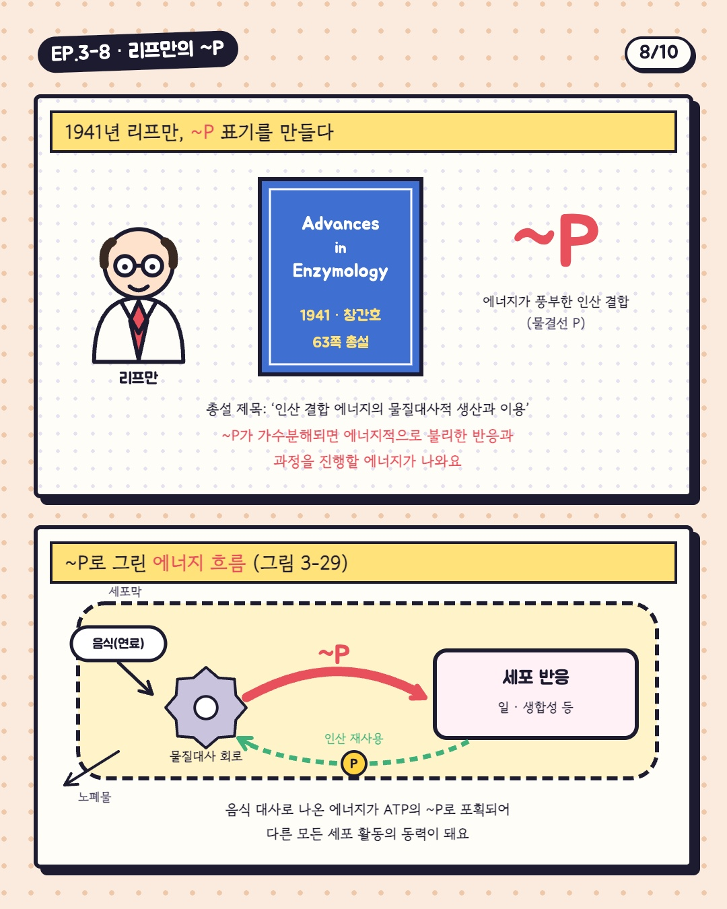
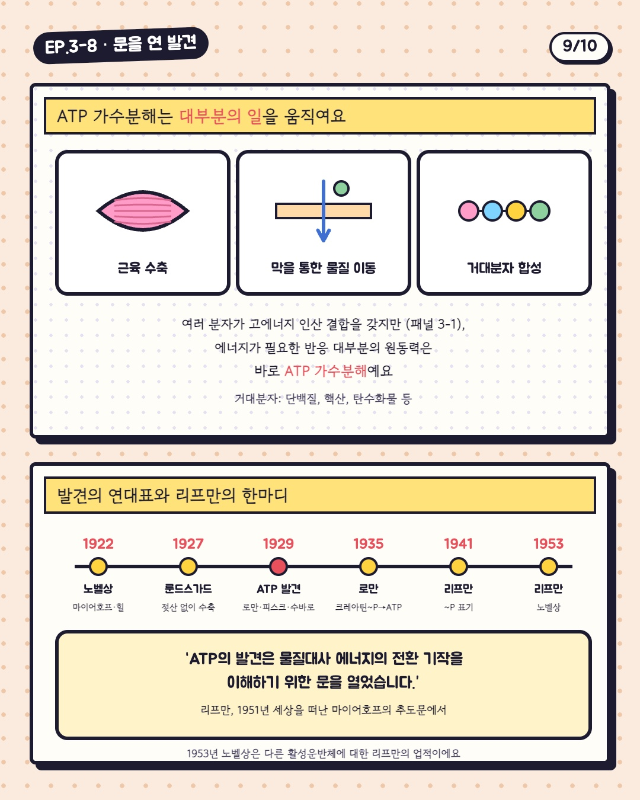
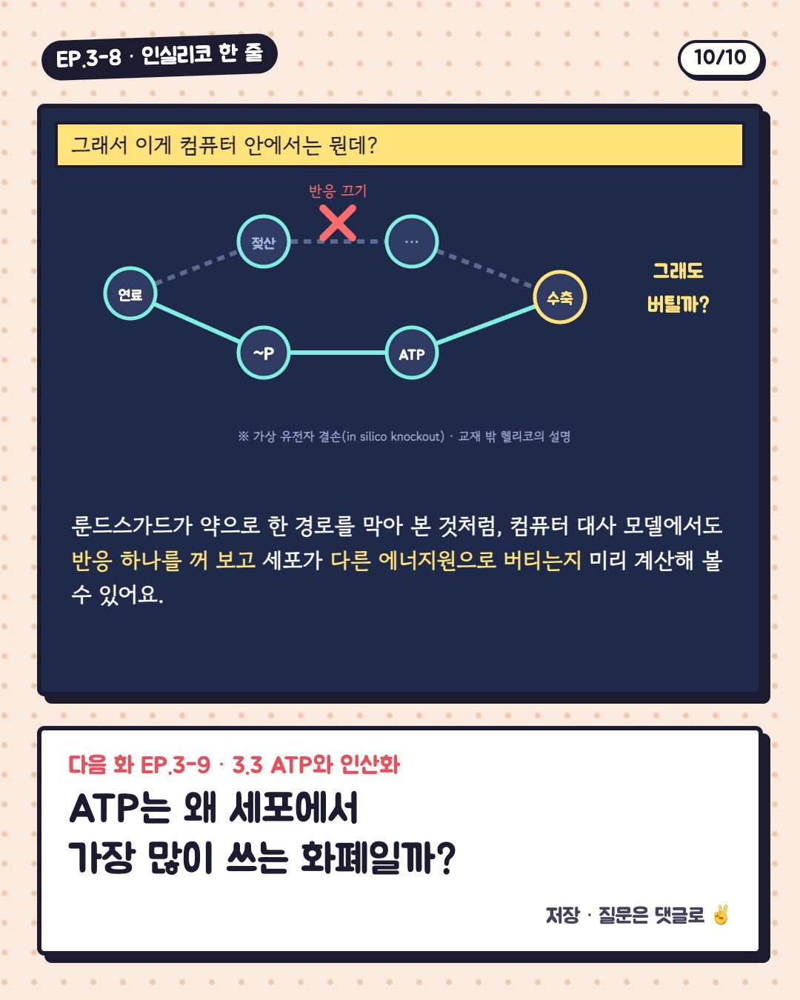

# EP.3-8 개구리 근육을 움직인 진짜 연료는 무엇이었을까?

- 교재: 3장 3.3 활성운반체와 생합성
- 게시: 2026-11-28 · [인스타그램](https://www.instagram.com/p/DgR_kcYj47k/)

## 캡션

```text
EP.3-8 개구리 근육을 움직인 진짜 연료는 무엇이었을까? 🐸
필수세포생물학 3장 ⑧ · 3.3 활성운반체와 생합성 (어떻게 알았을까: ‘고에너지’ 인산 결합)

핵, 야호~ ✌ 오늘은 과학 탐정 편! ATP가 세포의 에너지 화폐라는 걸 과학자들이 어떻게 알아냈는지 따라가 봐요.

🔬 마이어호프는 음식의 에너지가 열로 사라지기 전 여러 화학적 중간 단계가 있다고 보고 개구리 근육을 연구했어요. 첫 단서: 젖산은 글리코젠 분해에서 와요.
🔬 힐: 근육은 수축할 때도, 이완할 때도 열을 내고, 열의 양은 일의 양과 관련돼요.
🔬 젖산 회로 (그림 3-27): 회복기에 젖산 일부를 산화하고, 그 에너지로 나머지 젖산을 글리코젠으로 되돌려요. 1922년 마이어호프와 힐이 노벨상!
🔬 1927년 룬드스가드: 요오드아세테이트로 젖산을 못 만들게 해도 근육은 수축했어요. 에너지원은 크레아틴 인산, 바닥나면 근육이 굳어 버렸어요.
🔬 완전히 새로운 생각: 특정 인산 결합이 가수분해되면 에너지를 줄 수 있다!
🔬 1929년 로만, 그리고 피스크·수바로가 ATP를 발견. 1935년 로만: 크레아틴 인산의 인산이 ADP로 옮겨져 ATP가 돼요 (그림 3-28).
🔬 1941년 리프만이 ~P 표기와 에너지 흐름 그림을 냈어요 (그림 3-29). 1953년 노벨상.
🔬 리프만: “ATP의 발견은 물질대사 에너지의 전환 기작을 이해하기 위한 문을 열었습니다.”

💻 인실리코 한 줄: 룬드스가드가 약으로 한 경로를 막아 본 것처럼, 컴퓨터 대사 모델에서도 반응 하나를 꺼 보고 세포가 다른 에너지원으로 버티는지 미리 계산해 볼 수 있어요.

다음 화 EP.3-9 — 3.3 ATP와 인산화: ATP는 왜 세포에서 가장 많이 쓰는 화폐일까?

#인실리코 #insilico #세포생물학 #필수세포생물학 #생명과학 #ATP #고에너지인산결합 #크레아틴인산 #젖산 #과학사 #노벨상 #생화학 #공부스타그램 #과학만화 #컷툰
```

## 컷











